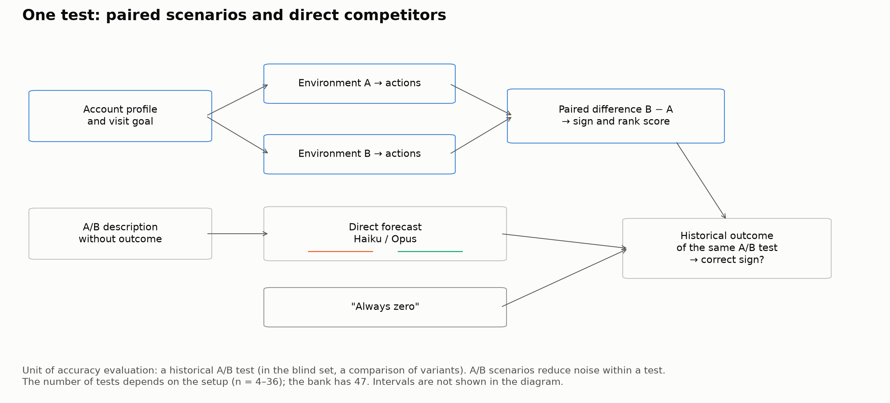
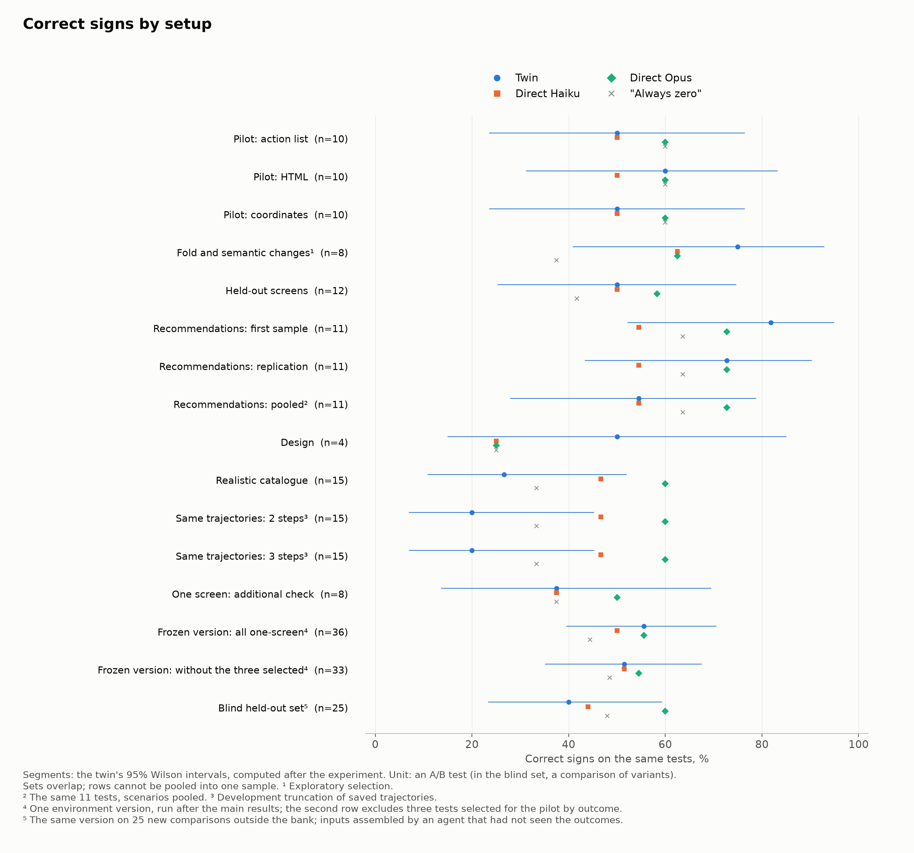
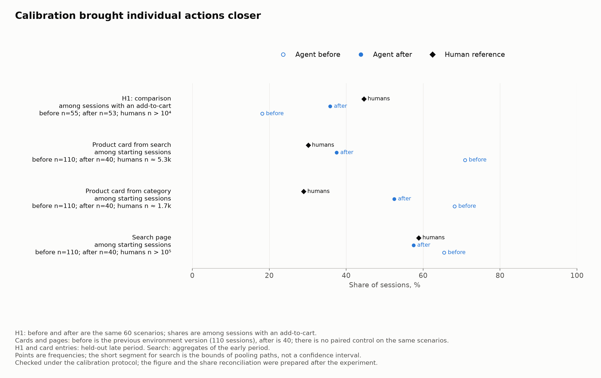
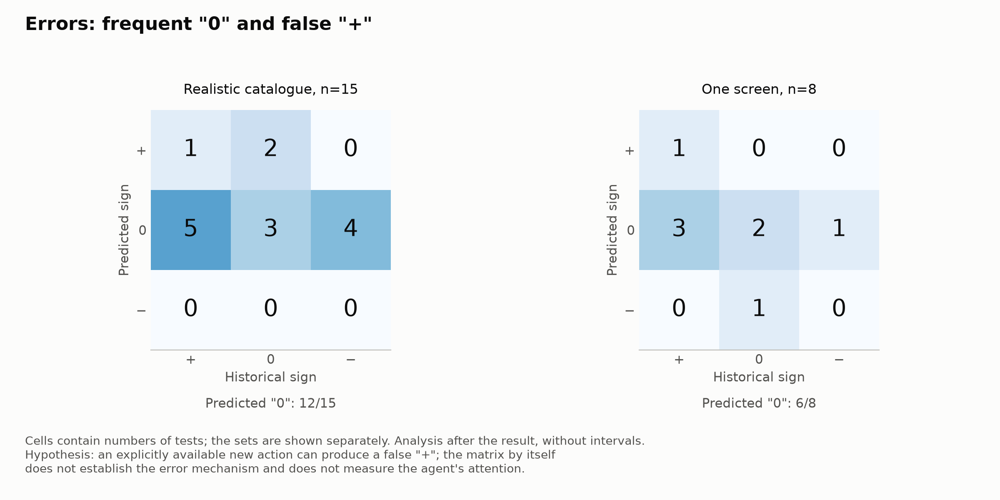

# Can We Simulate Customer Behavior and Use It to Predict A/B Test Outcomes?

## 0. Abstract

Can LLM agents simulate shoppers and predict the outcomes of interface A/B tests? We tested this on 47 internal, unpublished tests of a grocery retailer: 18 "+", 22 "0", 7 "−". The agent receives a profile and a goal derived from real purchases, sees one variant, and walks through the app on screenshots; action frequencies are checked against held-out human data. Set composition and success thresholds of the main checks were recorded before the runs; the tests stay closed, and results are reported over sets of tests. On a summary set of 27 tests ("Summary-27") the simulation is right in 14–17 cases versus 13 for a direct forecast by the same model, 16 for the strongest model and 13 for "always zero" (exact McNemar, p ≥ 0.289); a frozen version scores 20 of 36, with 20 for the strongest model and 16 for "always zero", and on 25 new comparisons, whose inputs were initially assembled by an agent that had not seen the outcomes, it scores 10, with 15 for the strongest model and 12 for "always zero". The rank association with the real effect is unstable and fragile: on the main rank set of the bank (n = 33) ρ ranges from −0.08 to +0.19; on the blind set it is +0.39 for clicks (n = 24), but +0.30 (p = 0.079) without the single largest effect. Ten improvement hypotheses gave no stable gain in accuracy. Calibration brought product comparison closer to humans: 18% → 36% of sessions versus 45% for humans. The human response to a photo change was not reproduced in any of three tests. The answer is twofold: behavior could be simulated only partly, and forecasting from the simulation did not beat simple baselines, the direct forecast and "always zero". In the binary metric of related work the simulation looks successful: 9–10 correct signs of 14, but "always +" gives the same. Without null tests, a direct forecast and a replication, such an evaluation overstates the value of simulation.

## 1. Introduction

Shopper simulation could screen product hypotheses before expensive A/B tests if it predicted the direction of an effect or the order of hypotheses by strength. But survey answers and in-app behavior are different tasks: a shopper may not notice a change, take another path, or postpone a purchase. Transfer to conversion therefore has to be checked on real experiments.

We separately test how similar agents' actions are to human actions and how accurate the A/B forecast is. The competitors are a direct forecast by the same model, stronger models and "always zero". The bank contains historical tests of a grocery retailer; the environment covers a single action as well as sessions with search, categories and a cart.

The answer is twofold: shopper behavior could be simulated only partly, and forecasting from such a simulation did not beat simple baselines in the setups we tested.

The contribution is a test on internal, unpublished experiments with null outcomes and the direct forecast as a baseline. The agent walks a path through the app, and the similarity of its actions is checked against held-out human data. Each of the ten improvement checks has a stated status: pilot, exploratory, or a check with set composition and criterion recorded in advance. We also test a frozen version, including on a blind held-out set whose inputs were initially assembled by an agent without access to the outcomes, and the transfer of behavioral calibration to the A/B forecast. Finally, we show how a binary metric can create an appearance of value for simulation without any advantage over a simple rule. The tests themselves remain closed: the paper and its repository report results over sets of tests, not individual experiments (Section 12).

## 2. Related Work

**Adjacent tasks.** In consumer choice, LLMs reproduce some preferences but err in the response to new attributes [Brand et al., 2026, original version 2023]; a treatment can also change the context the model infers [Gui and Toubia, 2025, original version 2023]. RecAgent and Agent4Rec test choice in recommendations [Wang et al., 2024; Zhang et al., 2024]. UXAgent helps prepare usability studies [Lu et al., 2025a]; on 31,865 real shopping sessions, the best models without fine-tuning guess about 12% of a shopper's next actions [Lu et al., 2025b], and on OPeRA, 8 to 22% [Wang et al., 2026a]. None of these tasks is yet a forecast of the effect of an interface change.

**LLMs in place of study participants.** Models reproduce survey answers and behavior in experimental settings [Argyle et al., 2023; Horton, 2023; Aher et al., 2023], and generative agents produce believable social behavior [Park et al., 2023]. On held-out GSS questions, agents of 1,052 participants reach 83% of human test–retest consistency from interviews and 86% from interviews together with surveys [Park et al., 2026]. Twin-2K-500 is a different dataset: 2,058 people, with twins reaching about 88% of human test–retest consistency [Toubia et al., 2025]; in purchase-intent surveys, the correlation of concept means reaches 90% of the ceiling estimated from the humans themselves [Maier et al., 2025]. Synthetic answers are less variable [Bisbee et al., 2024; Wang et al., 2025]; across 19 studies the mean correlation of twins with humans is about 0.20 [Peng et al., 2026]. Similar answers do not ensure similar mechanisms [Brucks and Toubia, 2025; Lin, 2025], and simulated answers are weak proxies for economic preferences across countries [Chen et al., 2026].

**Forecasting from a description.** Direct judgment has been studied for humans [DellaVigna and Pope, 2018] and for LLMs. Results vary: 78% correct conclusions on published field experiments [Chen et al., 2025], about 40% on 3,263 held-out headline tests against 33% by chance [Ye et al., 2024], and about chance level on interface pairs [Jeon et al., 2026]. Simulated effects can be inflated [Ashokkumar et al., 2026] or compressed to 39% of the human effect [Persson et al., 2026]; in predicting closed-ended responses, a trained graph model is no worse than LLMs [Suh et al., 2026]. On 330 website A/B tests, an LLM judge's agreement with outcomes is κ = 0.14, and in pre-registered checks a more expensive model, prompt rework and stimulus fidelity gave no qualifying improvement [Dooskin, 2026]. The direct forecast is therefore a mandatory competitor of agent simulation.

**Agent-based A/B forecasting.** SimAB picks the winner correctly in 67% of 45 significant tests against 62% for "always new" [Rieder et al., 2026]; Benomar and coauthors obtain 0.75–0.80 [2026b], SimGym 69% on 20 stores [Castelo et al., 2026] and 77% on 50 stores for the main cohort in the next version of the system [Li et al., 2026]. Agent A/B and PAARS were tested on one and three tests [Lu et al., 2026; Mansour et al., 2025]. Hut and Masoero [2026] obtain sign accuracy of 0.70 on 67 tests, against 0.57 for "always +" and an estimated sign replicability of 0.69; three-way accuracy is 0.41 against 0.33 by chance. In industry, successful tests make up 8–33% under differing definitions of success, and model-based estimates of true nulls are about 70–80% [Kohavi et al., 2022; Optimizely, 2026; Spotify Confidence, 2026; Berman and Van den Bulte, 2022; Berman et al., 2018]. The comparison conditions and the sources of the industry estimates are in Appendix G.

**Where this work stands.** Our agent walks through one variant of the app, without comparing A and B and without rating the design. The profile and the goal are derived from purchases; the similarity of actions is checked on held-out events of other shoppers. Unlike the screenshot-comparison approaches [Rieder et al., 2026; Benomar et al., 2026b], we test the response during a visit. Browser agents also see one variant [Castelo et al., 2026; Lu et al., 2026], but in those works behavior is not calibrated against held-out human actions. Our evaluation combines unpublished historical tests, null outcomes, a direct forecast, a replication on new scenarios and a frozen version. The frozen version is also tested on a blind held-out set: the inputs of the new tests were initially assembled by an agent without access to the outcomes, the ground truth was sealed, and the decision rule was recorded before the run (Section 6.2, Appendix H.8). We found no such check in the reviewed versions of the compared works (Appendix G). The evaluation separates similarity of behavior from correctness of the response to a treatment. Using LLMs as auxiliary data inside a test [Benomar et al., 2026a] was not examined here.

## 3. Task and Data

### 3.1. Target quantity and unit of evaluation

The unit of accuracy evaluation is an A/B test (in the blind set, a comparison of variants, Section 6.2); the unit of simulation is a scenario with one profile, a visit goal and an initial state, which goes through variants A and B separately. More scenarios reduce internal noise but do not increase the number of independent experiments. A historical "+" or "−" is the direction of a significant change in the primary metric in B relative to A (conversions, add-to-carts, revenue); a historical "0" is the absence of a significant change under the rule of the original report. For two metrics of the blind set where lower is better, the sign means improvement rather than an increase in the metric (Appendix H.8). A synthetic "0" means that the interval of the paired agent difference includes zero. The main competitor is a direct forecast by Haiku 5.5, the model the agents run on; Opus 5.5 is the strongest of the direct forecasts we tested.

### 3.2. Bank of historical experiments

The bank contains 47 tests with an unambiguous sign: 18 positive, 22 null and 7 negative; four mixed cases are excluded. Of the 68 reports found, 17 were not included: out of scope, borderline, or algorithmic changes with no screen for the agent. Some tests were run on user lists. The bank was reconstructed manually from reports; whether tests with a report differ from the rest was not checked. Individual tests are not reported; Appendix A gives the composition of the bank and of the evaluation sets. Separately, outside the bank, we assembled a blind held-out set: 25 comparisons from 23 tests (Section 6.2, Appendix H.8).

Each setup covers a subset of the bank: a static frame does not convey every difference, and a session needs an outcome measurable in the environment. The main sets therefore differ: Summary-27 consists of the tests of setups with selection fixed before the run (Section 6.2), and the main rank set of 33 consists of the one-screen tests without the three selected by outcome (Section 5.2). For breakdowns, tests are divided into classes F (findability and path), P (preference and interpretation of the design) and R (recommendations of additional products).

### 3.3. Agent profile card

The profile card describes an account by its purchases and app events: tenure, stable basket patterns, usual order size, visit time and discounts; there are no explicit demographics. The goal is taken from a purchase in which the tested screen could have been encountered. In sessions, habits were added, and in some setups a line about comparing products (Section 7.1). The profile card and the goal are the same in A and B; the catalogue of personas and missions was built before the runs and was not tuned on the results.

## 4. Method

### 4.1. Paired simulation

The shopper profile card, the A/B environment, the LLM agent and the aggregation of outcomes form the simulator (Figure 1). Below, "twin" is a short name for this system, with no claim to be an individual copy of a person.

**Agent role.** The agent imitates a real shopper with a specific visit goal: it buys primarily for the task, looks at the screen "like a busy person: first whatever is large and at the top", and may leave, postpone the purchase or buy nothing. It does not know about the test, the second variant or the metric, and does not rate the design as an expert. The verbatim rules are in Appendix B.2.

**Visit.** A scenario with one profile card, goal and initial state goes through A and B separately. At each step the agent receives the rules, the profile, the goal, the time, the visit history, the cart and a phone screenshot; it answers with a tap, a scroll, a back action, a search query or leaving. Each step is a separate call with the history passed in. The environment shows the next screen with real products. A visit ends with leaving, checkout, navigation outside shopping, or a limit: 5 or 10 steps in the A/B forecast, 30 in behavioral calibration. The outcome is the target action or the number of add-to-carts by any path; its mapping to the human metric is given in Appendix H.1.

**Environment development.** We tested an action list, HTML, and a screenshot with a coordinate tap; then scrolling and sessions in the full catalogue. In the one-screen setup the outcome is determined by a single action.

**Figure 1.** Profile → actions in A/B → paired difference → check against the historical outcome; alongside, the direct forecasts and "always zero". The unit of evaluation is an A/B test; the unit of internal computation is a paired scenario.

### 4.2. Setups and replications

An exploratory pilot tested the fold (the boundary of the first screen) and semantic changes on eight tests selected with knowledge of the outcomes; three of them were taken for their known strong effect and are excluded from Summary-27 and the main rank set. A set of 12 screen tests not used in developing the environment ("held-out screens") had a selection rule fixed before launch; the realistic catalogue had a recorded threshold but was tested on tests already familiar from development.

**Table 1.** Environment representations: planned number of paired scenarios per test, agent outcome and horizon. The actual number of usable pairs may be smaller than planned.

| Representation | Planned scenarios per test | Agent outcome and horizon | Purpose |
|---|---|---|---|
| Action list / HTML | 30 | choice of the next action from a list; one decision | pilots |
| Coordinates / fold / held-out screens | 150 | tap on the frame; with the fold, scrolling gives a second frame | pilot, exploratory, or selection before the run |
| Recommendations / design | 110 | add-to-carts or the target action per session; up to 5 steps | test and replication |
| Pooled recommendations | 220 | same | the same 11 tests |
| Realistic catalogue | 110 | target action per session; up to 5 or 10 steps by metric rule (8 and 7 tests) | protocol on known tests |
| One screen, additional | 150 | as for held-out screens | selection before the run |
| One screen, frozen version | 150 | as for held-out screens | all 36 one-screen tests, after the main results; 25 comparisons of the blind set |
| Action probabilities | 40 | split of 100% among the next actions | ranking |
| Transfer, four tests | 110 | add-to-carts per session; up to 10 steps | transfer check (Section 7.3) |

There is one population for all tests: tens of thousands of shoppers described over a six-month window. Scenarios are drawn with a fixed seed and weighted by the expected number of visits or orders during the test window; audience and mission restrictions are preserved. In the catalogue, calibration, transfer and model diagnostics, the weight additionally accounts for the share of visits to a screen of the same type. For 23 of the 47 tests, the start predates the population window: the agents represent later shoppers.

### 4.3. Direct forecasts and simple competitors

The direct forecast sees a description of the surface, entry point, audience, A/B variants and metric, without the outcome, effect or p-value (Appendix B). For Haiku 5.5, Sonnet 5.5 and Opus 5.5 we kept three answers each, with sign and confidence; the sign is chosen by majority. On 47 tests they are right in 24, 24 and 26 cases; "always zero" gets 22 and "always +" 18. Another simple baseline, the most frequent outcome within the F/P/R class excluding the evaluated test, gives 16/47, less than "always zero". On 43 tests, adding the first A/B screens gives 21, 23 and 21 correct signs versus 22, 23 and 25 from text (McNemar p: 1.0; 1.0; 0.219). For Opus the frames cost four correct signs against a recorded tolerance of two, so the text-based forecast remains the main competitor.

### 4.4. Models and call parameters

We used claude-haiku-5-5, claude-sonnet-5-5 and claude-opus-5-5 through Claude Code, on 13–20 October 2026, with final checks on 22 October; the blind held-out set ran on 22–23 October. Each call is a separate session in an empty folder with our system prompt, without history, hooks, instructions, MCP or tools. The CLI adds the date and a description of a built-in server-side advisor tool to the system prompt; according to the cost log, the model never called it. Sampling parameters were left at their defaults, temperature was not set, and reasoning was adaptive. On an error or a 240-second timeout, up to two retries were made. Screen: 390 × 844 logical pixels, 390 × 823 in sessions, scale 1.5. The agent's answer is JSON with an action or coordinates.

## 5. Evaluation

### 5.1. Sign rule and voting

For each scenario we compute the outcome difference B − A, and for each test the mean paired difference. The bootstrap resamples scenario pairs with replacement; if the 95% interval lies entirely above zero, the forecast is "+", entirely below, "−", otherwise "0". The interval describes simulator variation, so the share of "0" answers depends on the number of scenarios and the variance of the outcome (Section 8). A/A runs of the one-screen pilots all gave "0" (nine runs); there were no A/A runs for sessions. A tie among the three direct-forecast answers ("?") counts as a mismatch.

### 5.2. Ranking and status of decisions

The twin's rank score is the difference B − A in the shares of agents taking the target action in the latest one-screen run of the test; the click scores of the 33 tests come from five runs of different environment versions. For Opus it is the mean of three values of "sign × confidence / 10". Both are compared with the relative change in the human metric via Spearman's ρ, with a one-sided p from 10,000 permutations; ranks mix different metrics, so only the rank association is assessed. The main set has 33 tests: of the 36 one-screen tests, three selected for the pilot by known outcome are excluded. In the probability mode, 40 agents per test split 100% among the next actions.

Before each subsequent run we fixed the set, the metric and the success criterion: for example, at least 10 correct signs of 15 for the realistic catalogue, and for probability ranking a positive ρ with one-sided p < 0.05 and no lower than direct Opus (Appendix C). Wilson intervals, paired comparisons, the metrics of Section 5.4, the rules for combining with the direct forecast and the checks of Appendix H were computed after the main results, under rules recorded before the computation; their status is exploratory. p-values are reported without correction for multiplicity.

### 5.3. Paired uncertainty and power

In a paired comparison we count the tests where only the twin is right and the tests where only the competitor is right; the exact McNemar test checks the symmetry of these discordant pairs. For a difference in proportions we use the Tango score interval [Tango, 1998], and for a difference in correlations, a paired percentile bootstrap over tests (20,000 resamples). To detect a 10-percentage-point difference in accuracy at two-sided α = 0.05 and 80% power, about 155, 234 and 391 tests are needed at discordance rates of 20%, 30% and 50%, which is 3–8 times the size of the bank.

### 5.4. Outcome-group accuracy and sign agreement

If a set contains many historical nulls, any method that often answers "0" raises its share of correct signs. We therefore report accuracy separately on tests with an effect and on null tests, their mean, the **outcome-group accuracy** ("always zero" gives 0.5), the standard three-class balanced accuracy ("always zero" gives 1/3) and Cohen's kappa; intervals are 95% percentile bootstrap over tests.

### 5.5. Model-based estimate of verdict replicability

For 40 of the 47 tests the z-statistic was recovered. Under a flat prior, the probability of replicating a three-way verdict is 0.82, and the probability that two future replications agree in sign is 0.86; with 50–70% true nulls these are 0.875–0.888 and 0.72–0.74, respectively. This is a model of repeated measurement, not a ceiling on a forecaster's accuracy. Subset estimates and assumptions are in Appendix H.5.

## 6. Results: A/B Forecast Accuracy

### 6.1. Correct signs by setup

Moving to sessions gave the best initial score in recommendations, but it fell on replication and on pooling scenarios. The realistic catalogue did not reach the recorded threshold of 10/15. All results and the competitors, identical within each row, are in Table 2.

**Table 2.** Correct signs on the same set within a row; competitors are evaluated on the same n, and a tie among direct-forecast answers is an error. Rows overlap and cannot be summed. Setup plan: Section 4.2; paired comparisons by row: Table I.1.

| Setup | Twin | Wilson CI, % | Haiku | Opus | Zero | Sonnet | Status |
|---|---|---|---|---|---|---|---|
| Action list | 5/10 | 23.7–76.3 | 5 | 6 | 6 | 6 | pilot |
| HTML | 6/10 | 31.3–83.2 | 5 | 6 | 6 | 6 | pilot |
| Coordinates | 5/10 | 23.7–76.3 | 5 | 6 | 6 | 6 | pilot |
| Fold, exploratory | 6/8 | 40.9–92.9 | 5 | 5 | 3 | 4 | exploratory |
| Held-out screens | 6/12 | 25.4–74.6 | 6 | 7 | 5 | 7 | selection before the run |
| Recommendations, first sample | 9/11 | 52.3–94.9 | 6 | 8 | 7 | 6 | selection before the run |
| Recommendations, replication | 8/11 | 43.4–90.3 | 6 | 8 | 7 | 6 | replication |
| Recommendations, pooled | 6/11 | 28.0–78.7 | 6 | 8 | 7 | 6 | same tests |
| Design | 2/4 | 15.0–85.0 | 1 | 1 | 1 | 1 | selection before the run |
| Realistic catalogue | 4/15 | 10.9–52.0 | 7 | 9 | 5 | 8 | known tests |
| Truncation: 2 steps | 3/15 | 7.0–45.2 | 7 | 9 | 5 | 8 | development |
| Truncation: 3 steps | 3/15 | 7.0–45.2 | 7 | 9 | 5 | 8 | development |
| One screen, additional | 3/8 | 13.7–69.4 | 3 | 4 | 3 | 3 | selection before the run |
| Frozen version, all one-screen | 20/36 | 39.6–70.5 | 18 | 20 | 16 | 19 | set fixed before the run, after the main results |
| Frozen version, without the three selected by outcome | 17/33 | 35.2–67.5 | 17 | 18 | 16 | 18 | same run |
| Blind held-out set | 10/25 | 23.4–59.3 | 11 | 15 | 12 | 12 | inputs assembled blind, set fixed before the run |

**Figure 2.** Shares of correct signs for the twin, direct Haiku and Opus, and "always zero" on the same tests in each row of Table 2; segments are the twin's 95% Wilson intervals. Sets overlap; the replication and pooling of recommendations refer to the same 11 tests, and short sessions to the same catalogue trajectories.

### 6.2. Summary-27, the frozen version and the blind set

The twin showed no advantage in paired comparisons; on truncated trajectories it lost to Opus (0:6, p = 0.031; development analysis, Table I.1). Summary-27 combines 12 held-out screens, 11 recommendations and four design tests, all tests of these three setups; the three pilot tests selected by outcome are not included. The first sample, the replication and the pooling of recommendations form three summaries of the same corpus, presented on an equal footing.

**Table 3.** Summary-27. For the twin, the score and 95% Wilson interval; for competitors, the score out of the same 27. In all variants, 13 of the 27 human outcomes are null.

| Recommendations in the summary | Twin | Wilson CI, % | Haiku | Opus | Zero | Sonnet |
|---|---|---|---|---|---|---|
| first sample | 17/27 | 44.2–78.5 | 13/27 | 16/27 | 13/27 | 14/27 |
| replication | 16/27 | 40.7–75.5 | 13/27 | 16/27 | 13/27 | 14/27 |
| pooled scenarios | 14/27 | 34.0–69.3 | 13/27 | 16/27 | 13/27 | 14/27 |

On Summary-27 the advantage over Haiku is 1–4 tests, and the difference from Opus ranges from +1 to −2; all paired intervals include zero (Table I.3). Against "always zero" the discordant pairs are 6:2, 5:2 and 5:4 (p = 0.289; 0.453; 1.0). On all 44 tests with a twin forecast, the twin gets 25, 24 and 22 signs right versus 23 for Haiku, 24 for Sonnet, 26 for Opus and 21 for "always zero" (p ≥ 0.344). The kappas of the three summaries are 0.35 [0.01; 0.65], 0.28 [−0.05; 0.57] and 0.17 [−0.17; 0.48].

**One frozen version.** After the main results, the code, prompt and population of the held-out screens were frozen and run on all 36 one-screen tests, with 150 scenarios each; the set and rule were recorded before launch. The result is 20/36, with 20 for Opus and 16 for "always zero" (Table 2; p ≥ 0.344), kappa 0.27 [0.02; 0.51]. All three pilot tests selected by outcome are guessed correctly; without them the score is 17/33, with 17 for Haiku, 18 for Sonnet and Opus and 16 for "always zero". On tests with an effect 7/20 are right, on null tests 13/16: relative to "always zero", seven effects are recognized at the cost of three errors on null tests.

**Blind held-out set.** Next, the same version, unchanged, was run on 25 new comparisons outside the bank: 23 tests and two third arms compared against A. Reports with an unambiguous outcome were selected by an operator who had seen the signs; the tests among them were selected, and the inputs initially assembled, by a separate builder agent without access to the outcomes. From the original report of each A/B test it assembled a passport, an input description for the twin (entry point, screen, target action and audience), as well as the variant screens and a description for the direct forecast. Later the builder learned the signs of five comparisons whose inputs had already been frozen; after that it added a third arm of one test and corrected five other screens (chronology and roles: Appendix H.8). The ground truth, the set composition and the criterion were recorded before the first call to any evaluated model. The twin is right in 10 comparisons (Table 2): 2 fewer than "always zero" and 5 fewer than Opus; Haiku gets 11 and Sonnet 12. The pre-recorded criterion, that the twin is right more often than both "always zero" and Haiku at p < 0.05, is not met (4:6, p = 0.754; 5:6, p = 1.0) in any variant of the set (Table H.8.1). Here the twin answered "0" less often than on the 36 bank tests (13 of 25 versus 24 of 36) and recognized null outcomes less often (6 of 12 versus 13 of 16); in 6 comparisons its "0" is mechanical: no agent, or every agent, chose the target action (Appendix H.8).

### 6.3. Ranking of effects

On 33 tests, the twin's click response does not order the human effects; the probability mode did not meet the recorded criterion and did not beat direct Opus (Table 4). For the frozen version on the same 33 tests, ρ = −0.081, p = 0.673.

**Table 4.** Rank association of scores with the historical effect on the main set. Spearman's ρ, one-sided permutation p (10,000 permutations); the interval of the difference is a paired percentile bootstrap (20,000 resamples).

| Score on the main set, n=33 | ρ | One-sided p | 95% interval of the difference "Opus minus score" |
|---|---:|---:|---|
| Twin clicks | −0.061 | 0.636 | [−0.059; +0.634] |
| Action probabilities | +0.195 | 0.134 | [−0.314; +0.398] |
| Direct Opus: sign × confidence | +0.266 | 0.064 | — |

On all 36 tests, including the three selected by outcome, ρ is +0.109 for clicks, +0.421 for Opus (p = 0.006) and about +0.26 for probabilities (p = 0.061). On the 18 tests where the action list in B is not longer, the probability ρ is about +0.05 (p = 0.426): part of its positive shift apparently comes from the appearance of an additional target action in the list. Scale checks and breakdowns by metric type showed no additional rank association (Appendix H.3). On the blind held-out set, the effects of the primary metrics were brought to one scale by a separate agent session that had not seen the forecasts. The extraction rule was recorded after unsealing, so the status of this check is exploratory (Appendix H.8). Here ρ is +0.387 for twin clicks (one-sided p = 0.029, n = 24) and +0.316 for direct Opus (p = 0.071); the interval of the difference "Opus minus clicks" is [−0.564; +0.383]. For the same frozen version on the bank, ρ = −0.081: the association is unstable across sets. It is also fragile: without the single largest effect the click ρ is +0.302 (p = 0.079), without the two largest +0.298 (p = 0.087), and dropping any single comparison gives +0.302 to +0.534. The Opus association is no less fragile: +0.221 and +0.104 without the one and two largest effects. The computation is descriptive: 24 comparisons with different metrics, without correction for multiplicity.

### 6.4. Where the gain over Haiku comes from, and the level of the direct forecast

The gain over Haiku on Summary-27 comes from null tests: 11, 11 and 9 correct of 13 versus 6 for Haiku; on tests with an effect, 6, 5 and 5 of 14 versus 7. In the first recommendations sample, Haiku gave five false "+" on seven null tests, the twin none. Negative outcomes are rarely found: the twin gets 2/7 on all 44 tests, and direct Haiku, Sonnet and Opus 1/7, 0/7 and 1/7 on the bank. On the catalogue, outcome-group accuracy is 0.35 versus 0.65 for Opus.

**Table 5.** Outcome-group accuracy, standard balanced accuracy and Cohen's kappa on Summary-27, on all 44 tests with a twin forecast, for the frozen one-screen version, on the blind held-out set (Section 6.2) and on the realistic catalogue. Method cells show "outcome-group / standard / kappa"; for the "always zero" rule, 0.50 / 0.33 / 0. The table for the original setups is in Appendix F.

| Set | n | Twin correct: with effect; null | Twin | Haiku | Opus |
|---:|---:|---|---|---|---|
| Summary-27, first sample | 27 | 6/14; 11/13 | 0.64 / 0.58 / 0.35 | 0.48 / 0.44 / 0.14 | 0.60 / 0.51 / 0.28 |
| Summary-27, replication | 27 | 5/14; 11/13 | 0.60 / 0.55 / 0.28 | 0.48 / 0.44 / 0.14 | 0.60 / 0.51 / 0.28 |
| Summary-27, pooled scenarios | 27 | 5/14; 9/13 | 0.52 / 0.50 / 0.17 | 0.48 / 0.44 / 0.14 | 0.60 / 0.51 / 0.28 |
| All 44, first sample | 44 | 7/23; 18/21 | 0.58 / 0.49 / 0.23 | 0.53 / 0.44 / 0.19 | 0.60 / 0.48 / 0.27 |
| All 44, replication | 44 | 6/23; 18/21 | 0.56 / 0.46 / 0.19 | 0.53 / 0.44 / 0.19 | 0.60 / 0.48 / 0.27 |
| All 44, pooled scenarios | 44 | 6/23; 16/21 | 0.51 / 0.43 / 0.12 | 0.53 / 0.44 / 0.19 | 0.60 / 0.48 / 0.27 |
| Frozen one-screen version | 36 | 7/20; 13/16 | 0.58 / 0.49 / 0.27 | 0.52 / 0.43 / 0.18 | 0.58 / 0.47 / 0.24 |
| Blind held-out set | 25 | 4/13; 6/12 | 0.40 / 0.37 / 0.04 | 0.45 / 0.38 / 0.11 | 0.61 / 0.55 / 0.36 |
| Realistic catalogue | 15 | 1/10; 3/5 | 0.35 / 0.26 / −0.12 | 0.50 / 0.45 / 0.18 | 0.65 / 0.57 / 0.38 |

The direct forecasts also showed no advantage over "always zero": discordant pairs 11:9 for Haiku (p = 0.824), 7:5 for Sonnet (p = 0.774), 9:5 for Opus (p = 0.424). The kappas are 0.18 [−0.05; 0.40], 0.15 [−0.07; 0.36] and 0.21 [−0.03; 0.44]: the intervals include zero and allow moderate agreement.

## 7. Agent Behavior: Closeness to Humans and Transfer to the Forecast

### 7.1. Which actions moved closer

Calibration was checked on held-out events of other accounts; behavioral probabilities were estimated on early data, and the protocol was recorded before the computation. H1 is the share of sessions with an add-to-cart in which at least two different product cards were opened; for humans it is 44.6% at n ≈ 14k. The full layer allowed comparison, added the corresponding habit to the profile with a probability estimated per account, and added quantity and removal operations. The adoption criterion: a ratio of agent H1 to human H1 of 0.67–1.5; both starting product cards no farther from humans than the baseline; on search and category pages, the agent share between 0.67 of the lower and 1.5 of the upper bound of the human reference.

On the same 60 scenarios, H1 rose from 10/55 = 18.2% to 19/53 = 35.8%; as a share of all scenarios, from 10/60 to 19/60. The paired gain is +17.7 pp [+4.7; +31.0], the ratio to humans 0.80 [0.53; 1.10]: the point estimate passes the threshold, the lower bound does not. In the full layer, H1 is 14/21 with the comparison line and 5/32 without it; the contribution of that one line was not tested separately. Add-to-carts from starting surfaces are in Table 6.

**Table 6.** Add-to-carts from the starting surface. Agent shares are computed over all sessions with that start: baseline 110, full layer 40, a five-step limit; H1 is on the same 60 scenarios with a 30-step limit. These are different runs without paired control; for H1 above, the same 60 scenarios were used. Human definitions for product cards and pages are separate.

| Start | Before: previous environment version, 110 sessions | After: full layer, 40 sessions | Humans: value and denominator | Human data |
|---|---|---|---|---|
| Product card from search | 78/110 = 70.9% | 15/40 = 37.5% | 30.1%; n ≈ 5.3k | held-out period |
| Product card from category | 75/110 = 68.2% | 21/40 = 52.5% | 29.0%; n ≈ 1.7k | held-out period |
| Search page | 72/110 = 65.5% | 23/40 = 57.5% | 58.7–59.0%; n > 10⁵ | early period |
| Category page | 64/110 = 58.2% | 16/40 = 40.0% | 46.4–46.5%; n > 10⁴ | early period |

**Figure 3.** H1 and add-to-cart from a starting product card from search, a product card from a category and a search page (three of the four starting surfaces of Table 6) before and after calibration and for humans. For H1, "before" and "after" are the same 60 scenarios; for cards and pages, different runs of the simulation environment (110 and 40 sessions), without paired control. The calibration rule was set before the run.

### 7.2. Which gaps remained

The product card from a category moved closer to humans, but 52.5% versus 29.0% is still 1.8 times the human share. Among 53 agent sessions with an add-to-cart there were no quantity changes and no returns from the cart to a product card, and one removal; humans show such actions in roughly 17–31% of sessions with an add-to-cart. Agents' searches ended with an add-to-cart in about 88% of cases versus 60% for humans, partly because search in the simulation environment finds products more easily than search in the real app.

**Product card.** The agent opens a product card to buy and almost always adds the product straight from it. Humans open a card to examine the product (they swipe photos, read ingredients, compare candidates), and in a third of shopping visits they add products straight from a list (Appendix H.7). The line about a habit of comparing brought the frequency of opening several cards closer, but not what a person does in them.

**Photos: the agent verifies the product; appearance has little effect.** Diagnostics after the main results were run under rules recorded before the run, with 150 scenarios each, on synthetic screens built around the agent's own goal. A different product in the photo lowers add-to-carts by 30.9 pp [−39.6; −22.8], a doubled price by 18.0 pp; no photo by 2.7 pp [−8.0; +2.7]. In a grid of four products, blurring the product's own photo gives −5.3 pp [−10.0; −0.7], and a 30% price increase −6.7 pp [−13.3; 0.0]. A small shift without a photo does not prove equality; of the appearance changes, only a strongly degraded photo moved the choice, about as much as the price control.

In a real photo A/B test outside the bank, run under a pre-recorded rule with 30 scenarios per product in a 2 × 2 grid, the agent's choice changed by −0.6 pp [−2.1; +0.8] from a baseline of 19.6%, and the product's appearance is mentioned in 42% of answers with either photo: the agent sees the photo, but its choice hardly depends on it. With the two photo tests of the bank, in all three real tests the human response was not reproduced; their individual outcomes are not reported (Section 12). The photo helps verify the product, but appearance has little effect.

### 7.3. Transfer to four known A/B tests

On four known recommendation tests, after the version change, 1/4 signs are right; the previous version gave 3/4, 2/4 and 1/4 in the first sample, the replication and the pooling. The tests were chosen by their errors; scenarios, context, the limit (from five to ten steps) and the comparison layer were changed at the same time. Their historical effects are below 1%, and two of them are indistinguishable for the agent. The check therefore does not establish the effect of calibration on A/B accuracy (Appendix H.4).

## 8. Improvement Hypotheses and Their Tests

We tested ten improvement hypotheses. None gave a stable increase in accuracy; simultaneous changes of components do not allow the result to be attributed to any one of them. A possible common mechanism is frequent "0" answers when the shift is weak relative to internal noise: on a set with historical nulls this raises the score. The individual checks are given below.

### 8.1. Input closer to what a person sees

The closer the input is to what a person sees, the closer the response might be. An action list simplifies the screen, HTML conveys the markup, and a coordinate tap conveys the frame itself. On the same 10 pilot tests we obtained 5/10, 6/10 and 5/10 versus 5 for Haiku and 6 for Opus and "always zero". No advantage was established; the screenshot was used from then on.

### 8.2. Accounting for the fold and semantic changes

Some changes lie below the first screen or change only the meaning of the text. The agent was shown the fold line, a second frame after scrolling, and semantic markup of the changes. An exploratory pilot on eight tests selected with knowledge of outcomes (three for their known strong effect) gave 6/8 versus 5/8 for Haiku and Opus. On 12 held-out screens with selection before launch, 6/12 versus 6 for Haiku and 7 for Opus. The gain did not replicate.

### 8.3. A visit instead of a single action

A change may affect not the first tap but the shopper's path, so the outcome became add-to-carts per visit of up to five steps. On 11 recommendation tests with the set fixed before launch we obtained 9/11 versus 6 for Haiku and 8 for Opus; a replication of the same version on fresh scenarios gave 8/11. The gain over Opus is unstable.

### 8.4. More scenarios

If the errors are internal noise, more scenarios will remove them. Pooling two samples to 220 pairs per test narrowed the interval but lowered the score from 9/11 and 8/11 to 6/11. Two null tests received a false non-zero sign (in one, two separately non-significant differences became significant together), and one correct "+" was lost. A more precise internal estimate probably reveals the simulator's bias rather than the human effect.

### 8.5. Realistic environment

The direct forecast does not see the shopper's path through the app; a reconstruction of search, categories, product cards and the cart conveys it. On 15 tests with a limit of 5 or 10 steps the result is 4/15 against a recorded threshold of 10/15, with 7/15 for Haiku and 9/15 for Opus. On average, 87% of the agent's add-to-carts were made in the branch opened from the changed screen. On the same tests, five correct non-zero one-screen forecasts became session "0"s; there were no reverse cases.

### 8.6. Longer visit

We checked whether the effect is lost because the visit is short: catalogue trajectories were truncated to 1–10 steps, the limit in the transfer check was raised from five to ten, and a separate control without the comparison layer was run for one of the four transfer tests. On the catalogue, no more than 5/15 are right at any length. In that control the sign at ten steps stays "0", as at five. Up to 30 steps (up to 20 in model diagnostics), only behavior was tested; A/B accuracy was not measured at that horizon.

### 8.7. Behavior closer to humans

An agent that behaves more like humans might also respond to a change more like them. The comparison layer was adopted under a pre-recorded rule and tested on four known recommendation tests with a ten-step limit. Behavior moved closer (Section 7.1), but transfer to the forecast was not established: 1/4 signs are right, within the fluctuations of the previous version (Section 7.3).

### 8.8. A stronger agent model

A stronger agent might respond to a change more accurately. On 12 held-out screens, Sonnet 5.5 and a repeated Haiku 5.5 received the same stimuli and 80 scenarios each: 6/12 correct signs each (p = 1.0); the signs of the two models matched on all 12 tests, and the repeated Haiku on 80 scenarios reproduced the signs of the earlier run on 150: on these 12 tests the sign is robust to swapping the agent model. The recorded criterion is not met; the cost is $22.18 versus $2.14. In diagnostics on 20 scenarios, both models hardly compare and add the product from the open product card; a related but different distortion, a shift toward normatively rational answers, has been described for survey twins [Peng et al., 2026].

### 8.9. Action probabilities instead of a single action

A single agent choice is a coarse score for ranking. In the probability mode, 40 agents per test split 100% among actions; the criterion was a positive ρ with one-sided p < 0.05 and no lower than Opus. It is not met (Table 4). Without a longer action list in B the association almost disappears (Section 6.3), which is consistent with a representation artifact: part of the signal comes from the mere appearance of a new action in the list.

### 8.10. Simulation as a complement to the direct forecast

Simulation might be useful not on its own but as a correction to the direct forecast. Before the computation on Summary-27, three combination rules were recorded: the twin breaks a tie of the direct forecast; the sign is accepted on agreement, otherwise "0"; a non-zero twin sign replaces the direct answer. Haiku's score rose from 13/27 to 15–16/27 (p = 0.51–0.75), up to the level of direct Opus without simulation (16/27); no advantage was established.

## 9. Error Analysis

After the results were obtained, we identified four possible error mechanisms: a weak or incompletely conveyed stimulus (below and Appendix H.1), overreaction to a newly available action (Section 6.3, Figure 4), substitution of paths in a long session (Section 8.5), and treatments indistinguishable for the agent (Appendix H.4). Incomplete reconstruction does not explain everything: on the 31 of 44 tests where the change is conveyed by real frames or by wording, neither drawn as a mock-up nor marked as partial, the twin is right in 17 cases, the same as "always zero", and Opus in 20 (Appendix H.1). Confusion matrices are in Figure 4.

**Figure 4.** Predicted sign × historical sign: the realistic catalogue, n=15, and the additional one-screen setup, n=8. Cells contain numbers of tests: frequent "0" and occasional false non-zero signs.

## 10. Discussion

**Why simulation added no accuracy.** The direct forecast applies the model's knowledge to the test description at once. In simulation, that knowledge passes through the profile, the reconstruction, the action and the aggregation, which can add noise without new information about human responses. The direct forecast itself showed no advantage over a simple baseline, and behavioral calibration did not establish transfer to A/B. Added value should be sought where the description does not convey information that matters for the response. Theoretically, behavioral similarity of a twin is neither necessary nor sufficient for statistical substitutability of human measurements, and calibration on humans can reduce aggregate error without a stable gain in estimate precision or human-data savings [Wang et al., 2026b]; our data are consistent with this.

**What the metric changes.** In the binary evaluation of related work our twin looks as successful as they do: 9–10 correct signs of 14 (64–71%) against 67% for SimAB and 69% for SimGym. But "always +" gives 10 of 14, and no advantage over it is established (p ≥ 0.549; Appendix F). Such accuracy alone therefore does not show the value of simulation. The blind set is the same: the twin's point sign is right in 7 of 13 comparisons with an effect, as is "always +" (Appendix H.8). Replication also changes the choice of the best configuration: recommendation sessions gave 9/11 in the first sample, 8/11 in the replication and 6/11 with pooled scenarios. The results of related work refer to other sets and other agent actions; a direct forecast from a description is not used as a competitor in any of the six agent-based works reviewed (Appendix G). Our methods also do not guess the direction of the historical point estimate better than a simple rule (Appendix H.2).

**What agrees with the literature.** Effect-size errors occur in both directions: inflation [Hut and Masoero, 2026; Mansour et al., 2025; Ashokkumar et al., 2026] and compression [Persson et al., 2026]. In Agent A/B, as with us, a high purchase rate and short search paths are more consistent with completing a task than with shopping. A stronger model and calibration do not guarantee a correct sign: in Benomar and coauthors, in the paired-rating format that is best for Sonnet, Opus lost to it (0.60 versus 0.78) and scored 0.75 in its own best format; in Hut and Masoero, calibration reduced the magnitude error, and no gain in sign accuracy is reported; and with us, the Sonnet agent matched Haiku on all 12 tests. In pre-registered checks of an LLM judge on website tests, none of the improvements (a more expensive model, a new prompt, stimulus fidelity) gave the required gain [Dooskin, 2026]; the same holds for our ten hypotheses in Section 8. In SimGym, personas from other stores gave 62% versus 69% with the store's own, and in the best run of each configuration, 15 of 20 for both: the contribution of persona content to the sign is not established there either. Details are in Appendix G.

**Evaluating synthetic shoppers.** One set needs a direct forecast by the same model and a simple rule, separate scores on null tests and on tests with an effect, and both sign and ranking. Composition and success criteria are fixed before launch; robustness is checked on new scenarios. Similarity of trajectories is assessed separately from forecast accuracy. If the developer knows the historical outcomes, the inputs of new tests can be assembled by a separate agent without access to them. The ground truth is then sealed, the decision rule is recorded before the run, and any rework of the inputs after a disclosure is recorded separately. If the bank is proprietary, confusion matrices and paired correctness counts per evaluation set let readers recompute the accuracy statistics without the tests themselves (Section 12). For us, such a check of 25 comparisons cost $10.93 (Appendix H.8). Differences of a few percentage points require a larger bank (Section 5.3).

## 11. Conditions of the Evaluation and Limitations

**Retrospective design.** The historical outcomes were known to the developer. Set composition and thresholds were recorded before launch; the three pilot tests selected by outcome are excluded from Summary-27 and the rank set. This narrows the freedom to tune but does not make the evaluation blind. The outcomes are internal and unpublished; we know of no public source from which the models could have learned them. For the 25 comparisons of the blind held-out set (Section 6.2), access was separated: reports with an unambiguous outcome were selected by an operator who had seen the signs, while the tests among them, the passports, screens and descriptions were assembled by an agent without access to the outcomes; the twin version did not change. The tests are still historical. The signs of five comparisons became known to the builder after their inputs had been frozen; after that it added a third arm of one test and corrected five other screens. Results without the disclosed comparisons are reported separately; the chronology and roles are in Appendix H.8.

**Versions.** The main summaries combine development versions under a rule fixed before the computation. The frozen version was tested on 36 one-screen bank tests and on 25 comparisons of the blind set; the eight session tests were not tested with a single session version. The population was updated: 3,530 of 3,600 held-out-screen prompts changed relative to the cache (Appendix D).

**Samples and dependence among tests.** Comparisons are made on 4–44 bank tests and on 25 comparisons of the blind set; pooling 36 + 25 is descriptive only. Multiplicity is not formally corrected. Intervals and p-values assume independence, although some changes are similar in meaning (two tests are one stimulus in two periods, and two others are indistinguishable for the twin). In the blind set, the two third arms share arm A with their tests, so the unit there is a comparison of variants and the intervals and p-values are nominal. A non-significant difference does not mean the methods are equivalent. A historical "0" means no significant difference under the rule of the original test, and the error of the point estimates is not accounted for in the ranks (Section 5.5).

**Models and input.** The agents run on Haiku 5.5; Sonnet 5.5 was tested on 12 screens and in diagnostics on 20 scenarios. The direct forecast used a single prompt (Appendix B): the role of "analyst and UX researcher" and the label "(better)" next to "+" could have shifted answers toward "+"; sensitivity to wording and the contribution of the profile card content were not tested.

**Reconstruction.** The environment uses real products, but a static frame does not convey animation or photo swiping; the composition of recommendations is not always known, search is simplified, and a single visit does not convey a postponed purchase. The agent always arrives with a shopping goal. A single population from a later period represents tests conducted in different years; some monetary and order metrics are replaced by available actions (Appendix H.1).

**Closed data.** The tests are internal and remain closed; the paper reports results over sets of tests only (Section 12). External readers can recompute the summary statistics from the published aggregates, but cannot audit the historical labels, the composition of the sets, the reconstruction of each stimulus or any statistic that needs per-test values.

**One retailer, one class of changes.** The bank belongs to one grocery retailer and to changes in the app and website interface. Accuracy for other companies, for other treatments (price, assortment, communications) and for future interfaces is not assessed.

## 12. Reproducibility and Data Availability

**Closed.** The 47 tests of the bank and the 25 comparisons of the blind set are internal experiments of the retailer. Their identifiers, descriptions, screens, metrics, per-test outcomes, effect sizes and z-statistics, the per-test forecasts of every method, the purchase histories, profile cards and filled-in prompts, the simulator and the reconstructed app are not published, and this paper reports results over sets of tests only. The empirical validation is therefore closed: an external reader cannot check the historical labels, the composition of the sets or the reconstruction of each stimulus, and relies on the authors' description, as for the chronology of the blind set, the preparation of its inputs and the extraction of its effects.

**Open.** The [GitHub repository](https://github.com/egorkogor/synthetic-shoppers-ab-testing) contains this paper; every number that summarizes tests, with its status; the confusion matrices of every method on every evaluation set and the paired correctness counts; the calibration counts with the 60 calibration scenarios (agent sessions only); the photo probes on synthetic screens; the rules and prompt templates; the statistics code with tests; and a fully synthetic demonstration bank on which the whole evaluation protocol runs. From the aggregates, a script recomputes 401 printed statistics exactly (Wilson intervals, McNemar tests, Tango and Clopper–Pearson intervals, outcome-group and balanced accuracy, kappa, the H1 calibration with its paired interval, power) and 26 bootstrap intervals approximately; another 693 printed counts (scores, discordant pairs, set compositions) are read from the aggregate files, so for them the check is only that the files match the paper. 102 values need per-test data (rank associations and their intervals, the replicability model, agreement between runs and others): the code that computes them is published and tested on synthetic data, their inputs are not. The example profile and goal in the prompts are fictional.

The checks described in the paper cost about $167 excluding labor and infrastructure, of which the blind set cost $10.93 and the direct Opus forecast over the whole bank $2.27 (Appendix E), so the protocol can be repeated on another bank of tests.

## 13. Conclusion

On internal, unpublished A/B tests, shopper behavior could be simulated only partly, and forecasting from the simulation did not beat simple baselines. One frozen version is right in 20 of all 36 one-screen tests, the same as direct Opus. On 25 new comparisons whose inputs were initially assembled by an agent that had not seen the outcomes, it is right in 10, fewer than "always zero" (12) and direct Opus (15). The rank association of its clicks with the effect is positive there (ρ = +0.39), but it was absent on the bank, and without the single largest effect it weakens to +0.30 and loses nominal significance. Bringing individual actions closer to human ones, checked on held-out human sessions, did not establish transfer to accuracy; the agent verifies the product from its photo but responds weakly to appearance, including in a real photo A/B test, and the human response to a photo change was not reproduced in any of three tests. At the same time, the binary metric of related work creates an appearance of success here too, with no advantage over "always +". The evaluation of synthetic shoppers should therefore include null outcomes, a direct forecast by the same model, and a replication on new scenarios.

**Next step.** Test the frozen system on tests whose outcome is not yet known and on a bank from several companies, including ranking hypotheses by effect size with a criterion recorded in advance. Develop product examination and choice by appearance (for example, by training on human trajectories [Tang et al., 2026]), as well as findability tasks where a description is insufficient. An alternative target is the effect size or the probability of a practically noticeable change, taking into account the parameters of the human test. Finding navigation errors requires a separate evaluation.

## References

1. Aher G. V., Arriaga R. I., Kalai A. T. Using Large Language Models to Simulate Multiple Humans and Replicate Human Subject Studies. In: *Proceedings of the 40th International Conference on Machine Learning*. PMLR. 2023;202:337–371. [Official publication](https://proceedings.mlr.press/v202/aher23a.html).
2. Argyle L. P., Busby E. C., Fulda N., et al. Out of One, Many: Using Language Models to Simulate Human Samples. *Political Analysis*. 2023;31(3):337–351. [DOI: 10.1017/pan.2023.2](https://doi.org/10.1017/pan.2023.2).
3. Ashokkumar A., Hewitt L., Ghezae I., Willer R. Large language models can predict the results of social science experiments. *Nature*. 2026;656:115–122. [DOI: 10.1038/s41586-026-10742-x](https://doi.org/10.1038/s41586-026-10742-x).
4. Benomar Z., Al Marjani A., Missault P., Mansour S. Augmented Hypothesis Testing with Persona-Based LLM Simulations. COLM 2026 Workshop on Agent Behavior. Preprint. arXiv:2609.24629v1. 2026. [arXiv](https://arxiv.org/abs/2609.24629v1). Cited as [Benomar et al., 2026a].
5. Benomar Z., Łajewska W., Perelli L., Mansour S. Data-Driven Persona-Conditioned Agents for A/B Test Simulation. Accepted at EMNLP 2026 Industry Track. Preprint: arXiv:2609.01038v2 (9 October 2026). [arXiv](https://arxiv.org/abs/2609.01038v2). Cited as [Benomar et al., 2026b].
6. Berman R., Pekelis L., Scott A., Van den Bulte C. p-Hacking and False Discovery in A/B Testing. Working paper. 2018. [DOI: 10.2139/ssrn.3204791](https://doi.org/10.2139/ssrn.3204791).
7. Berman R., Van den Bulte C. False Discovery in A/B Testing. *Management Science*. 2022;68(9):6762–6782. [DOI: 10.1287/mnsc.2021.4207](https://doi.org/10.1287/mnsc.2021.4207).
8. Bisbee J., Clinton J. D., Dorff C., et al. Synthetic Replacements for Human Survey Data? The Perils of Large Language Models. *Political Analysis*. 2024;32(4):401–416. [DOI: 10.1017/pan.2024.5](https://doi.org/10.1017/pan.2024.5).
9. Brand J., Israeli A., Ngwe D. Using LLMs for Market Research (originally Using GPT for Market Research, 2023). Harvard Business School Working Paper 23-062, 2026 revision. [PDF](https://www.hbs.edu/ris/Publication%20Files/23-062_1f58623a-ee21-44b9-a262-276047bc5543.pdf).
10. Brucks M., Toubia O. Prompt architecture induces methodological artifacts in large language models. *PLOS ONE*. 2025;20(4):e0319159. [DOI: 10.1371/journal.pone.0319159](https://doi.org/10.1371/journal.pone.0319159).
11. Castelo A., Zanjani Foumani Z., Fan A., et al. SimGym: Traffic-Grounded Browser Agents for Offline A/B Testing in E-Commerce. Preprint. arXiv:2602.01443v1. 2026. [Version v1](https://arxiv.org/abs/2602.01443v1).
12. Chen F., Wang Q., Wang L., Bhatia S. Simulated responses from large language models are weak proxies for human economic preferences across 74 countries. *Nature Human Behaviour*. Published online 12 October 2026. [DOI: 10.1038/s41562-026-02611-4](https://doi.org/10.1038/s41562-026-02611-4).
13. Chen Y., Hu Y., Lu Y. Predicting Field Experiments with Large Language Models. Preprint. arXiv:2504.01167v3. 2025. [Version v3](https://arxiv.org/abs/2504.01167v3).
14. DellaVigna S., Pope D. Predicting Experimental Results: Who Knows What? *Journal of Political Economy*. 2018;126(6):2410–2456. [DOI: 10.1086/699976](https://doi.org/10.1086/699976).
15. Dooskin T., Squoosh Technical Staff. The Judge Knows When It Knows: Calibrated Abstention for LLM-Based A/B-Test Prediction. Preprint. arXiv:2608.07517v1. 2026. [Version v1](https://arxiv.org/abs/2608.07517v1).
16. Gui G., Toubia O. The Challenge of Using LLMs to Simulate Human Behavior: A Causal Inference Perspective. Preprint. arXiv:2312.15524v3. 2025 (first version 2023). [Version v3](https://arxiv.org/abs/2312.15524v3).
17. Horton J. J. Large Language Models as Simulated Economic Agents: What Can We Learn from Homo Silicus? Preprint. arXiv:2301.07543v1. 2023. [Version v1](https://arxiv.org/abs/2301.07543v1).
18. Hut S., Masoero L. Can AI Agents Simulate A/B Test Outcomes? A Validation Framework for Agentic Experimentation. Workshop paper on AI agent behavior, 2026. Preprint: arXiv:2608.02345v3. [Version v3](https://arxiv.org/abs/2608.02345v3).
19. Jeon J., Kim M. S., Yoon J. H., et al. Do MLLMs Capture How Interfaces Guide User Behavior? A Benchmark for Multimodal UI/UX Design Understanding. In: *Proceedings of ACL 2026 (Volume 1: Long Papers)*. 2026:44269–44294. [DOI: 10.18653/v1/2026.acl-long.2049](https://doi.org/10.18653/v1/2026.acl-long.2049).
20. Kohavi R., Deng A., Vermeer L. A/B Testing Intuition Busters: Common Misunderstandings in Online Controlled Experiments. In: *Proceedings of the 28th ACM SIGKDD Conference on Knowledge Discovery and Data Mining (KDD ’22)*. 2022:3168–3177. [DOI: 10.1145/3534678.3539160](https://doi.org/10.1145/3534678.3539160).
21. Kohavi R., Thomke S. The Surprising Power of Online Experiments. *Harvard Business Review*. 2017;95(5):74–82.
22. Li H., Malik V., Zanjani Foumani Z., et al. SimGym: A Framework for A/B Test Simulation in E-Commerce with Traffic-Grounded VLM Agents. Preprint. arXiv:2605.19219v1. 2026. [Version v1](https://arxiv.org/abs/2605.19219v1).
23. Lin Z. Six Fallacies in Substituting Large Language Models for Human Participants. *Advances in Methods and Practices in Psychological Science*. 2025;8(3). [DOI: 10.1177/25152459251357566](https://doi.org/10.1177/25152459251357566).
24. Lu Y., Hsu T.-Y., Gu H., et al. Agent A/B: Automated and Scalable A/B Testing on Live Websites with Interactive LLM Agents. In: *Extended Abstracts of the 2026 CHI Conference on Human Factors in Computing Systems (CHI EA ’26)*. 2026:1–12. [DOI: 10.1145/3772363.3799039](https://doi.org/10.1145/3772363.3799039). Preprint: arXiv:2504.09723.
25. Lu Y., Huang J., Han Y., et al. Can LLM Agents Simulate Multi-Turn Human Behavior? Evidence from Real Online Customer Behavior Data. Preprint. arXiv:2503.20749v8. 2026 (first version 2025). [Version v8](https://arxiv.org/abs/2503.20749v8).
26. Lu Y., Yao B., Gu H., et al. UXAgent: A System for Simulating Usability Testing of Web Design with LLM Agents. Preprint. arXiv:2504.09407v3. 2025. [Version v3](https://arxiv.org/abs/2504.09407v3).
27. Maier B. F., et al. LLMs Reproduce Human Purchase Intent via Semantic Similarity Elicitation of Likert Ratings. Preprint. arXiv:2510.08338v3. 2025. [Version v3](https://arxiv.org/abs/2510.08338v3).
28. Mansour S., Perelli L., Mainetti L., Davidson G., D’Amato S. PAARS: Persona Aligned Agentic Retail Shoppers. In: *Proceedings of the 1st Workshop for Research on Agent Language Models (REALM 2025)*. 2025:143–159. [DOI: 10.18653/v1/2025.realm-1.11](https://doi.org/10.18653/v1/2025.realm-1.11).
29. Optimizely. Top 10 takeaways from running 173,000 experiments (updated version of the report on 127,000 experiments). 2026. [Report page](https://www.optimizely.com/field-notes/guides/top-10-takeaways-from-the-experimentation-playbook).
30. Park J. S., O’Brien J. C., Cai C. J., et al. Generative Agents: Interactive Simulacra of Human Behavior. In: *UIST ’23*. 2023. [DOI: 10.1145/3586183.3606763](https://doi.org/10.1145/3586183.3606763).
31. Park J. S., Zou C. Q., Kamphorst J., et al. LLM Agents Grounded in Self-Reports Enable General-Purpose Simulation of Individuals. Preprint. arXiv:2411.10109v3. 2026. [Version v3](https://arxiv.org/abs/2411.10109v3). Earlier version of the same work: Park J. S., Zou C. Q., Shaw A., et al. *Generative Agent Simulations of 1,000 People*. arXiv:2411.10109v1. 2024. [Version v1](https://arxiv.org/abs/2411.10109v1).
32. Peng T., Brucks M., Gui G., et al. Digital twins are funhouse mirrors: Five systematic distortions. *Science Advances*. 2026;12(36):eaeh8260. [DOI: 10.1126/sciadv.aeh8260](https://doi.org/10.1126/sciadv.aeh8260).
33. Persson J., Schultzberg M., Ankargren S. Statistical Foundations of LLM-based A/B Testing: A Surrogacy Framework for Human Causal Inference. Preprint. arXiv:2606.17165v3. 2026. [Version v3](https://arxiv.org/abs/2606.17165v3).
34. Rieder T., Schneider M., Truss M., et al. SimAB: Simulating A/B Tests with Persona-Conditioned AI Agents for Rapid Design Evaluation. Preprint. arXiv:2603.01024v1. 2026. [Version v1](https://arxiv.org/abs/2603.01024v1).
35. Spotify Confidence. Beyond Winning: Spotify’s Experiments with Learning Framework. Updated 12 May 2026. [Page](https://confidence.spotify.com/blog/experiments-with-learning).
36. Suh J., Moon S., Chang S. Graph-Based Alternatives to LLMs for Human Simulation. In: *Proceedings of ACL 2026 (Volume 1: Long Papers)*. 2026:46479–46506. [DOI: 10.18653/v1/2026.acl-long.2157](https://doi.org/10.18653/v1/2026.acl-long.2157).
37. Tang J., Mi Y., Yu J., et al. Towards Faithful Simulation of Human Shopping Behavior. Preprint. arXiv:2608.20707v1. 2026. [Version v1](https://arxiv.org/abs/2608.20707v1).
38. Tango T. Equivalence test and confidence interval for the difference in proportions for the paired-sample design. *Statistics in Medicine*. 1998;17(8):891–908. [DOI: 10.1002/(SICI)1097-0258(19980430)17:8<891::AID-SIM780>3.0.CO;2-B](https://doi.org/10.1002/(SICI)1097-0258(19980430)17:8%3C891::AID-SIM780%3E3.0.CO;2-B).
39. Toubia O., Gui G. Z., Peng T., et al. Database Report: Twin-2K-500: A Data Set for Building Digital Twins of over 2,000 People Based on Their Answers to over 500 Questions. *Marketing Science*. 2025;44(6):1446–1455. [DOI: 10.1287/mksc.2025.0262](https://doi.org/10.1287/mksc.2025.0262).
40. Wang A., Morgenstern J., Dickerson J. P. Large language models that replace human participants can harmfully misportray and flatten identity groups. *Nature Machine Intelligence*. 2025;7:400–411. [DOI: 10.1038/s42256-025-00986-z](https://doi.org/10.1038/s42256-025-00986-z).
41. Wang L., Zhang J., et al. User Behavior Simulation with Large Language Model based Agents (originally RecAgent). Preprint. arXiv:2306.02552v3. 2024. [Version v3](https://arxiv.org/abs/2306.02552v3).
42. Wang S., Hunt K., Tang S., Joseph K. When Can LLM Digital Twins Reduce Human Measurement? From Behavioral Fidelity to Statistical Substitutability. Preprint. arXiv:2609.07987v1. 2026. [Version v1](https://arxiv.org/abs/2609.07987v1).
43. Wang Z., Lu Y., Li W., et al. OPeRA: A Dataset of Observation, Persona, Rationale, and Action for Evaluating LLMs on Human Online Shopping Behavior Simulation. In: *Proceedings of ACL 2026*. Vol. 1. pp. 43942–43960. [DOI: 10.18653/v1/2026.acl-long.2033](https://doi.org/10.18653/v1/2026.acl-long.2033).
44. Ye Z., Yoganarasimhan H., Zheng Y. LOLA: LLM-Assisted Online Learning Algorithm for Content Experiments. Preprint. arXiv:2406.02611v3. 2024. [Version v3](https://arxiv.org/abs/2406.02611v3).
45. Zhang A., Chen Y., Sheng L., Wang X., Chua T.-S. On Generative Agents in Recommendation. In: *SIGIR ’24*. 2024. [DOI: 10.1145/3626772.3657844](https://doi.org/10.1145/3626772.3657844).

## Appendix A. Composition of the Bank and of the Evaluation Sets

Individual tests are not reported in this version: neither identifiers, descriptions, screens, metrics, per-test outcomes, effect sizes nor per-test forecasts. This appendix gives the composition of the bank and of the evaluation sets in aggregate; the confusion matrices of every method on every set are in the repository (Section 12). The table was assembled after the experiment from saved results.

**Table A.1.** The bank and the main evaluation sets: number of tests (in the blind set, comparisons) by historical outcome. Per-setup composition is in Table I.2 (historical "0") and in Appendix F (tests with "+" and "−").

| Set | n | "+" | "0" | "−" | Composition |
|---|---:|---:|---:|---:|---|
| Bank | 47 | 18 | 22 | 7 | classes F 16, P 17, R 14 |
| All tests with a twin forecast | 44 | 16 | 21 | 7 | three tests not run (Appendix H.1) |
| Summary-27 | 27 | 10 | 13 | 4 | 12 held-out screens, 11 recommendations, 4 design |
| One-screen tests | 36 | 13 | 16 | 7 | all tests one frame can show |
| Main rank set | 33 | 11 | 16 | 6 | the 36 without the three selected by outcome |
| Blind held-out set | 25 | 7 | 12 | 6 | 23 tests and two third arms, outside the bank |

Four tests with mixed outcomes have no single historical sign and are therefore included neither in the bank of 47 nor in the denominators of sign scores; answers for them are not reported.

## Appendix B. Prompts for the Direct Forecast and the Agent

The prompts were written and run in Russian; below are English translations.

### B.1. Direct forecast

System prompt, translated verbatim:

> You are an experienced product analyst and UX researcher at a grocery delivery service (app and website). You are given a description of an A/B test: what users in group A and group B see. Predict the outcome of the test's primary metric for group B compared with A: "+" means the metric in B is statistically significantly higher (better), "-" significantly lower (worse), "0" no significant difference. Answer with JSON only: {"sign": "+ | 0 | -", "confidence": 1-10, "why": "one or two sentences"}

The user message is filled in from the test description: "Where: {surface}. Entry point: {entry point}. Audience: {audience}. Variants: {variants A and B}. Primary metric: {metric}." The second and third requests add the line "(Attempt 2.)" or "(Attempt 3.)". In the check with frames (Section 4.3), the first screens of A and B are attached to the same message, with two sentences: the first screenshot is the group A screen, the second the group B screen; the products are matched to one shopper, and only what the test changes differs.

The "UX researcher" role and the labels "(better)" and "(worse)" may shift the answers; a variant without them was not tested (Section 11). The historical outcome, effect size and test statistics are not included in the input. For each test, three answers were obtained from each model; the sign is by majority, and a tie of three different signs is "?" and counts as a mismatch (Section 5.1).

### B.2. Agent rules

The rules are the same in all setups except rule 6 and the answer format, which depend on how the screen is presented. Below is the screenshot version, used in the coordinate, one-screen and session setups, translated verbatim:

> You are taking part in a study of a grocery delivery app. You are given a description of a shopper and their situation. Act as this shopper would act on this visit.
>
> Rules:
> 1. Rely only on the shopper description, the situation and what is visible on the screen. Do not invent a name, age, occupation, income, city or family beyond what is described.
> 2. The description is your life: who is at home, how you eat and cook. The task is why you came now. You buy primarily for the task. You take something beyond it as in real life: if the screen happens to show something that would really be useful to you or your household.
> 3. Your food habits from the description affect any choice of product.
> 4. You look at the phone screen like a busy person: first whatever is large and at the top. You do not read or compare everything indiscriminately.
> 5. Leaving, postponing, buying nothing are normal outcomes. You are not obliged to help the app and you do not rate the design as an expert.
> 6. In front of you is a phone or website screen. Act as on a phone: tap where you would tap, or scroll the screen, go back, close the app.
> 7. The screenshots were taken on someone else's phone. The cart counter and total, bonuses, address and other account data on them are not yours. Your cart and situation are in the text.
> 8. Answer with JSON only in the given format, with no text around it.

Answer format: `{"see": "what you noticed first", "action": "tap | scroll | back | leave", "x": number or null, "y": number or null, "query": "what you would type into search if you tap the search bar, otherwise empty", "why": "briefly, based on the shopper description and the task"}`.

In the action-list and HTML pilots, rule 6 reads "Choose an action only from the 'You can do' list. If none fits, choose 'leave' or the closest in meaning"; in the probability mode the agent splits a total of 100 among the actions in the list. In the calibrated version (Section 7.1), the restriction on comparing is removed from rule 4, rule 6 allows swiping an element to the left, the profile card may include a line about a habit of comparing products, and the cart gets quantity changes and removal.

The user message at a session step consists of three blocks and the answer format: the shopper (the profile card); the visit ("Now: {day of week}, {time of day}, {month}. Why you came: {goal}. Came in via: {entry point}."); and the step ("What you have already done on this visit: … Now in the cart: … Screen: {name}. Screenshot above, {width}×{height} pixels; x runs left to right, y top to bottom."). A fictional example of a profile card: "You order from us from time to time. There are children in the family. You like to cook from raw ingredients yourself. Usually 4–5 items per order. You order more often in the evening. You use discounts." Example goals: "Running out of dairy and bread at home", "Planning to cook: need meat or fish".

## Appendix C. Summary of Pre-Recorded Rules

- Paired A/B scenarios with one profile card; the sign is from the 95% bootstrap interval of the mean paired difference B − A.
- Before launching each check: the set composition, the metric and the success criterion.
- Realistic catalogue: at least 10 correct signs of 15.
- Probability ranking on the main set of 33: a positive ρ with one-sided p < 0.05 and a value no lower than direct Opus.
- Comparison calibration: ratio of agent H1 to human H1 of 0.67–1.5; both starting product cards no farther from humans than the baseline; search and category pages: agent share between 0.67 of the lower and 1.5 of the upper bound of the human reference.
- Main rank set: of the 36 tests, the three selected by known outcome are excluded.
- Comparison of agent models on 12 held-out screens, after the main results: success for Sonnet means at least 8/12 and above both "always zero" and direct Haiku (Section 8.8).
- Exploratory analyses after the main results, with rules recorded before the first computation: outcome-group accuracy, kappa and three rules for combining with the direct forecast (Sections 5.4 and 8.10); the model-based estimate of verdict replicability (Section 5.5); the direct forecast with frames, namely the set, the input and a tolerance of two correct signs for the conclusion "frames do not change accuracy" (Section 4.3); one twin forecast per test for the row "all 44 tests" (Section 6.2); the direction of the point estimate (Appendix H.2); additional recomputations (Appendix H).
- Final runs, with rules recorded and committed before the first call: the frozen one-screen version on all 36 tests with a one-screen frame (Section 6.2); photo checks, namely a different product's photo and no photo on the product card, an unappetizing photo and a +30% price in a list of four products, with a decision rule for each outcome (Section 7.2); a real photo A/B test outside the bank, namely the set of products, the overall sign by cluster bootstrap, the rank association across products and a decision rule for each outcome (Section 7.2).
- Blind held-out set: the rule, the sealed and hashed ground truth, the set composition, the choice of the main set and the advantage criterion were recorded before the first call to any evaluated model; the inputs were assembled by an agent without access to the outcomes (Section 6.2, Appendix H.8). The rank association on it is exploratory: the effect extraction rule was recorded after unsealing.

The original versions of the rules are kept in an internal archive with commit timestamps; this summary does not replace checking them.

## Appendix D. Deviations and Ambiguities

- **Realistic catalogue calibration:** initially 5 of 8 references within tolerance; after correcting the definition of one group of lists, 6 of 8. The correction was made after the result; both scores are shown.
- **Identical screens:** one test was excluded from the screen setup because the first screens of A and B did not differ. The exclusion applies to that setup, not to the whole bank.
- **Metric for ranking:** a formal rule of the first available numeric primary metric was used; in one test it diverges from the substantively relevant outcome. The case was kept without substitution.
- **Selection by known outcome:** three specially chosen tests are excluded from the main rank set and from Summary-27.
- **Tie rule for the direct forecast:** internal reports used two rules ("first answer" and "?"). The paper uses "?" throughout; for Sonnet this gives 24 of 47 and 14 of 27 instead of 25 and 15.
- **Main variant of Summary-27:** in the internal report the recommendations replication was the main one (16 of 27); the paper shows all three variants equally, as three summaries of one corpus.
- **Comparison calibration:** a run assessing the contribution of a single rule without the comparison line was not launched for budget reasons; the question was examined within the full run (Section 7.1) and is marked as descriptive.
- **Transfer check:** on four known tests, scenarios, the step limit and the comparison layer were changed at the same time; the tests were chosen by their earlier errors.
- **Comparison of agent models on held-out screens:** the Haiku run (150 scenarios per test) cannot be reproduced from the cache: the population data were updated after it, and 3,530 of 3,600 prompts changed. Both models were therefore rerun on identical current stimuli; the number of scenarios was reduced to 80 under a budget rule recorded before the run. The repeated Haiku matched the earlier run in sign on all 12 tests (6/12); the tables in Section 6 keep the earlier run. The Sonnet run was interrupted by the model usage limit and resumed with the same code from the cache; interrupted calls were not saved. 10 of 2,041 Sonnet answers could not be parsed, so there are 75–80 pairs per test.
- **Direct forecast with frames:** Sonnet and Opus calls were interrupted by the usage limit and re-sent with the same command; a model was counted only when each of the 43 tests had three parsed answers.

## Appendix E. Cost of Comparable Checks

| Procedure | Tests | Cost of calls |
|---|---:|---:|
| Direct Opus forecast, three answers per test | 47 | $2.27 |
| Realistic catalogue | 15 | $22.35 |
| One screen, additional check (twin only) | 8 | $3.14 |
| Action probabilities | 36 | $2.80 |
| Sonnet 5.5 agent, held-out screens, 80 scenarios | 12 | $22.18 |
| Haiku 5.5 agent, repeat on the same stimuli | 12 | $2.14 |
| Main cycle of model calls | — | ≈ $106 |
| Whole cycle with the comparison of agent models | — | ≈ $131 |
| Direct Haiku, Sonnet and Opus forecast with frames, three answers per test | 43 | $6.42 |
| Whole cycle with the frame-based direct forecast | — | ≈ $137 |
| Frozen one-screen version, 150 scenarios (after the main results) | 36 | $12.17 |
| Photo checks: product card and list, 150 scenarios each | — | $1.51 |
| Real photo A/B test outside the bank, 30 scenarios per product (22 Oct) | 1 | $4.91 |
| Whole cycle with the final runs | — | ≈ $156 |
| Blind held-out set: twin, 150 scenarios, and direct Haiku, Sonnet and Opus (23 Oct) | 25 | $10.93 |
| Whole cycle with the blind set | — | ≈ $167 |

Rows are parts of the overall total and are not added to it again. Labor, infrastructure and data preparation are not included; the full expense log was not re-reconciled.

## Appendix F. Outcome-Group Accuracy and Cohen's Kappa

Computed after the result from saved answers; the computation rules were recorded before these metrics were first computed. "With effect" is a historical "+" or "−", "null" a historical "0". Method columns contain three numbers: outcome-group accuracy (the mean of the shares correct on tests with an effect and on null tests; 0.5 for "always zero"), standard balanced accuracy (the mean recall over the classes "+", "0", "−" present in the set; 1/3 for "always zero", and 0.5 in sets without a historical "−") and Cohen's kappa; a "?" of the direct forecast is a separate label and always a mismatch. Opposite sign means "+" for a historical "−" or vice versa. Values are rounded once from the exact value, with halves to even (0.625 → 0.62).

| Setup | n | Twin correct: with effect; null | Twin | Haiku | Opus | Opposite sign: twin / Opus |
|---|---:|---|---|---|---|---|
| Action list | 10 | 0/4; 5/6 | 0.42 / 0.28 / −0.04 | 0.42 / 0.28 / −0.04 | 0.54 / 0.44 / 0.17 | 1 / 0 |
| HTML | 10 | 0/4; 6/6 | 0.50 / 0.33 / 0.00 | 0.42 / 0.28 / −0.04 | 0.54 / 0.44 / 0.17 | 0 / 0 |
| Coordinates | 10 | 0/4; 5/6 | 0.42 / 0.28 / −0.14 | 0.42 / 0.28 / −0.04 | 0.54 / 0.44 / 0.17 | 0 / 0 |
| Fold, exploratory | 8 | 3/5; 3/3 | 0.80 / 0.83 / 0.60 | 0.70 / 0.50 / 0.40 | 0.70 / 0.50 / 0.37 | 0 / 0 |
| Held-out screens | 12 | 3/7; 3/5 | 0.51 / 0.48 / 0.20 | 0.51 / 0.48 / 0.20 | 0.61 / 0.54 / 0.33 | 0 / 0 |
| Recommendations, first | 11 | 2/4; 7/7 | 0.75 / 0.75 / 0.56 | 0.64 / 0.64 / 0.23 | 0.73 / 0.73 / 0.44 | 0 / 0 |
| Recommendations, replication | 11 | 1/4; 7/7 | 0.62 / 0.62 / 0.30 | 0.64 / 0.64 / 0.23 | 0.73 / 0.73 / 0.44 | 0 / 0 |
| Recommendations, pooled | 11 | 1/4; 5/7 | 0.48 / 0.48 / 0.04 | 0.64 / 0.64 / 0.23 | 0.73 / 0.73 / 0.44 | 0 / 0 |
| Design | 4 | 1/3; 1/1 | 0.67 / 0.67 / 0.33 | 0.50 / 0.33 / 0.08 | 0.50 / 0.33 / −0.09 | 0 / 1 |
| Realistic catalogue | 15 | 1/10; 3/5 | 0.35 / 0.26 / −0.12 | 0.50 / 0.45 / 0.18 | 0.65 / 0.57 / 0.38 | 0 / 0 |
| Truncation: 2 steps | 15 | 2/10; 1/5 | 0.20 / 0.18 / −0.22 | 0.50 / 0.45 / 0.18 | 0.65 / 0.57 / 0.38 | 1 / 0 |
| Truncation: 3 steps | 15 | 1/10; 2/5 | 0.25 / 0.19 / −0.23 | 0.50 / 0.45 / 0.18 | 0.65 / 0.57 / 0.38 | 0 / 0 |
| One screen, additional | 8 | 1/5; 2/3 | 0.43 / 0.31 / 0.02 | 0.37 / 0.28 / −0.03 | 0.53 / 0.39 / 0.11 | 0 / 1 |
| Summary-27, first sample | 27 | 6/14; 11/13 | 0.64 / 0.58 / 0.35 | 0.48 / 0.44 / 0.14 | 0.60 / 0.51 / 0.28 | 0 / 1 |
| Summary-27, replication | 27 | 5/14; 11/13 | 0.60 / 0.55 / 0.28 | 0.48 / 0.44 / 0.14 | 0.60 / 0.51 / 0.28 | 0 / 1 |
| Summary-27, pooled scenarios | 27 | 5/14; 9/13 | 0.52 / 0.50 / 0.17 | 0.48 / 0.44 / 0.14 | 0.60 / 0.51 / 0.28 | 0 / 1 |
| Bank of 47, direct forecasts only | 47 | — | — | 0.52 / 0.43 / 0.18 | 0.57 / 0.45 / 0.21 | — / 1 |

**Table F.1.** Our results in the binary metric of the literature. Only tests with a historical "+" or "−"; the twin's sign is the sign of the point difference B − A, and a zero difference counts as an error. "Always +" is on the same tests. A cell "a:b; p" is as in Table I.1, with "always +" as the competitor. Computed after the result, without model calls.

| Set | Tests with effect ("+" / "−") | Twin correct | "Always +" correct | Twin only : "always +" only; p |
|---|---|---|---|---|
| Summary-27, first sample | 14 (10 / 4) | 10 | 10 | 3:3; 1.000 |
| Summary-27, replication | 14 (10 / 4) | 9 | 10 | 3:4; 1.000 |
| Summary-27, pooled scenarios | 14 (10 / 4) | 10 | 10 | 3:3; 1.000 |
| Main rank set 33, clicks | 17 (11 / 6) | 8 | 11 | 4:7; 0.549 |
| Main rank set 33, action probabilities | 17 (11 / 6) | 11 | 11 | 3:3; 1.000 |
| All 36 one-screen, clicks | 20 (13 / 7) | 11 | 13 | 5:7; 0.774 |
| All 36 one-screen, action probabilities | 20 (13 / 7) | 14 | 13 | 4:3; 1.000 |

**Binary metric of the literature by setup.** Only tests with a historical "+" or "−". The twin's sign is the sign of the saved point difference B − A; a zero difference is a tie and counts as an error. Direct forecasts were allowed to answer "0", so their column is descriptive: the sign of the mean "sign × confidence / 10" over three answers, with the number of zeros and ties in parentheses. A cell "a:b; p" is as in Table I.1, with "always +" as the competitor. Computed after the result, without model calls; the summary is Table F.1.

| Setup | Tests / with effect ("+" / "−") | Twin correct | on "+"; on "−" | "Always +" | Twin only : "always +" only; p | Haiku / Sonnet / Opus (zeros and ties) |
|---|---|---|---|---|---|---|
| Action list | 10 / 4 (2 / 2) | 0/4 | 0/2; 0/2 | 2/4 | 0:2; 0.500 | 1 (0) / 0 (4) / 1 (3) |
| HTML | 10 / 4 (2 / 2) | 2/4 (ties 1) | 0/2; 2/2 | 2/4 | 2:2; 1.000 | 1 (0) / 0 (4) / 1 (3) |
| Coordinates | 10 / 4 (2 / 2) | 2/4 | 1/2; 1/2 | 2/4 | 1:1; 1.000 | 1 (0) / 0 (4) / 1 (3) |
| Fold, exploratory | 8 / 5 (4 / 1) | 3/5 | 2/4; 1/1 | 4/5 | 1:2; 1.000 | 3 (1) / 1 (4) / 3 (2) |
| Held-out screens | 12 / 7 (4 / 3) | 4/7 (ties 1) | 2/4; 2/3 | 4/7 | 2:2; 1.000 | 4 (2) / 2 (4) / 3 (4) |
| Recommendations, first | 11 / 4 (4 / 0) | 3/4 | 3/4; — | 4/4 | 0:1; 1.000 | 4 (0) / 3 (1) / 3 (1) |
| Recommendations, replication | 11 / 4 (4 / 0) | 2/4 (ties 1) | 2/4; — | 4/4 | 0:2; 0.500 | 4 (0) / 3 (1) / 3 (1) |
| Recommendations, pooled | 11 / 4 (4 / 0) | 3/4 | 3/4; — | 4/4 | 0:1; 1.000 | 4 (0) / 3 (1) / 3 (1) |
| Design | 4 / 3 (2 / 1) | 3/3 | 2/2; 1/1 | 2/3 | 1:0; 1.000 | 0 (1) / 1 (2) / 0 (2) |
| Realistic catalogue | 15 / 10 (6 / 4) | 5/10 (ties 2) | 2/6; 3/4 | 6/10 | 3:4; 1.000 | 6 (2) / 3 (6) / 6 (4) |
| Truncation: 2 steps | 15 / 10 (6 / 4) | 5/10 (ties 3) | 3/6; 2/4 | 6/10 | 2:3; 1.000 | 6 (2) / 3 (6) / 6 (4) |
| Truncation: 3 steps | 15 / 10 (6 / 4) | 4/10 (ties 4) | 3/6; 1/4 | 6/10 | 1:3; 0.625 | 6 (2) / 3 (6) / 6 (4) |
| One screen, additional | 8 / 5 (4 / 1) | 3/5 | 2/4; 1/1 | 4/5 | 1:2; 1.000 | 2 (1) / 3 (2) / 2 (2) |
| Summary-27, first sample | 27 / 14 (10 / 4) | 10/14 (ties 1) | 7/10; 3/4 | 10/14 | 3:3; 1.000 | 8 (3) / 6 (7) / 6 (7) |
| Summary-27, replication | 27 / 14 (10 / 4) | 9/14 (ties 2) | 6/10; 3/4 | 10/14 | 3:4; 1.000 | 8 (3) / 6 (7) / 6 (7) |
| Summary-27, pooled scenarios | 27 / 14 (10 / 4) | 10/14 (ties 1) | 7/10; 3/4 | 10/14 | 3:3; 1.000 | 8 (3) / 6 (7) / 6 (7) |
| Main rank set 33, clicks | 33 / 17 (11 / 6) | 8/17 (ties 1) | 4/11; 4/6 | 11/17 | 4:7; 0.549 | 8 (4) / 5 (11) / 5 (11) |
| All 36 one-screen, clicks | 36 / 20 (13 / 7) | 11/20 (ties 1) | 6/13; 5/7 | 13/20 | 5:7; 0.774 | 10 (4) / 6 (13) / 8 (11) |
| Main rank set 33, action probabilities | 33 / 17 (11 / 6) | 11/17 | 8/11; 3/6 | 11/17 | 3:3; 1.000 | 8 (4) / 5 (11) / 5 (11) |
| All 36 one-screen, action probabilities | 36 / 20 (13 / 7) | 14/20 | 10/13; 4/7 | 13/20 | 4:3; 1.000 | 10 (4) / 6 (13) / 8 (11) |

## Appendix G. Work on LLM-Based A/B Forecasting

Here the works against which our result is compared in Sections 2 and 10 are described on a common scheme: what they predict, how the agents are built, what the agent sees and does, what they compare against, what they found, and what should be kept in mind. Numbers are taken from the works themselves; where we recomputed from their published data, this is stated explicitly. Preprint versions are as of 20 October 2026.

**Table G.** Setups of works on LLM-based A/B forecasting and ours. Setups are compared, not raw percentages. The "simple rule" is computed from the works' own data; for SimAB, from their confusion matrix (our recomputation). More on each work in Subsections G.2–G.8.

| Work | Tests and ground truth | Nulls in the evaluation | What the agent does | Main competitor | Replication, new tests | Reported | Simple rule on their data |
|---|---|---|---|---|---|---|---|
| SimAB [Rieder et al., 2026] | 45 significant; some public since 2010 | no | compares 2 screenshots | a single persona | four runs of one test | 67% | "always new" 62% |
| [Benomar et al., 2026b] | 40, sign-probability threshold 0.7–0.8 | no | rates 2 screenshots | one call without a persona | no | 0.75–0.80 | not reported |
| [Hut and Masoero, 2026] | 67 click-through tests, a third "unclear" | only as "unclear" in the three-way metric | answers whether it would click, in each variant | coin, "always +", replication | no | sign 0.70; three-way 0.41 | "always +" 0.57; sign replicability 0.69; chance 0.33 |
| SimGym [Castelo et al., 2026] | 20 stores, before and after, noticeable effects only | no | goes through one variant in a browser | no personas, other stores' personas | two runs | 69% | not reported |
| Agent A/B [Lu et al., 2026] | 1 test | — | goes through one variant on a website | — | no | direction matched | — |
| PAARS [Mansour et al., 2025] | 3 tests | — | goes through a variant in a text environment | — | no | 2 of 3 | — |
| WiserUI-Bench [Jeon et al., 2026] | 300 public pairs | no | — (direct model choice) | random choice | two orders, 3 runs | about chance | chance 50% and 25% |
| LOLA [Ye et al., 2024] | 17,681 headline tests, evaluated on 3,263 held-out | no | — (direct choice, trained model) | random choice, humans | held-out sample | 40–47% | chance 33% |
| This work | 47 internal tests: 18 "+", 22 "0", 7 "−" | yes | goes through one variant; A and B are separate passes with one profile card | direct forecast by the same model, a stronger model, "always zero" | replication on new scenarios, selection before the run, held-out screens; blind held-out set, 25 comparisons | Summary-27: 14–17 of 27; binary metric 9–10 of 14; blind set 10 of 25 | "always zero" 13 of 27; "always +" 10 of 14; "always zero" 12 of 25 |

### G.1. Industry shares of A/B outcomes and set compositions

| Source | Data | What is reported |
|---|---|---|
| [Kohavi and Thomke, 2017] | Microsoft overall | about a third of experiments are effective, a third neutral, a third negative |
| same | Google, Bing | only 10–20% of experiments give a positive result |
| [Kohavi et al., 2022], summary of published estimates | various companies | share of successes (significant improvement of the main metric): Microsoft 33%, Bing 15%, Booking.com, Google Ads and Netflix about 10%, Airbnb search 8% |
| [Optimizely, 2026], summary of 173k experiments | platform customers | significant improvement of the main metric in 12%; a negative result is about as likely as a positive one; in a healthy experimentation program 35–40% of tests give a conclusive outcome |
| [Berman and Van den Bulte, 2022] | 4,964 effects from 2,766 experiments on a commercial platform, 2014 | by a model-based estimate, about 70% of tested effects are truly null; citing Deng (2015): more than 80% at Bing |
| [Berman et al., 2018] | 2,101 experiments, 2014 | 73–77% truly null |
| [Spotify Confidence, 2026] | Spotify experiments | win rate about 12%, share of tests from which a conclusion was drawn about 64% |

Definitions differ: "success" at one company and "significant improvement" at another are counted differently, and the share of true nulls is a model-based estimate; the authors of the summary [Kohavi et al., 2022] call these numbers indicative. The overall picture is stable: successful tests make up 8–33%, truly null effects an estimated 70–80% by model-based estimates (both works by Berman and coauthors use data from one platform in 2014), and where this is reported (Microsoft, Optimizely), "+" and "−" occur about equally often. Set compositions in agent-based works, according to their own data:

| Work | Set composition |
|---|---|
| [Hut and Masoero, 2026] | 67 tests, roughly equal "launch", "harm" and "unclear"; an "always +" rule on the sign of the point estimate would give 0.57 |
| SimAB [Rieder et al., 2026] | significant tests only; the new variant won in 28 of 45 (62%), computed from their confusion matrix |
| [Benomar et al., 2026b] | ambiguous tests excluded; share of "+" not reported |
| SimGym [Castelo et al., 2026] | only stores with a measurable difference; shares of increase and decrease not reported |
| WiserUI-Bench [Jeon et al., 2026] | only pairs with a winner; random choice 50% |
| This work | 47 tests: 18 "+", 22 "0", 7 "−" (38%, 47%, 15%) |

### G.2. SimAB (ETH Zurich and Adobe) [Rieder et al., 2026]

**What is predicted.** Which of two page variants, the original or the new one, won a historical test. The corpus is 47 tests that reached significance: internal Adobe tests (web commerce and a desktop application over five years) and public Wikimedia tests from 2010–2011. Goals are sign-ups, engagement and bounces. Two tests did not reach significance in simulation, leaving 45 in the evaluation.

**Agents.** Personas are generated by GPT-5-mini from screenshots of the variants and, if given, an audience description; there are no data on real users. 13 attributes: demographics, psychographics, online behavior, visit context. Personas are created in batches of 5–10 with a diversity requirement; documents, for example an analytics report, can be supplied and are mixed in through retrieval over fragments.

**What the agent sees and does.** GPT-5 receives a persona, a conversion goal and both images with neutral labels. The system prompt contains evaluation criteria: clarity, friction points, trust signals, value communication. The agent can scroll the screenshot and move between steps. The answer is "image 1", "image 2" or "neither", with a justification. The display order alternates between agents. Agents are added until the cumulative preference becomes significant under a sequential criterion; 200 is the limit on concurrent requests, not on the number of agents.

**What it is compared against.** A single fixed persona instead of varied ones (accuracy 10 pp lower) and "increased diversity" (no better than the base). There is no direct model forecast or majority rule.

**What was found.** 67% (30 of 45). If the decision is made within 70 agents ("high confidence", 60% of tests), 75%; at 20 agents, above 80%. A check on two identical images gave a tie. Without alternating order, the new variant was chosen 6–17 times more often.

The new variant won in 28 of 45 tests: "always new" gives 62% versus 67% for SimAB. The model chose it in 31/45; balanced accuracy is 0.63. A difference between 30 and 28 matches is not established (our recomputation). Null tests are excluded, the high-confidence subset is evaluated on the same corpus, and some Wikimedia tests have been public since 2010. The prompt contains UX evaluation criteria; this distinguishes the task from a shopper going through one variant.

### G.3. Agents with personas from shopper data (Amazon) [Benomar et al., 2026b]

**What is predicted.** The sign of the effect in 40 e-commerce marketing tests: 20 on widget click-through and 20 on subscriptions. The ground truth is a normal distribution of the effect based on the test's confidence interval. A test is considered positive or negative if the probability of the sign exceeds a threshold: 0.8 for click-through and 0.7 for subscriptions. Ambiguous tests are excluded: of more than 50 click-through and 40 subscription tests, 20 of each remained.

**Agents.** 935 personas. An LLM (Claude Sonnet 4.5) builds them from anonymized aggregate behavioral statistics of a shopper in two steps: it infers demographics (age, gender, income, education, housing, children), then describes shopping attitudes (brands, price, quality, reviews). A persona includes activity and spending levels, "search → view → purchase" conversions and textual conclusions about behavior. A "deep" pool of active shoppers was compared with a "representative" one (a stratified sample), as well as with personas from public data: a survey, movie reviews, public Amazon purchases.

**What the agent sees and does.** Four question formats: one variant or two side by side; a "yes / no" answer or a rating from 1 to 10. The best format is both screenshots side by side with ratings from 1 to 10; order is shuffled per persona, temperature 0. The forecast is the mean rating difference across personas with its standard error.

**What it is compared against.** A single "generic" persona and a call without a persona (one call each); personas from demographics only; an answer without reasoning. There is no direct test forecast or majority rule.

**What was found.** Binary sign: click-through 0.75, subscriptions 0.80. Single-variant formats: 0.40–0.45. Without a persona, 0.45 and 0.65; demographics only, 0.65 and 0.30. Personas from public Amazon purchases on subscriptions: 0.90. Selecting 500 personas out of 935 does not worsen the result. Haiku and Opus confirm the superiority of side-by-side formats, but in the paired-rating format that is best for Sonnet, Opus gives 0.60 versus 0.78 for Sonnet, and 0.75 in its own best format (over 40 tests).

**What to keep in mind.** The share of "+" in the set is not reported, so 0.75 cannot be compared with the majority rule. A ground-truth threshold of 0.7–0.8 means a one-sided p of up to 0.2–0.3: some historical signs are themselves unstable. There are 20 tests per metric, a standard error of about ±0.10. Differences of 2–3 tests are tested with one-sided paired t-tests without multiplicity correction. Formats, persona sources, pools, selection methods and models were compared in series; the best configuration was chosen and evaluated on the same 40 tests. In arXiv v2 (9 October 2026) the same configuration appears with different values in different tables: for the pool of personas with many purchases, the summary table by pool gives 0.75 for click-through and 0.80 for subscriptions, while its full version in Appendix C gives 0.70 and 0.70. The comparison "935 personas versus one call" mixes persona content with averaging over hundreds of calls: even movie-lover personas give 0.65 on click-through. The limitations named by the authors match our observations: isolated screenshots, the model's optimism toward the new variant, demographics inferred by the model.

### G.4. Validation of agent-based A/B simulation (Amazon) [Hut and Masoero, 2026]

**What is predicted.** The average effect in 67 historical marketing click-through tests on a high-traffic e-commerce surface. Outcomes are split roughly equally into "launch", "harm" and "unclear"; effects are mostly small.

**Agents.** Each agent is tied to a real shopper who took part in the test. The profile consists of that shopper's behavioral features. The model is an off-the-shelf general-purpose one, without tuning; 1,000 agents per test.

**What the agent sees and does.** A description of what the user sees in the control and in the new variant (for example, the banner text), and a question whether they would click. The main design is within-subject: each agent goes through both variants in random order. A between-subject design was also tested.

**What it is compared against.** A coin, an "always +" rule and a replicability ceiling. The authors decompose the error into the error of the behavior model and the finite-sample error of the agents.

**What was found.** Sign 0.70, sign overlap 0.70, three-way "launch / unclear / harm" 0.41 against a chance level of 0.33. Agent effects are several times larger than human ones. The between-subject design gave 0.65 on sign; the within-subject design reduced standard errors by a factor of 2.4. Calibration on a pre-period, in which both arms show the control and the real outcome is known, reduced the squared error of the magnitude by a factor of 77 on 16 tests.

**What to keep in mind.** The authors themselves write that 0.70 is above "always +" (0.57) but is numerically close to the estimated sign replicability (0.69), and that the sign overlap is below that of a useless forecast (0.75). Their conclusion: on this noisy set, agreement in direction is "not clear evidence of a directional signal". The simulator tends to predict "+", and this raises agreement with mostly positive signs. Calibration reduces the magnitude error; there is no before-and-after comparison of sign accuracy; what is calibrated is the simulator output (the level of predicted click-through is brought to the real one), not the agent's behavior itself. The authors do not validate the agents' multi-step behavior against held-out human actions. There is no held-out set. By its set of baselines ("always +", sign replicability, a useless forecast), this is the strictest of the agent-based works, and its conclusion agrees with ours.

### G.5. SimGym (Shopify) [Castelo et al., 2026]

**What is predicted.** The direction and size of the change in the add-to-cart rate after a store changed its design theme. This is not a randomized test but a before-and-after comparison. Stores with sufficient traffic and a measurable difference between themes were selected from history; cases with seasonality, promotions, price and assortment changes were filtered out, and the estimate was checked with double machine learning. The result is 20 stores in 12 countries. Theme changes range from style edits to a full redesign; trivial ones were filtered out.

**Agents.** Profiles are built from each store's clickstream. Sessions are clustered (k-means, 5 clusters). For each cluster an LLM identifies product categories and formulates an intent ("looking for sneakers; ready to buy" or "exploring options"); the share of purchase intents is set from the share of add-to-carts in the cluster (with rounding). A persona consists of five scales: price sensitivity, depth of exploration, premium orientation, feature orientation, ethical orientation.

**What the agent sees and does.** A live browser; the page is presented as an accessibility tree, a text structure without images. The agent remembers the whole session and works until it reaches the goal, a step limit or a safeguard. 600 agents per store, each in one of the themes.

**What it is compared against.** Ablations: without memory, without personas (intent only), with personas from similar stores.

**What was found.** Sign agreement of 69% on average over two runs; correlation of magnitudes 0.64. Without personas, 52%; without memory, 55%; with other stores' personas, 62%. The figures show the better of two runs: 15 of 20 both for the full system and for other stores' personas. By a bootstrap over sample size, sign agreement between two simulation runs grows from 51% at 50 agents to about 73% at 700.

**What to keep in mind.** No null cases, no shares of increase and decrease, no intervals; one store is 5 pp. The ground truth is non-randomized. The authors warn that the version is not final. The 77% figure is not in v1 (1 February 2026): it appears in a separate paper by the same group [Li et al., 2026], with 50 stores and sign agreement of 77%; null outcomes are not analyzed separately.

### G.6. Agent A/B (Northeastern and Amazon) [Lu et al., 2026]

**What is predicted.** One test on Amazon.com: a simplified filter panel, from which filters with low similarity to the query are removed, versus the full one.

**Agents.** 100k synthetic personas: demographics are sampled to match the distribution of online shoppers, and an LLM writes the text from a template. 1,000 of them were used. Each is given a task such as "find an inexpensive smart speaker under $40 with good reviews". The model is Claude 3.5 Sonnet, up to 20 actions per session, at a cost of about $2,925.

**What the agent sees and does.** A live website; the page is parsed into a structure (products, filters, prices). Actions are search, clicking a product, filtering and purchase. Between-subject design: 500 agents per variant.

**What was found.** 414 purchases in the new variant versus 403 in the control (out of 500). The direction matched a parallel test on 2 million people; the numbers of the human effect are not reported. Behavior differs: per session, humans make 6.4 searches and 7.0 product clicks, agents 1.4 and 1.9–2.1; purchases per session are 0.62 versus 0.81–0.83.

**What to keep in mind.** A single test. The reported significance (χ² = 5.51, p < 0.05) cannot be reproduced from the numbers given: for 414 and 403 out of 500, χ² ≈ 0.8, p ≈ 0.37 (our recomputation). Agents almost always buy, a consequence of the assigned intent.

### G.7. PAARS (Amazon) [Mansour et al., 2025]

**What is studied.** How well a population of agents with personas from real purchase histories reproduces human behavior, at the level of individual shoppers and of distributions.

**Agents.** An LLM (Claude 3 Sonnet) receives a real shopper's sessions over six months (searches, views, purchases) plus older purchase history, and infers a profile, then shopping attitudes. The persona is the profile, the attitudes and the history itself.

**What was found.** With personas, agents are closer to humans: query similarity 0.69 versus 0.59; accuracy of choosing the purchased product 47% versus 25%; distributions closer by Kullback–Leibler divergence. But the diversity of queries and viewed products is lower for agents than for humans: the type–token ratio (TTR) is 0.23 versus 0.38 and 0.66 versus 0.97. A/B is a demonstration on three tests chosen as reproducible in a text environment (for example, search ranking): the direction of sales matched in 2 of 3, and the agents' effect sizes were 10–30 times larger.

### G.8. Direct model judgment without agents

**WiserUI-Bench** [Jeon et al., 2026]. 300 interface pairs with a known winner from public case studies (VWO, GoodUI, abtest.design); annotations on the screenshots were removed. The model sees both variants and chooses the one that influences behavior more strongly. Each pair is shown in two orders; "consistent accuracy" credits an answer only if the model chose the correct variant in both orders (chance level 25%). Mean accuracy is 47.5–60.1% against 50% by chance; many models strongly prefer the second image, so answers diverge between the two orders; consistent accuracy is 10–35%: 32.3% for Claude 4.5 Sonnet, 33.3% for GPT-5.1, 15.6% for o1. Some reasoning and model-debate strategies reduce the position bias and raise consistent accuracy, but the effects are mixed. Models can explain why a known winner won: for the strongest models, their explanations cover up to 64–69% of the experts' key interpretations. This is the same "two variants side by side" format as in SimAB and in Benomar and coauthors, and the same model as in Benomar and coauthors; on public pairs with a known winner the result is close to chance.

**LOLA** [Ye et al., 2024]. 17,681 Upworthy headline tests (2013–2015), of which 3,263 were held out for evaluation; choosing the best headline among several. Prompts with and without examples, embedding-based models and a fine-tuned Llama-3-8B are compared. Random choice gives 33%; GPT-4 with examples about 40%; embeddings 46%; the fine-tuned model 47%. Students guess at chance level. The authors conclude that an LLM forecast cannot replace an experiment; it is useful to combine the forecast with adaptive traffic allocation.

**Surrogacy of LLM answers** [Persson et al., 2026]. Theory: when an effect measured on model answers equals the effect on humans; the model's answer is treated as a surrogate outcome, surrogacy and comparability conditions are required, and a falsification test is proposed. Empirics: 417 Upworthy tests comparing a question headline with a non-question; gpt-4o-mini predicts the click-through of each headline. Raw predictions get the sign of the overall question-headline effect right, but only 39% of its magnitude. Calibration on human outcomes with nonlinear models closes the gap within sampling error; a linear one does not. This is a forecast of one overall effect across hundreds of tests, not a forecast for each test; even here, without human data, the magnitude is wrong.

**Field experiments** [Chen et al., 2025]. 276 field experiments from leading journals (1,261 conclusions). The model chooses the correct conclusion among three: the real one, the reversed one and an unrelated one. GPT-4o gets 78%, but about 18% of conclusions are almost never guessed; the worst topics are ethnicity, social norms and ethical dilemmas. The experiments are published, so the model may have seen their outcomes.

## Appendix H. Details of the Analyses

This appendix collects the analyses on which the main text relies. Everything was computed after the main results without new model calls and has exploratory status; the exception is the run under a pre-recorded rule in H.8.

### H.1. How the changes reached the agent

The per-test table of the closed edition (what changed, how it was conveyed, the human metric and the setups of each test) is not published. In aggregate, of the 47 tests the change reached the agent as real frames of both variants in 21, as a real frame of B with A reconstructed from it in 6, as mock-ups of both variants drawn from the report's description in 8, only through wording in 4, and partly in 5 (the difference starts beyond the first screen, a selection algorithm or an audience attribute is not conveyed, or the treatment is indistinguishable from another test's); 3 tests were not run (in two the metric is not on the screen, in one the change cannot be shown in a static frame). Of the 44 run tests, the human metric is a user action in 24 and money, orders or a mix in 20; 14 tests were run only in one-screen setups, 8 only in sessions and 22 in both. The agent outcome is the choice of the target action on the screen in the one-screen setups and the target action or adds per session in the session setups.

On the 31 tests with a twin forecast where the change is conveyed by real frames (21, and 6 with A reconstructed from B) or only by wording (4), that is, without mock-ups and partial cases, the twin is right in 17 cases, direct Haiku in 16, Opus in 20, "always zero" in 17. The metric type: "action" means a user action only; everything else, including mixed metrics, is money or orders. On the 24 tests with an action metric, the twin is right in 11, Haiku in 10, Opus in 11 and "always zero" in 7; on the 20 tests with a monetary or order metric, 14, 13, 15 and 14 (first recommendations sample). On the subsets with full conveyance of the change and with an action metric, the picture is the same as on the whole set.

### H.2. Direction of the historical point estimate

A recorded verdict mixes the direction of the effect with the power of the test, so the direction of the forecast was compared separately with the sign of the historical z-statistic on 40 tests with numbers (28 positive). On the 37 tests where the twin has a forecast, its point direction (first sample) matched in 17 cases versus 25 for "always +" (6:14, p = 0.115); on the 31 tests where it named a direction, 17 versus 20 (6:9, p = 0.607). Replication and pooled scenarios give 16 and 18 matches, with p from 0.064 to 0.607. Direct forecasts name a direction less often: Haiku in 19 tests, correctly in 14; Sonnet in 11, correctly in 9; Opus in 13, correctly in 10; on the same tests "always +" is right in 16, 9 and 10 cases. Neither the twin nor the direct forecast beats "always +" at guessing the direction; the three-way metric does not hide a correct direction in the twin that merely lacked power.

### H.3. Checks of the rank scale

With the relative agent response (B − A) / A instead of the difference in shares, the click ρ is −0.024 on 31 tests versus +0.234 for Opus. Within the source runs, the twin's association is no higher than that of Opus: +0.259 versus +0.394 on 12 held-out screens, +0.120 versus +0.294 on the 8 tests of the additional one-screen setup, −0.422 versus −0.412 on 8 coordinate tests. Controlling for Opus, the partial ρ is −0.127 [−0.43; +0.21] for clicks and +0.072 [−0.35; +0.43] for probabilities; the sum of normalized ranks of the twin and Opus is no more strongly associated with the effect ranks than Opus alone (+0.131 and +0.265 versus +0.266; intervals of the difference [−0.32; +0.06] and [−0.18; +0.21]). The twin's probability score agrees with direct Opus (ρ = +0.506). By metric type (Appendix H.1), the main set splits into 20 tests with an action metric and 13 with a monetary, order or mixed metric: for clicks ρ = −0.12 and +0.04, for Opus +0.14 and +0.49 (one-sided p = 0.041). The difference between the breakdowns was not tested as an interaction.

### H.4. Transfer to four known tests

The four recommendation tests were chosen by their earlier errors, and several components changed at the same time (Section 7.3). The previous version was right in 3, 2 and 1 of 4 (first sample, replication, pooled scenarios), the version after the change in 1 of 4, with 104–110 usable pairs per test. Per-test signs are not reported.

Two of the four are iterations of one change, in different periods, that differ only in a component the agent cannot see. For the twin they are represented identically, with the same frames, description and rules; only the scenarios, matched to the month of the test, differ, so any difference between the twin's signs on them comes from the sample of scenarios, not from the stimulus. Their effects are below 1%, at the threshold of significance, so agreement of the previous version with the historical signs on this pair is not evidence that the twin responds to the change. After the version change, agents compared products more often: in these two tests the share of sessions with two different product cards rose from 0–3% to 25–35%, and the gain in add-to-carts from the new block in B decreased: 0.24 and 0.25 items per session in the first sample, 0.15 and 0.11 in the replication, 0.08 after the change.

In the test with a separate control without the comparison layer, the ten-step limit increased add-to-carts in both variants, and the agent's paired difference stayed non-significant with and without the layer; these are internal simulator intervals. Half the width of the twin's 95% paired-difference interval on all four tests was 7–32% of the mean number of add-to-carts in A, against historical effects below 1%; agent and human outcomes are measured differently, so the comparison establishes neither the cause of a non-zero sign nor the impossibility of transfer.

### H.5. Verdict replicability: models and subsets

z values were found for 40 tests (20 with an effect, 20 null); from Summary-27, for 20 (8 "+", 11 "0", 1 "−"), and from the main rank set for 26. Recovery of z: from the exact p-value with the sign of the effect, otherwise from the 95% interval, otherwise from the group proportions and sizes, otherwise from the minimum detectable effect. Under a flat prior, a replication gives the same verdict with probability 0.82 on all 40 tests, 0.83 on the Summary-27 subset and 0.81 on the rank-set subset; 0.90 on tests with an effect and 0.74 on null tests. The probability that two future replications agree in sign is 0.86; an early version of the computation substituted the observed z for the true effect, which gave 0.84. In a model where the true effect is zero with probability 0.5 or 0.7 and otherwise normal with a variance fitted to the 40 z values, a replication gives the same verdict with probability 0.888 and 0.875 (0.848 and 0.811 on tests with an effect, 0.927 and 0.940 on null tests), and two replications agree in sign with probability 0.737 and 0.719. On identical subsets, the observed shares of correct verdicts are below the model estimate in both models: from Summary-27, 20 tests have z (estimate 0.83), on which the twin is right in 13, 12 and 10 cases, Haiku in 10, Opus in 12 and "always zero" in 11; on the 40 bank tests the direct forecasts are right in 21, 21 and 22 cases versus 20 for "always zero". Both models assume a normal observation of z with unit variance and the same power for the replication. By method of z recovery: from the p-value, 15 tests; from the interval, 23; from proportions, 1; from the minimum detectable effect, 1 (the standard error equals that effect divided by 2.80, at 80% power and α = 0.05). In all three models, the sign agreement of two replications (0.72–0.86) is above the estimated sign replicability of 0.69 in Hut and Masoero. In one test the recorded "0" disagrees with the recovered z at the 1.96 threshold: the report deemed the difference non-significant by its interval, and the verdict was kept.

### H.6. Confusion matrices

Negative historical outcomes are almost never found by any method: direct Haiku, Sonnet and Opus get 1, 0 and 1 of 7 on the bank, the twin 2 of 7 on all 44 tests (2 of 4 on Summary-27). Positive ones: the direct forecasts get 10, 7 and 8 of 18, the twin 5 of 16 on all 44 tests. False "+" on null tests: 9, 5 and 5 of 22 for the direct forecasts, 2 of 21 for the twin. A small number of opposite-sign errors combined with frequent "0" answers does not mean good detection of harmful changes.

### H.7. Product-card behavior of agents and humans

In early human data (early period), a product is added from the product card after 13.5% of card openings; in sessions with an add-to-cart, after 17.5%; if the card was opened from search or a category, as is usual for the agent, after 20.3%; if we count adding that product by any path within 30 minutes, after 32.1%. A human shopping visit has on average 4.7 add-to-carts and about three opened product cards, and in 31.7% of such visits no product card is opened at all. Humans swipe photos on average about once per card opening (medians by order-frequency group from 0.95 to 1.17). Per product-card opening, the agent added the product from it in 16 of 17 cases (Haiku) and in 14 of 15 (Sonnet). In the catalogue, where swiping was allowed, the agent tried to swipe a photo in 163 of 1,662 sessions with an open product card. Agents' searches ended with an add-to-cart in 111 of 126 cases versus 60% of human search chains; taps on a category suggestion numbered 21 per 126 searches versus 0.14% for humans; the definitions for agents and humans are close but not identical.

### H.8. Blind held-out set: protocol

**Who saw what, and in what order.**

1. The run rule was recorded and committed before the builder was launched; deviations were added before the ground truth was unsealed. All records are commits in an internal repository and have no external timestamp.
2. The package and the sealed ground truth were prepared by an operator who had seen the signs of the candidates. The operator therefore did not edit the content of the inputs: they only truncated report texts by rule, rendered screens and launched runs.
3. The builder, a separate agent session without access to the outcomes, selected the tests and assembled the inputs: passports, screens and descriptions for the direct models. These were frozen with a commit.
4. The operator then wrote into an amendment to the rule the author's decisions on the set and on ambiguous reports, including the final signs of five comparisons. The remaining signs were kept only in the sealed file. The builder was given the amendment to read for the author's decisions at its next launch. The inputs of the five disclosed comparisons did not change after that (see "Deviation").
5. After the disclosure, the builder added a third arm of one test (its sign was not in the amendment) and, following the instructions of a blind cross-check, corrected five other screens. The author chose the main set before the disclosure; the strict set follows from the metric type under the selection rule. The final inputs were frozen before the first call to any evaluated model, the twin or the direct forecasts. Then came the run and the unsealing; after unsealing, the extraction of effects and the fragility check of the rank association.

The author, who chose the main set and answered the builder's borderline questions, had not seen the outcomes of these tests.

**Source and ground truth.** The source is an export of 78 reports on the retailer's tests; none of them is in the bank. The package included 42 reports with an unambiguous sign and fields for primary metrics and conclusions; they were given neutral numbers in random order. Each report text was truncated at the first place with an outcome: conclusions, analysis, results, an interval. The fields with the decision and the estimate of profit from rollout were removed, as were lines with outcome words. Only images located above that place were kept. The sign of the first primary metric and the mapping of numbers to reports were sealed and hashed before the first call. For two metrics, lower is better. For them the historical sign, like the direct-forecast answer ("+" means better), means improvement rather than an increase in the metric. The twin answered "0" on both comparisons, so its score does not depend on this convention. The prompt explains "+" as "higher (better)", which is ambiguous for such metrics. Under the recorded scoring rule direct answers are scored literally; read by the models' explanations, Opus is right in 16 comparisons of 25 and Sonnet in 13.

**Builder.** A separate agent session without access to the export, the ground truth or internal systems containing test outcomes; the only external source was read-only access to interface mock-ups. The mock-ups could indirectly show which variant was rolled out; we did not rule out this leakage path. Selection by report:

- the change is visible on a static screen;
- frames A and B differ for at least one of the first 40 scenarios (checked by rendering);
- of two iterations of one A/B test, the later one is taken.

Monetary and order metrics are admitted through the closest action on the screen, as in the frozen version: this is the broad set. Service metrics, delayed participation and tests without a primary metric are outside the set. Of the 42 reports, 19 were excluded: 16 by metric type, 2 because the change is not visible on a static screen, 1 because frames A and B do not differ. 23 tests remained, and with the two third arms, 25 comparisons. A test's third arm is a separate comparison with A. The strict set is the 8 comparisons in which the first primary metric is itself an action on the screen.

A passport is an input description for the twin: entry point, screen, the target action from the numerator of the first primary metric, and audience; it is assembled from the fields of the original report. A separate blind session cross-checked the twin's screens against mock-ups and descriptions. 19 of 25 matched literally; the builder corrected five, and on re-check they matched as well. One cannot be assessed: the hypothesis and the description of the future variant in the report contradict each other, and there are no mock-ups.

**Deviation.** The final signs of five comparisons ended up in the amendment to the rule, which the builder read when their inputs (passports, screens and descriptions for the direct models) had already been frozen; they did not change afterwards. The disclosure could have affected only what the builder did later: the third arm of one test and the corrections of five other screens following the cross-check. By a decision made before unsealing, the main analysis includes these comparisons and the sensitivity analysis excludes them. Without the five disclosed comparisons and the arm added after the disclosure, the twin is right in 10 of 19, with 8 for "always zero" and 11 for Opus.

**Run.** The frozen one-screen version unchanged: Haiku 5.5, 150 scenarios per comparison, the same seed. Direct Haiku, Sonnet and Opus: the prompt of Appendix B, three answers, sign by majority. The cost cap was $25, recorded in advance. Calls cut off by the CLI session limit were repeated with the same command. Agents gave 8,911 answers: 7,500 on the first screen and 1,411 after scrolling. Five of them could not be parsed (corrupted JSON or a tap outside the frame) and, as in the frozen version, were dropped from the pairs. The run cost $10.93: $9.05 for the twin and $1.88 for the direct forecasts.

**Advantage criterion**, recorded in advance: the twin is right more often than both "always zero" and direct Haiku, at p < 0.05 in both exact McNemar tests. It tests only sign accuracy on this set.

**Table H.8.1.** Blind held-out set: correct signs. A cell "a:b; p" is as in Table I.1, relative to the twin. The pooled row is the sum with the frozen version on the 36 bank tests, descriptive.

| Set, n | Twin | Wilson CI, % | "Always 0" | "Always +" | Haiku | Sonnet | Opus | Zero: a:b; p | Haiku: a:b; p | Opus: a:b; p |
|---|---|---|---|---|---|---|---|---|---|---|
| Broad, main, 25 | 10 | 23.4–59.3 | 12 | 7 | 11 | 12 | 15 | 4:6; 0.754 | 5:6; 1.000 | 4:9; 0.267 |
| Strict, 8 | 2 | 7.1–59.1 | 3 | 3 | 3 | 3 | 5 | 0:1; 1.000 | 2:3; 1.000 | 1:4; 0.375 |
| Without the five disclosed, 20 | 10 | 29.9–70.1 | 9 | 7 | 10 | 11 | 12 | 4:3; 1.000 | 5:5; 1.000 | 4:6; 0.754 |
| The five disclosed, 5 | 0 | 0.0–43.4 | 3 | 0 | 1 | 1 | 3 | 0:3; 0.250 | 0:1; 1.000 | 0:3; 0.250 |
| Pooled 36 + 25, 61 | 30 | 37.1–61.4 | 28 | 20 | 29 | 31 | 35 | 11:9; 0.824 | 11:10; 1.000 | 8:13; 0.383 |

On the broad set the twin gave 12 non-zero forecasts, of which 4 are right; kappa 0.04 [−0.25; 0.33]. False effects on null tests: 6; opposite signs: 2. On the five disclosed comparisons the twin got none right, while Opus and "always zero" got three each; the inputs of these comparisons were frozen before the disclosure. Caveats:

- the two third-arm comparisons share arm A with their tests: the unit here is a comparison of variants, and the intervals and p-values are nominal;
- the independence of two similar tests in the set is not confirmed;
- monetary and order metrics were translated into the closest action on the screen, not into a monetary outcome.

**Mechanical "0" and the binary metric** (after the result, descriptive). In 6 comparisons no agent, or every agent, chose the target action, in both variants, and the "0" arose without any difference between agents. This is a property of the passport-plus-twin combination: on the bank, the same version had this in one test of 36. The historical signs of these six are three "0" and three "−". Without them the twin is right in 7 of 19, "always zero" and Haiku in 9, Sonnet in 10, Opus in 11. In the binary metric of related work, the twin's point sign is right in 7 of 13 comparisons with an effect, as is "always +" (1:1, p = 1.0).

**Rank association.** It was not part of the advantage criterion. After unsealing, the effects of the primary metrics were extracted by yet another separate agent session. It saw the full reports with outcomes but not the forecasts of the twin or the direct models. The extraction rule and the computation were recorded before its launch, but after unsealing, so the status of the check is exploratory. According to the session log, there were no requests outside the package of reports. The scale is the relative effect of the compared variant versus A in the "better" direction; for two metrics, lower is better. A number was found for 24 comparisons of 25. One was skipped: the description of the variants in the report contradicts the roles of the groups. For one comparison, the sign of the extracted effect disagrees with the historical verdict: the relative effect stated in the report contradicts the group means, and the rule prescribed taking the stated number. The values were not edited; the computation is as in Table 4. The twin's score was not reoriented: its target action is chosen so that more is better.

**Table H.8.2.** Blind held-out set: Spearman's ρ with the historical effect. One-sided permutation p (10,000 permutations); the interval is a paired percentile bootstrap of the difference "Opus minus twin clicks" (20,000 resamples). Descriptive.

| Set | n | ρ twin clicks | p | ρ direct Opus | p | 95% interval of the difference |
|---|---:|---:|---:|---:|---:|---|
| All comparisons with a number | 24 | +0.387 | 0.029 | +0.316 | 0.071 | [−0.564; +0.383] |
| Without the five disclosed | 20 | +0.572 | 0.005 | +0.379 | 0.051 | [−0.765; +0.363] |
| Without the sign discrepancy | 23 | +0.423 | 0.024 | +0.336 | 0.062 | [−0.608; +0.388] |
| Without "toward better" orientation | 24 | +0.401 | 0.024 | +0.431 | 0.019 | [−0.404; +0.461] |

On this set the twin guesses the sign no better than "always zero", but the order of the oriented historical effects broadly matches the order of the agents' B − A differences. For the same frozen version on the bank there was no such association: −0.081 on 33 tests (Section 6.3). The interval of the difference from Opus includes zero in all variants.

**Fragility** was checked after the result, outside the rule. Without the effect largest in absolute value, the click ρ is +0.302 (p = 0.079); without two, +0.298 (p = 0.087). Without three it is again +0.468 (p = 0.018). Dropping any single comparison gives ρ from +0.302 to +0.534, with p < 0.05 in 21 cases of 24. For Opus, without the one and two largest effects, +0.221 and +0.104: its association depends on the largest effects no less. The three largest agent shifts fall on comparisons where the target action is effectively available only in B. This is the newly-available-action mechanism (Section 9). Without these three, the click ρ is +0.397 (p = 0.038): the association does not rest on it alone.

## Appendix I. Paired Comparisons and the Composition of Zeros by Setup

**Table I.1.** Cell "a:b; p": a is the number of tests where only the twin is right, b where only the named competitor is right; followed by the exact two-sided McNemar p. The denominator and composition match Table 2. The whole table was computed after the experiment.

| Setup, n | Haiku: a:b; p | Opus: a:b; p | Zero: a:b; p | Sonnet: a:b; p |
|---|---|---|---|---|
| Action list, 10 | 1:1; 1.000 | 1:2; 1.000 | 0:1; 1.000 | 0:1; 1.000 |
| HTML, 10 | 1:0; 1.000 | 1:1; 1.000 | 0:0; 1.000 | 0:0; 1.000 |
| Coordinates, 10 | 1:1; 1.000 | 1:2; 1.000 | 0:1; 1.000 | 0:1; 1.000 |
| Fold, exploratory, 8 | 2:1; 1.000 | 1:0; 1.000 | 3:0; 0.250 | 2:0; 0.500 |
| Held-out screens, 12 | 2:2; 1.000 | 2:3; 1.000 | 3:2; 1.000 | 2:3; 1.000 |
| Recommendations, first, 11 | 5:2; 0.453 | 2:1; 1.000 | 2:0; 0.500 | 4:1; 0.375 |
| Recommendations, replication, 11 | 5:3; 0.727 | 2:2; 1.000 | 1:0; 1.000 | 4:2; 0.688 |
| Recommendations, pooled, 11 | 4:4; 1.000 | 2:4; 0.688 | 1:2; 1.000 | 3:3; 1.000 |
| Design, 4 | 1:0; 1.000 | 1:0; 1.000 | 1:0; 1.000 | 1:0; 1.000 |
| Realistic catalogue, 15 | 1:4; 0.375 | 1:6; 0.125 | 1:2; 1.000 | 0:4; 0.125 |
| Truncation: 2 steps, 15 | 0:4; 0.125 | 0:6; 0.031 | 2:4; 0.688 | 0:5; 0.062 |
| Truncation: 3 steps, 15 | 0:4; 0.125 | 0:6; 0.031 | 1:3; 0.625 | 0:5; 0.062 |
| One screen, additional, 8 | 1:1; 1.000 | 0:1; 1.000 | 1:1; 1.000 | 1:1; 1.000 |
| Frozen version, 36 | 6:4; 0.754 | 4:4; 1.000 | 7:3; 0.344 | 5:4; 1.000 |
| Blind held-out set, 25 | 5:6; 1.000 | 4:9; 0.267 | 4:6; 0.754 | 3:5; 0.727 |

**Table I.2.** Composition of zeros and sign scores by setup. The unit is an A/B test, and in the blind-set row a comparison of variants; shares and both scores have the row's n as denominator. Sets overlap; computed after the experiment.

| Setup | n | Historical "0" | Twin "0" answers | Twin score | "Always zero" score |
|---|---|---|---|---|---|
| Action list | 10 | 6/10 = 60.0% | 8/10 = 80.0% | 5/10 | 6/10 |
| HTML | 10 | 6/10 = 60.0% | 10/10 = 100.0% | 6/10 | 6/10 |
| Coordinates | 10 | 6/10 = 60.0% | 9/10 = 90.0% | 5/10 | 6/10 |
| Fold, exploratory | 8 | 3/8 = 37.5% | 5/8 = 62.5% | 6/8 | 3/8 |
| Held-out screens | 12 | 5/12 = 41.7% | 7/12 = 58.3% | 6/12 | 5/12 |
| Recommendations, first | 11 | 7/11 = 63.6% | 9/11 = 81.8% | 9/11 | 7/11 |
| Recommendations, replication | 11 | 7/11 = 63.6% | 10/11 = 90.9% | 8/11 | 7/11 |
| Recommendations, pooled | 11 | 7/11 = 63.6% | 8/11 = 72.7% | 6/11 | 7/11 |
| Design | 4 | 1/4 = 25.0% | 3/4 = 75.0% | 2/4 | 1/4 |
| Realistic catalogue | 15 | 5/15 = 33.3% | 12/15 = 80.0% | 4/15 | 5/15 |
| Truncation: 2 steps | 15 | 5/15 = 33.3% | 8/15 = 53.3% | 3/15 | 5/15 |
| Truncation: 3 steps | 15 | 5/15 = 33.3% | 11/15 = 73.3% | 3/15 | 5/15 |
| One screen, additional | 8 | 3/8 = 37.5% | 6/8 = 75.0% | 3/8 | 3/8 |
| Frozen version | 36 | 16/36 = 44.4% | 24/36 = 66.7% | 20/36 | 16/36 |
| Blind held-out set | 25 | 12/25 = 48.0% | 13/25 = 52.0% | 10/25 | 12/25 |

**Table I.3.** Twin minus direct competitor on Summary-27. Δ and both intervals are in percentage points. The main one is the 95% Tango score interval (1998); Clopper–Pearson with Bonferroni is a conservative sensitivity check with coverage of at least 95% in a multinomial model of independent test pairs (Section 5.3). "Only" is the number of tests where only the twin or only the competitor is right; p is exact McNemar. Computed after the experiment.

| Variant | Competitor | Twin only / competitor only | Δ, pp | Tango 95%, pp | CP + Bonferroni, pp | McNemar p |
|---|---|---|---|---|---|---|
| first sample | Haiku | 8 / 4 | +14.8 | [−10.9; +38.6] | [−24.3; +49.5] | 0.388 |
| first sample | Opus | 5 / 4 | +3.7 | [−19.2; +26.3] | [−31.2; +37.4] | 1.000 |
| replication | Haiku | 8 / 5 | +11.1 | [−15.5; +36.1] | [−28.7; +47.6] | 0.581 |
| replication | Opus | 5 / 5 | +0.0 | [−23.6; +23.6] | [−35.5; +35.5] | 1.000 |
| pooled scenarios | Haiku | 7 / 6 | +3.7 | [−22.6; +29.5] | [−35.3; +41.6] | 1.000 |
| pooled scenarios | Opus | 5 / 7 | −7.4 | [−32.1; +18.2] | [−43.7; +31.1] | 0.774 |
