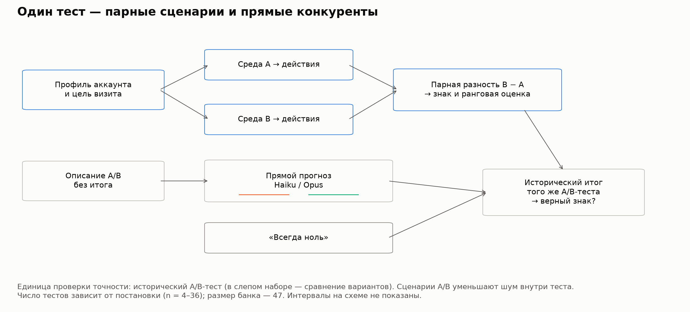
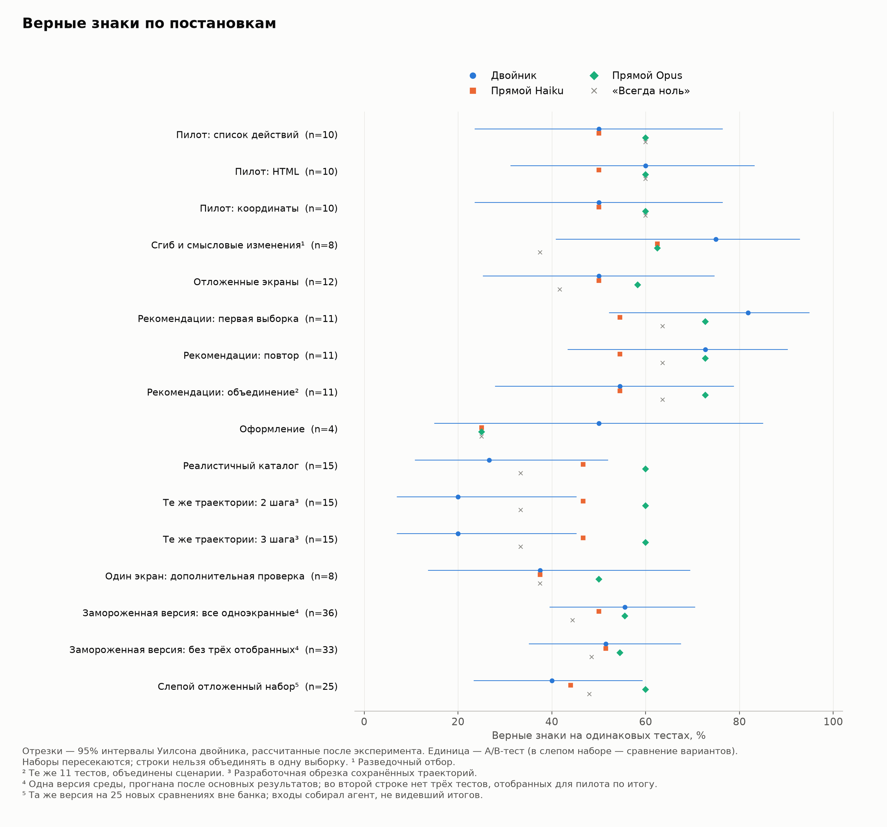
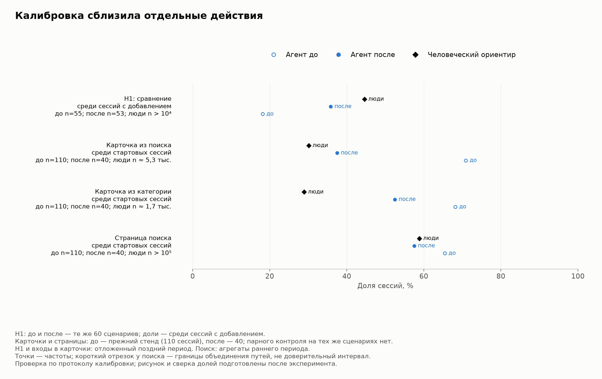
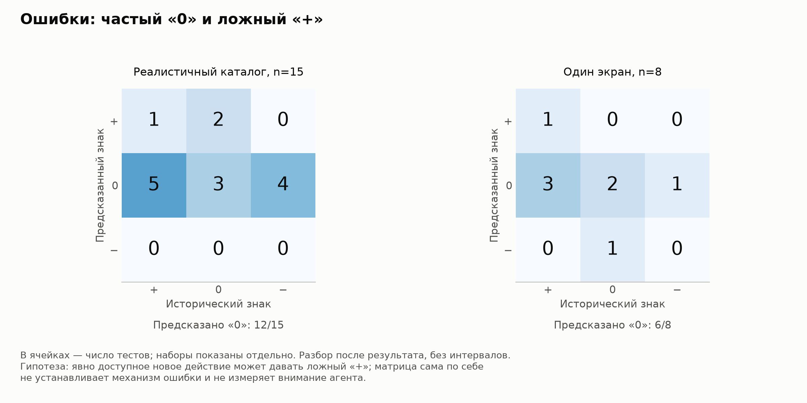

# Можем ли мы симулировать поведение клиента и на его основе предсказывать результаты A/B-тестов?

## 0. Аннотация

Можно ли симулировать покупателей LLM-агентами и предсказывать итоги A/B-тестов интерфейса? Мы проверили это на 47 внутренних неопубликованных тестах продуктового ритейлера: 18 «+», 22 «0», 7 «−». Агент получает профиль и цель из реальных покупок, видит один вариант и проходит путь по скриншотам приложения; частоты действий сверены с отложенными данными людей. Состав наборов и пороги успеха основных проверок записывались до прогонов; сами тесты закрыты, результаты приводятся по наборам тестов. На сводном наборе из 27 тестов («сводка 27») симуляция верна в 14–17 случаях против 13 у прямого прогноза той же модели, 16 у сильнейшей и 13 у «всегда ноль» (точный Макнемар, p ≥ 0,289); замороженная версия — 20 из 36 при 20 у сильнейшей модели и 16 у «всегда ноль», а на 25 новых сравнениях, входы которых первоначально собирал агент, не видевший итогов, — 10 при 15 у сильнейшей модели и 12 у «всегда ноль». Ранговая связь с реальным эффектом неустойчива и хрупка: на основном ранговом наборе банка (n = 33) ρ от −0,08 до +0,19, на слепом наборе у кликов +0,39 (n = 24), но без одного крупнейшего эффекта +0,30 (p = 0,079). Десять гипотез улучшения устойчивой прибавки точности не дали. Калибровка сблизила сравнение карточек: 18% → 36% сессий при 45% у людей. Реакция людей на смену фото не воспроизведена ни в одном из трёх тестов. Ответ двойной: поведение удалось симулировать лишь частично, а прогноз по симуляции не превзошёл простых планок — прямого прогноза и «всегда ноль». В двоичной метрике соседних работ симуляция выглядит успешной: 9–10 верных знаков из 14, но столько же даёт «всегда +». Без нулевых тестов, прямого прогноза и повтора такая оценка завышает пользу симуляции.

## 1. Введение

Симуляция покупателей могла бы отбирать продуктовые гипотезы до дорогих A/B-тестов, если бы предсказывала направление эффекта или порядок гипотез по силе. Но ответы опроса и поведение в приложении — разные задачи: покупатель может не заметить изменение, уйти другим путём или отложить покупку. Поэтому перенос на конверсию нужно проверять на реальных экспериментах.

Мы отдельно проверяем сходство действий агентов с человеческими и точность A/B-прогноза. Конкуренты — прямой прогноз той же модели, более сильные модели и «всегда ноль». Банк включает исторические тесты продуктового ритейлера; среда охватывает одно действие и сессии с поиском, категориями и корзиной.

Ответ двойной: поведение покупателей удалось симулировать лишь частично, а прогноз по такой симуляции в проверенных постановках не превзошёл простых планок.

Вклад работы — проверка на внутренних неопубликованных экспериментах с нулевыми исходами и прямым прогнозом как планкой. Агент проходит путь по приложению, а сходство действий сверяется с отложенными данными людей. У каждой из десяти проверок улучшения указан статус: пилот, разведка или проверка с составом и критерием, записанными заранее. Отдельно проверены замороженная версия, в том числе на слепом отложенном наборе, входы которого первоначально собирал агент без доступа к итогам, и перенос калибровки поведения на A/B-прогноз. Наконец, показано, как двоичная метрика может создавать видимость пользы симуляции без преимущества над простым правилом. Сами тесты остаются закрытыми: статья и её репозиторий приводят результаты по наборам тестов, а не по отдельным экспериментам (раздел 12).

## 2. Связанные работы

**Соседние задачи.** В потребительском выборе LLM воспроизводят часть предпочтений, но ошибаются в реакции на новые свойства [Brand и др., 2026, первоначальная версия 2023]; воздействие может менять и домысленный моделью контекст [Gui и Toubia, 2025, первоначальная версия 2023]. RecAgent и Agent4Rec проверяют выбор в рекомендациях [Wang и др., 2024; Zhang и др., 2024]. UXAgent помогает готовить usability-исследования [Lu и др., 2025a]; на 31 865 реальных сессиях покупок лучшие модели без дообучения угадывают около 12% следующих действий покупателя [Lu и др., 2025b], на OPeRA — от 8 до 22% [Wang и др., 2026a]. Все эти задачи ещё не прогноз эффекта изменения интерфейса.

**LLM вместо участников исследований.** Модели воспроизводят ответы опросов и поведение в экспериментальных средах [Argyle и др., 2023; Horton, 2023; Aher и др., 2023], а генеративные агенты — правдоподобное социальное поведение [Park и др., 2023]. На отложенных вопросах GSS агенты 1 052 участников достигают 83% человеческой повторяемости по интервью и 86% по интервью вместе с опросами [Park и др., 2026]. Twin-2K-500 — другой набор: 2 058 человек, двойники достигают около 88% человеческой повторяемости [Toubia и др., 2025]; в опросах о намерении купить корреляция средних по концепциям достигает 90% потолка, оценённого по самим людям [Maier и др., 2025]. Синтетические ответы менее вариативны [Bisbee и др., 2024; Wang и др., 2025]; в 19 исследованиях средняя корреляция двойников с людьми — около 0,20 [Peng и др., 2026]. Сходство ответов не обеспечивает сходства механизмов [Brucks и Toubia, 2025; Lin, 2025], а экономические предпочтения в разных странах симулированные ответы передают слабо [Chen и др., 2026].

**Прогноз по описанию.** Прямое суждение изучали для людей [DellaVigna и Pope, 2018] и LLM. Результаты различаются: 78% верных выводов в опубликованных полевых экспериментах [Chen и др., 2025], около 40% на 3 263 отложенных тестах заголовков при случайных 33% [Ye и др., 2024], около случайного уровня на парах интерфейсов [Jeon и др., 2026]. Симулированные эффекты бывают завышены [Ashokkumar и др., 2026] или сжаты до 39% человеческого [Persson и др., 2026]; в предсказании ответов с закрытым выбором обученная графовая модель не уступает LLM [Suh и др., 2026]. На 330 A/B-тестах сайтов согласие LLM-судьи с исходами — κ = 0,14, а в заранее записанных проверках более дорогая модель, переработка промпта и точность стимула не дали заданного улучшения [Dooskin, 2026]. Прямой прогноз поэтому служит обязательным конкурентом агентной симуляции.

**Агентный прогноз A/B.** SimAB верно выбирает победителя в 67% из 45 значимых тестов при 62% у «всегда новый» [Rieder и др., 2026]; Benomar и соавторы получают 0,75–0,80 [2026b], SimGym — 69% на 20 магазинах [Castelo и др., 2026] и 77% на 50 магазинах для основной когорты в следующей версии системы [Li и др., 2026]. Agent A/B и PAARS проверены на одном и трёх тестах [Lu и др., 2026; Mansour и др., 2025]. Hut и Masoero [2026] получают на 67 тестах точность знака 0,70 при 0,57 у «всегда +» и оценённой воспроизводимости знака 0,69; трёхзначная точность — 0,41 при случайных 0,33. В индустрии доля успешных тестов — 8–33% при разных определениях успеха, модельные оценки истинных нулей — около 70–80% [Kohavi и др., 2022; Optimizely, 2026; Spotify Confidence, 2026; Berman и Van den Bulte, 2022; Berman и др., 2018]. Условия сравнения и источники индустриальных оценок — в приложении Ж.

**Место этой работы.** Наш агент проходит один вариант приложения, не сравнивая A и B и не оценивая дизайн. Карточка и цель получены из покупок; сходство действий проверено на отложенных событиях других покупателей. В отличие от подходов со сравнением скриншотов [Rieder и др., 2026; Benomar и др., 2026b], проверяется реакция в ходе визита. Браузерные агенты тоже видят один вариант [Castelo и др., 2026; Lu и др., 2026], но в этих работах поведение не калибруется по отложенным действиям людей. Проверка сочетает неопубликованные исторические тесты, нулевые исходы, прямой прогноз, повтор на новых сценариях и замороженную версию. Замороженная версия проверена и на слепом отложенном наборе: входы новых тестов первоначально собирал агент без доступа к итогам, истина была запечатана, а правило вывода записано до прогона (раздел 6.2, приложение З.8). В рассмотренных версиях сравниваемых работ такой проверки мы не нашли (приложение Ж). Проверка отделяет сходство поведения от верности реакции на воздействие. Использование LLM как вспомогательных данных внутри теста [Benomar и др., 2026a] здесь не проверялось.

## 3. Задача и данные

### 3.1. Целевая величина и единица проверки

Единица проверки точности — A/B-тест (в слепом наборе — сравнение вариантов, раздел 6.2); единица симуляции — сценарий с одной карточкой, целью визита и начальным состоянием, который проходит варианты A и B отдельно. Больше сценариев уменьшает внутренний шум, но не увеличивает число независимых экспериментов. Исторический «+» или «−» — направление значимого изменения основной метрики в B относительно A (конверсии, добавления, выручка); исторический «0» — отсутствие значимого изменения по правилу исходного отчёта. Для двух метрик слепого набора, где лучше меньшее значение, знак означает улучшение, а не рост метрики (приложение З.8). Синтетический «0» означает, что интервал парной разности агентов включает ноль. Основной конкурент — прямой прогноз Haiku 5.5, на которой работают агенты; Opus 5.5 — сильнейший из проверенных прямых прогнозов.

### 3.2. Банк исторических экспериментов

Банк содержит 47 тестов с однозначным знаком: 18 положительных, 22 нулевых и 7 отрицательных; четыре смешанных случая исключены. Из 68 найденных отчётов не вошли 17: вне задачи, пограничные или алгоритмические изменения без экрана для агента. Часть тестов проводилась по спискам пользователей. Банк восстановлен вручную по отчётам; отличие тестов с отчётом от остальных не проверено. Отдельные тесты не приводятся; в приложении А — состав банка и наборов оценки. Отдельно, вне банка, собран слепой отложенный набор: 25 сравнений из 23 тестов (раздел 6.2, приложение З.8).

Каждая постановка охватывает подмножество банка: статичный кадр передаёт не все различия, а сессии нужен измеримый в среде исход. Поэтому основные наборы различаются: сводка 27 — тесты постановок с отбором до прогона (раздел 6.2), основной ранговый набор 33 — одноэкранные тесты без трёх отобранных по итогу (раздел 5.2). Для разрезов тесты разделены на классы F — находимость и путь, P — предпочтение и интерпретация оформления, R — рекомендации дополнительных товаров.

### 3.3. Карточка агента

Карточка описывает аккаунт по покупкам и событиям приложения: опыт, устойчивые паттерны корзины, привычный размер заказа, время визита и скидки; явной демографии нет. Цель взята из покупки, при которой мог встретиться тестируемый экран. В сессиях добавлены привычки, в части постановок — строка о сравнении товаров (раздел 7.1). Карточка и цель одинаковы в A/B; каталог персон и миссий построен до прогонов и по результатам не подбирался.

## 4. Метод

### 4.1. Парная симуляция

Карточка покупателя, среда A/B, LLM-агент и агрегация исходов образуют симулятор (рисунок 1). Далее «двойник» — краткое название этой системы, без утверждения об индивидуальной копии человека.

**Роль агента.** Агент имитирует реального покупателя с конкретной целью визита: покупает прежде всего под задачу, смотрит на экран «как занятой человек: сначала то, что крупно и вверху», может уйти, отложить покупку или ничего не купить. Он не знает о тесте, втором варианте и метрике и не оценивает дизайн как эксперт. Дословные правила — в приложении Б.2.

**Визит.** Сценарий с одной карточкой, целью и начальным состоянием проходит A и B отдельно. На шаге агент получает правила, профиль, цель, время, историю визита, корзину и скриншот телефона; отвечает нажатием, прокруткой, возвратом, поисковым запросом или уходом. Каждый шаг — отдельный вызов с переданной историей. Среда показывает следующий экран на реальных товарах. Визит заканчивается уходом, оформлением заказа, переходом вне покупок или лимитом: 5 либо 10 шагов в A/B-прогнозе, 30 в калибровке поведения. Исход — целевое действие или число добавлений любым путём; соответствие человеческой метрике дано в приложении З.1.

**Развитие среды.** Проверены список действий, HTML и скриншот с координатным нажатием; затем прокрутка и сессии в полном каталоге. В одноэкранной постановке исход определяется одним действием.

**Рисунок 1.** Профиль → действия в A/B → парная разность → проверка по историческому итогу; рядом прямые прогнозы и «всегда ноль». Единица проверки — A/B-тест, внутреннего расчёта — парный сценарий.

### 4.2. Постановки и повторы

Разведочный пилот проверял сгиб (границу первого экрана) и смысловые изменения на восьми тестах, отбиравшихся с учётом известных результатов; три из них взяты ради известного сильного эффекта и исключены из сводки 27 и основного рангового набора. Набор из 12 экранных тестов, не использованных при разработке среды («отложенные экраны»), имел правило отбора до запуска; реалистичный каталог — записанный порог, но проверялся на тестах, уже знакомых по разработке.

**Таблица 1.** Представления среды: запланированное число парных сценариев на тест, исход агента и горизонт. Фактическое число пригодных пар может быть меньше плана.

| Представление | План сценариев на тест | Исход агента и горизонт | Назначение |
|---|---|---|---|
| Список действий / HTML | 30 | выбор следующего действия из списка; одно решение | пилоты |
| Координаты / сгиб / отложенные экраны | 150 | нажатие на кадре; при сгибе прокрутка даёт второй кадр | пилот, поисковое или отбор до прогона |
| Рекомендации / оформление | 110 | добавления или целевое действие за сессию; до 5 шагов | проверка и повтор |
| Объединение рекомендаций | 220 | то же | те же 11 тестов |
| Реалистичный каталог | 110 | целевое действие за сессию; до 5 или 10 шагов по правилу метрики (8 и 7 тестов) | протокол на известных тестах |
| Один экран, дополнительный | 150 | как у отложенных экранов | отбор до прогона |
| Один экран, замороженная версия | 150 | как у отложенных экранов | все 36 одноэкранных тестов, после основных результатов; 25 сравнений слепого набора |
| Вероятности действий | 40 | распределение 100% между следующими действиями | ранжирование |
| Перенос, четыре теста | 110 | добавления за сессию; до 10 шагов | проверка переноса (раздел 7.3) |

Популяция одна для всех тестов: десятки тысяч покупателей, описанных за шестимесячное окно. Сценарии отбираются с фиксированным seed и весом по ожидаемому числу визитов или заказов за окно теста; ограничения аудитории и миссии сохраняются. В каталоге, калибровке, переносе и диагностике модели вес дополнительно учитывает долю визитов на экран того же типа. У 23 из 47 тестов начало раньше окна популяции: агенты представляют более поздних покупателей.

### 4.3. Прямые прогнозы и простые конкуренты

Прямой прогноз видит описание поверхности, входа, аудитории, A/B и метрики, без исхода, эффекта и p-значения (приложение Б). У Haiku 5.5, Sonnet 5.5 и Opus 5.5 сохранено по три ответа со знаком и уверенностью; знак выбирается большинством. На 47 тестах верны 24, 24 и 26, у «всегда ноль» — 22, у «всегда +» — 18. Ещё одна простая планка — самый частый итог в классе F/P/R без оцениваемого теста — даёт 16/47, меньше «всегда ноль». На 43 тестах добавление первых экранов A/B даёт 21, 23 и 21 верный знак против 22, 23 и 25 по тексту (p Макнемара: 1,0; 1,0; 0,219). У Opus кадры отняли четыре верных знака при записанном допуске в два, поэтому основным конкурентом остаётся прогноз по тексту.

### 4.4. Модели и параметры вызовов

Использованы claude-haiku-5-5, claude-sonnet-5-5 и claude-opus-5-5 через Claude Code, 13–20 октября 2026 года, с последними проверками 22 октября; слепой отложенный набор — 22–23 октября. Каждый вызов — отдельная сессия в пустой папке с нашим системным промптом, без истории, хуков, инструкций, MCP и инструментов. CLI добавляет к системному промпту дату и описание встроенного серверного инструмента-советника; по журналу стоимости модель к нему не обращалась. Параметры выборки оставлены по умолчанию, температура не задавалась, рассуждение адаптивное. При ошибке или таймауте 240 секунд — до двух повторов. Экран: 390 × 844, в сессиях 390 × 823 логических пикселя, масштаб 1,5. Ответ агента — JSON с действием или координатами.

## 5. Оценка

### 5.1. Правило знака и голосование

Для сценария вычисляется разность исходов B − A, для теста — средняя парная разность. Бутстреп выбирает с возвращением пары сценариев; если 95% интервал целиком выше нуля, прогноз «+», если ниже — «−», иначе «0». Интервал описывает вариацию симулятора, поэтому доля ответов «0» зависит от числа сценариев и дисперсии исхода (раздел 8). A/A-прогоны одноэкранных пилотов все дали «0» (девять прогонов); для сессий A/A-прогонов не было. Ничья трёх ответов прямого прогноза («?») считается несовпадением.

### 5.2. Ранжирование и статус решений

Ранговая оценка двойника — разность долей агентов с целевым действием B − A в последнем по времени одноэкранном прогоне теста; кликовые оценки 33 тестов взяты из пяти прогонов разных версий среды. У Opus — среднее трёх величин «знак × уверенность / 10». Обе сопоставляются с относительным изменением человеческой метрики через ρ Спирмена, односторонний p — по 10 000 перестановок; ранги смешивают разные метрики, поэтому оценивается только ранговая связь. Основной набор — 33 теста: из 36 одноэкранных исключены три, отобранные для пилота по известному результату. В вероятностном режиме 40 агентов на тест распределяли 100% между следующими действиями.

До очередных прогонов фиксировались состав, метрика и критерий успеха: например, для реалистичного каталога — не менее 10 верных знаков из 15, для вероятностного ранжирования — положительная ρ при одностороннем p < 0,05 и не ниже прямого Opus (приложение В). Интервалы Уилсона, парные сравнения, метрики раздела 5.4, правила сочетания с прямым прогнозом и проверки приложения З рассчитаны после основных результатов по правилам, записанным до расчёта; их статус — разведка. Значения p приводятся без поправки на множественность.

### 5.3. Парная неопределённость и мощность

В парном сравнении считаются тесты, где верен только двойник, и тесты, где верен только конкурент; точный Макнемар проверяет симметрию этих несовпадений. Для разности долей используется score-интервал Tango [Tango, 1998], для разности корреляций — парный процентильный бутстреп по тестам (20 000 повторов). Чтобы при двустороннем α = 0,05 и мощности 80% обнаружить разность точностей 10 процентных пунктов, нужно около 155, 234 и 391 теста при доле несовпадений 20%, 30% и 50% — в 3–8 раз больше банка.

### 5.4. Точность по группам исходов и согласие по знакам

Если в наборе много исторических нулей, долю верных знаков поднимает любой метод, часто отвечающий «0». Поэтому приводятся точность отдельно на тестах с эффектом и на нулевых, их среднее — **точность по группам исходов** («всегда ноль» даёт 0,5), стандартная сбалансированная точность по трём классам («всегда ноль» даёт 1/3) и каппа Коэна; интервалы — 95% процентильный бутстреп по тестам.

### 5.5. Модельная оценка воспроизводимости вердиктов

Для 40 из 47 тестов восстановлена z-статистика. При плоском априорном распределении вероятность повторить трёхзначный вердикт равна 0,82, совпадение знака двух будущих повторов — 0,86; при 50–70% истинных нулей — 0,875–0,888 и 0,72–0,74 соответственно. Это модель повторного измерения, а не потолок точности прогнозиста. Оценки по поднаборам и предположения — в приложении З.5.

## 6. Результаты: точность A/B-прогноза

### 6.1. Верные знаки по постановкам

Переход к сессии дал лучший начальный счёт в рекомендациях, но он снизился при повторе и объединении сценариев. Реалистичный каталог не достиг записанного порога 10/15. Все результаты и одинаковые внутри строк конкуренты — в таблице 2.

**Таблица 2.** Верные знаки на одинаковом наборе внутри строки; конкуренты оцениваются на том же n, ничья ответов прямого прогноза — ошибка. Строки пересекаются; их нельзя суммировать. План постановок — раздел 4.2, парные сравнения по строкам — таблица И.1.

| Постановка | Двойник | ДИ Уилсона, % | Haiku | Opus | Ноль | Sonnet | Статус |
|---|---|---|---|---|---|---|---|
| Список действий | 5/10 | 23,7–76,3 | 5 | 6 | 6 | 6 | пилот |
| HTML | 6/10 | 31,3–83,2 | 5 | 6 | 6 | 6 | пилот |
| Координаты | 5/10 | 23,7–76,3 | 5 | 6 | 6 | 6 | пилот |
| Сгиб, разведочный | 6/8 | 40,9–92,9 | 5 | 5 | 3 | 4 | разведочное |
| Отложенные экраны | 6/12 | 25,4–74,6 | 6 | 7 | 5 | 7 | отбор до прогона |
| Рекомендации, первая | 9/11 | 52,3–94,9 | 6 | 8 | 7 | 6 | отбор до прогона |
| Рекомендации, повтор | 8/11 | 43,4–90,3 | 6 | 8 | 7 | 6 | повтор |
| Рекомендации, объединение | 6/11 | 28,0–78,7 | 6 | 8 | 7 | 6 | те же тесты |
| Оформление | 2/4 | 15,0–85,0 | 1 | 1 | 1 | 1 | отбор до прогона |
| Реалистичный каталог | 4/15 | 10,9–52,0 | 7 | 9 | 5 | 8 | известные тесты |
| Обрезка: 2 шага | 3/15 | 7,0–45,2 | 7 | 9 | 5 | 8 | разработочное |
| Обрезка: 3 шага | 3/15 | 7,0–45,2 | 7 | 9 | 5 | 8 | разработочное |
| Один экран, доп. | 3/8 | 13,7–69,4 | 3 | 4 | 3 | 3 | отбор до прогона |
| Замороженная версия, все одноэкранные | 20/36 | 39,6–70,5 | 18 | 20 | 16 | 19 | набор до прогона, после основных результатов |
| Замороженная версия, без трёх отобранных по итогу | 17/33 | 35,2–67,5 | 17 | 18 | 16 | 18 | тот же прогон |
| Слепой отложенный набор | 10/25 | 23,4–59,3 | 11 | 15 | 12 | 12 | входы собраны вслепую, набор до прогона |

**Рисунок 2.** Доли верных знаков двойника, прямых Haiku и Opus и «всегда ноль» на одинаковых тестах каждой строки таблицы 2; отрезки — 95% интервалы Уилсона двойника. Наборы пересекаются; повтор и объединение рекомендаций относятся к тем же 11 тестам, короткие сессии — к тем же траекториям каталога.

### 6.2. Сводка 27, замороженная версия и слепой набор

Двойник не показал преимущества в парных сравнениях; у обрезанных траекторий он уступил Opus (0:6, p = 0,031; разработочный разбор, таблица И.1). Сводка 27 объединяет 12 отложенных экранов, 11 рекомендаций и четыре оформления — все тесты этих трёх постановок; три пилотных теста, отобранных по итогу, в неё не входят. Первая выборка, повтор и объединение рекомендаций образуют три равноправные сводки одного корпуса.

**Таблица 3.** Сводка 27. Для двойника — счёт и 95% интервал Уилсона, для конкурентов — счёт из тех же 27. Во всех вариантах 13 нулевых человеческих исходов из 27.

| Рекомендации в сводке | Двойник | ДИ Уилсона, % | Haiku | Opus | Ноль | Sonnet |
|---|---|---|---|---|---|---|
| первая выборка | 17/27 | 44,2–78,5 | 13/27 | 16/27 | 13/27 | 14/27 |
| повтор | 16/27 | 40,7–75,5 | 13/27 | 16/27 | 13/27 | 14/27 |
| объединение сценариев | 14/27 | 34,0–69,3 | 13/27 | 16/27 | 13/27 | 14/27 |

На сводке 27 преимущество над Haiku составляет 1–4 теста, разность с Opus — от +1 до −2; все парные интервалы включают ноль (таблица И.3). Относительно «всегда ноль» несовпадения — 6:2, 5:2 и 5:4 (p = 0,289; 0,453; 1,0). На всех 44 тестах с прогнозом двойника верны 25, 24 и 22 знака против 23 у Haiku, 24 у Sonnet, 26 у Opus и 21 у «всегда ноль» (p ≥ 0,344). Каппа трёх сводок — 0,35 [0,01; 0,65], 0,28 [−0,05; 0,57] и 0,17 [−0,17; 0,48].

**Одна замороженная версия.** После основных результатов код, промпт и популяция отложенных экранов зафиксированы и прогнаны на всех 36 одноэкранных тестах, по 150 сценариев; набор и правило записаны до запуска. Результат — 20/36 при 20 у Opus и 16 у «всегда ноль» (таблица 2; p ≥ 0,344), каппа 0,27 [0,02; 0,51]. Все три пилотных теста, отобранных по итогу, угаданы; без них счёт 17/33 при 17 у Haiku, 18 у Sonnet и Opus и 16 у «всегда ноль». На тестах с эффектом верны 7/20, на нулевых — 13/16: относительно «всегда ноль» распознаны семь эффектов ценой трёх ошибок на нулевых тестах.

**Слепой отложенный набор.** Затем та же версия без изменений прогнана на 25 новых сравнениях вне банка: 23 теста и две третьи ветки против A. Отчёты с однозначным итогом отобрал исполнитель, видевший знаки; тесты из них отобрал и входы первоначально собрал отдельный агент-сборщик без доступа к итогам. По исходному отчёту каждого A/B он собрал паспорт — описание входа для двойника: точку входа, экран, целевое действие и аудиторию, — а также экраны вариантов и описание для прямого прогноза. Позже сборщику стали известны знаки пяти сравнений, входы которых уже были зафиксированы; после этого он добавил третью ветку одного теста и поправил пять других экранов (хронология и роли — приложение З.8). Истина, состав набора и критерий записаны до первого вызова оцениваемых моделей. Двойник верен в 10 сравнениях (таблица 2): на 2 меньше, чем «всегда ноль», и на 5 меньше, чем Opus; у Haiku 11, у Sonnet 12. Записанный заранее критерий — двойник верен чаще и «всегда ноль», и Haiku при p < 0,05 — не выполнен (4:6, p = 0,754; 5:6, p = 1,0) ни в одном варианте набора (таблица З.8.1). Двойник здесь реже отвечал «0», чем на 36 тестах банка (13 из 25 против 24 из 36), и реже узнавал нулевые исходы (6 из 12 против 13 из 16); в 6 сравнениях его «0» механический: целевое действие не выбрал ни один агент или выбрали все (приложение З.8).

### 6.3. Ранжирование эффектов

На 33 тестах кликовая реакция двойника не упорядочивает человеческие эффекты; вероятностный режим не выполнил записанный критерий и не превзошёл прямой Opus (таблица 4). У замороженной версии на тех же 33 тестах ρ = −0,081, p = 0,673.

**Таблица 4.** Ранговая связь оценок с историческим эффектом на основном наборе. ρ Спирмена, односторонний перестановочный p (10 000 перестановок); интервал разности — парный процентильный бутстреп (20 000 повторов).

| Оценка на основном наборе, n=33 | ρ | Односторонний p | 95% интервал разности «Opus минус оценка» |
|---|---:|---:|---|
| Клики двойника | −0,061 | 0,636 | [−0,059; +0,634] |
| Вероятности действий | +0,195 | 0,134 | [−0,314; +0,398] |
| Прямой Opus: знак × уверенность | +0,266 | 0,064 | — |

На всех 36 тестах, включая три отобранных по итогу, ρ кликов +0,109, Opus +0,421 (p = 0,006), вероятностей около +0,26 (p = 0,061). На 18 тестах без удлинения списка действий в B вероятностная ρ около +0,05 (p = 0,426): часть её положительного сдвига, по-видимому, даёт появление дополнительного целевого действия в списке. Проверки шкалы и разрезы по типу метрики добавочной ранговой связи не показали (приложение З.3). На слепом отложенном наборе эффекты основных метрик к одной шкале свела отдельная сессия агента, не видевшая прогнозов. Правило извлечения записано после вскрытия, поэтому статус этой проверки — разведка (приложение З.8). Здесь ρ кликов двойника +0,387 (односторонний p = 0,029, n = 24), прямого Opus — +0,316 (p = 0,071); интервал разности «Opus минус клики» [−0,564; +0,383]. У той же замороженной версии на банке ρ = −0,081: между наборами связь неустойчива. Она и хрупка: без одного крупнейшего эффекта ρ кликов +0,302 (p = 0,079), без двух — +0,298 (p = 0,087), при исключении любого одного сравнения — от +0,302 до +0,534. Связь Opus хрупка не меньше: без одного и двух крупнейших эффектов +0,221 и +0,104. Расчёт описательный: 24 сравнения с разными метриками, без поправки на множественность.

### 6.4. Откуда выигрыш над Haiku и уровень прямого прогноза

Выигрыш над Haiku на сводке 27 приходится на нулевые тесты: 11, 11 и 9 верных из 13 против 6 у Haiku; на тестах с эффектом — 6, 5 и 5 из 14 против 7. В первой выборке рекомендаций на семи нулевых тестах Haiku дал пять ложных «+», двойник — ни одного. Отрицательные исходы находят редко: двойник — 2/7 на всех 44 тестах, прямые Haiku, Sonnet и Opus — 1/7, 0/7 и 1/7 на банке. На каталоге точность по группам исходов — 0,35 против 0,65 у Opus.

**Таблица 5.** Точность по группам исходов, стандартная сбалансированная точность и каппа Коэна на сводке 27, на всех 44 тестах с прогнозом двойника, у замороженной одноэкранной версии, на слепом отложенном наборе (раздел 6.2) и на реалистичном каталоге. В ячейках методов — «по группам / стандартная / каппа»; у правила «всегда ноль» — 0,50 / 0,33 / 0. Таблица по первоначальным постановкам — приложение Е.

| Набор | n | Двойник верно: с эффектом; нулевые | Двойник | Haiku | Opus |
|---:|---:|---|---|---|---|
| Сводка 27, первая выборка | 27 | 6/14; 11/13 | 0,64 / 0,58 / 0,35 | 0,48 / 0,44 / 0,14 | 0,60 / 0,51 / 0,28 |
| Сводка 27, повтор | 27 | 5/14; 11/13 | 0,60 / 0,55 / 0,28 | 0,48 / 0,44 / 0,14 | 0,60 / 0,51 / 0,28 |
| Сводка 27, объединение сценариев | 27 | 5/14; 9/13 | 0,52 / 0,50 / 0,17 | 0,48 / 0,44 / 0,14 | 0,60 / 0,51 / 0,28 |
| Все 44, первая выборка | 44 | 7/23; 18/21 | 0,58 / 0,49 / 0,23 | 0,53 / 0,44 / 0,19 | 0,60 / 0,48 / 0,27 |
| Все 44, повтор | 44 | 6/23; 18/21 | 0,56 / 0,46 / 0,19 | 0,53 / 0,44 / 0,19 | 0,60 / 0,48 / 0,27 |
| Все 44, объединение сценариев | 44 | 6/23; 16/21 | 0,51 / 0,43 / 0,12 | 0,53 / 0,44 / 0,19 | 0,60 / 0,48 / 0,27 |
| Замороженная одноэкранная версия | 36 | 7/20; 13/16 | 0,58 / 0,49 / 0,27 | 0,52 / 0,43 / 0,18 | 0,58 / 0,47 / 0,24 |
| Слепой отложенный набор | 25 | 4/13; 6/12 | 0,40 / 0,37 / 0,04 | 0,45 / 0,38 / 0,11 | 0,61 / 0,55 / 0,36 |
| Реалистичный каталог | 15 | 1/10; 3/5 | 0,35 / 0,26 / −0,12 | 0,50 / 0,45 / 0,18 | 0,65 / 0,57 / 0,38 |

Прямые прогнозы также не показали преимущества над «всегда ноль»: несовпадения 11:9 у Haiku (p = 0,824), 7:5 у Sonnet (p = 0,774), 9:5 у Opus (p = 0,424). Каппа — 0,18 [−0,05; 0,40], 0,15 [−0,07; 0,36] и 0,21 [−0,03; 0,44]: интервалы включают ноль и допускают умеренное согласие.

## 7. Поведение агентов: близость к людям и перенос на прогноз

### 7.1. Какие действия сблизились

Калибровка проверена на отложенных событиях других аккаунтов; вероятности поведения оценивались по ранним данным, протокол записан до расчёта. H1 — доля сессий с добавлением, где открыты минимум две разные карточки; у людей — 44,6% при n ≈ 14 тыс. Полный слой разрешал сравнение, добавлял в профиль соответствующую привычку с оценённой по аккаунту вероятностью, операции количества и удаления. Критерий подключения: отношение H1 агента к человеческому 0,67–1,5; обе стартовые карточки не дальше от людей, чем база; на страницах поиска и категории доля агентов между 0,67 нижней и 1,5 верхней границы человеческого ориентира.

На тех же 60 сценариях H1 вырос с 10/55 = 18,2% до 19/53 = 35,8%; от всех сценариев — с 10/60 до 19/60. Парная прибавка +17,7 п.п. [+4,7; +31,0], отношение к людям 0,80 [0,53; 1,10]: точечная оценка проходит порог, нижняя граница — нет. В полном слое H1 со строкой о сравнении — 14/21, без неё — 5/32; вклад одной строки отдельно не проверялся. Добавления со стартовых поверхностей — в таблице 6.

**Таблица 6.** Добавления со стартовой поверхности. Агентные доли рассчитаны от всех сессий с данным стартом: база — 110, полный слой — 40, лимит пять шагов; H1 — на тех же 60 сценариях с лимитом 30 шагов. Это разные прогоны без парного контроля; для H1 выше использованы те же 60 сценариев. Человеческие определения карточек и страниц разделены.

| Старт | До: прежний стенд, 110 сессий | После: полный слой, 40 сессий | Люди: показатель и знаменатель | Данные людей |
|---|---|---|---|---|
| Карточка из поиска | 78/110 = 70,9% | 15/40 = 37,5% | 30,1%; n ≈ 5,3 тыс. | отложенный период |
| Карточка из категории | 75/110 = 68,2% | 21/40 = 52,5% | 29,0%; n ≈ 1,7 тыс. | отложенный период |
| Страница поиска | 72/110 = 65,5% | 23/40 = 57,5% | 58,7–59,0%; n > 10⁵ | ранний период |
| Страница категории | 64/110 = 58,2% | 16/40 = 40,0% | 46,4–46,5%; n > 10⁴ | ранний период |

**Рисунок 3.** H1 и добавление со стартовой карточки из поиска, карточки из категории и страницы поиска (три из четырёх стартовых поверхностей таблицы 6) до и после калибровки и у людей. Для H1 «до» и «после» — те же 60 сценариев, для карточек и страниц — разные прогоны стенда (110 и 40 сессий), без парного контроля. Правило калибровки задано до прогона.

### 7.2. Какие расхождения остались

Карточка из категории стала ближе к людям, но 52,5% против 29,0% — всё ещё в 1,8 раза выше человеческой доли. Среди 53 агентных сессий с добавлением не было изменения количества и возврата из корзины в карточку, удаление было в одной; у людей такие действия есть примерно в 17–31% сессий с добавлением. Поиск у агентов заканчивался добавлением примерно в 88% случаев, у людей — в 60%, отчасти потому, что поиск стенда находит товар легче реального.

**Карточка.** Агент открывает карточку, чтобы купить, и почти всегда кладёт товар прямо с неё. Люди открывают карточку, чтобы рассмотреть товар, — листают фото, читают состав, сравнивают кандидатов, — а в трети покупательских визитов кладут товар прямо из списка (приложение З.7). Строка о привычке сравнивать приблизила частоту открытия нескольких карточек, но не то, что человек в них делает.

**Фото: агент сверяет товар, внешний вид влияет мало.** Диагностики после основных результатов проведены по записанным до прогона правилам, по 150 сценариев, на синтетических экранах под собственную цель агента. Чужой товар на фото снижает добавления на 30,9 п.п. [−39,6; −22,8], удвоенная цена — на 18,0 п.п.; отсутствие фото — на 2,7 п.п. [−8,0; +2,7]. В сетке четырёх товаров размытие своего фото даёт −5,3 п.п. [−10,0; −0,7], повышение цены на 30% — −6,7 п.п. [−13,3; 0,0]. Малый сдвиг без фото не доказывает равенства; из изменений вида заметно сдвинуло выбор только сильно испорченное фото — примерно как контрольное повышение цены.

В реальном A/B фото вне банка, проведённом по заранее записанному правилу, по 30 сценариев на товар в сетке 2 × 2, выбор агента изменился на −0,6 п.п. [−2,1; +0,8] от исходных 19,6%, а вид товара упоминается в 42% ответов при обоих фото: агент видит фото, но выбор от него почти не зависит. Вместе с двумя тестами фото из банка во всех трёх реальных тестах реакция людей не воспроизведена; их отдельные исходы не приводятся (раздел 12). Фото помогает сверить товар, внешний вид влияет мало.

### 7.3. Перенос на четыре известных A/B-теста

На четырёх известных рекомендательных тестах после изменения версии верен 1/4 знаков; прежняя версия давала 3/4, 2/4 и 1/4 в первой выборке, повторе и объединении. Тесты выбраны по ошибкам; одновременно изменены сценарии, контекст, лимит с пяти до десяти шагов и слой сравнения. Исторические эффекты меньше 1%, а два из этих тестов неразличимы для агента. Поэтому проверка не устанавливает влияние калибровки на A/B-точность (приложение З.4).

## 8. Гипотезы улучшения и их проверка

Проверены десять гипотез улучшения. Ни одна не дала устойчивого роста точности; одновременные изменения компонентов не позволяют приписать результат одному из них. Возможный общий механизм — частые «0» при слабом сдвиге относительно внутреннего шума: на наборе с историческими нулями это повышает счёт. Отдельные проверки приведены ниже.

### 8.1. Вход ближе к тому, что видит человек

Чем ближе вход к тому, что видит человек, тем ближе может быть реакция. Список действий упрощает экран, HTML передаёт разметку, координатное нажатие — сам кадр. На тех же 10 пилотных тестах получено 5/10, 6/10 и 5/10 против 5 у Haiku и 6 у Opus и «всегда ноль». Преимущество не установлено; далее использован скриншот.

### 8.2. Учёт сгиба и смысловых изменений

Часть изменений лежит ниже первого экрана или меняет только смысл текста. Агенту показали границу сгиба, второй кадр после прокрутки и смысловую разметку изменений. Разведочный пилот на восьми тестах, отбиравшихся с учётом известных исходов (три — ради известного сильного эффекта), дал 6/8 против 5/8 у Haiku и Opus. На 12 отложенных экранах с отбором до запуска — 6/12 против 6 у Haiku и 7 у Opus. Выигрыш не повторился.

### 8.3. Визит вместо одного действия

Изменение может сказаться не на первом нажатии, а на пути покупателя, поэтому исходом стали добавления за визит до пяти шагов. На 11 рекомендательных тестах с набором до запуска получено 9/11 против 6 у Haiku и 8 у Opus; повтор той же версии на свежих сценариях дал 8/11. Выигрыш над Opus неустойчив.

### 8.4. Больше сценариев

Если ошибки — внутренний шум, больше сценариев их уберёт. Объединение двух выборок до 220 пар на тест сузило интервал, но снизило счёт с 9/11 и 8/11 до 6/11. Два нулевых теста получили ложный ненулевой знак (в одном две по отдельности незначимые разности вместе стали значимыми), а один верный «+» потерян. Более точная внутренняя оценка, вероятно, выявляет смещение симулятора, а не человеческий эффект.

### 8.5. Реалистичная среда

Прямой прогноз не видит пути покупателя по приложению; реконструкция поиска, категорий, карточек и корзины его передаёт. На 15 тестах с лимитом 5 либо 10 шагов результат 4/15 при записанном пороге 10/15, 7/15 у Haiku и 9/15 у Opus. В среднем 87% добавлений агент делал в ветке, открытой с изменённого экрана. На тех же тестах пять верных ненулевых одноэкранных прогнозов стали сессионными «0»; обратных случаев нет.

### 8.6. Длиннее визит

Проверено, не теряется ли эффект из-за короткого визита: траектории каталога обрезаны до 1–10 шагов, в переносе лимит поднят с пяти до десяти, для одного из четырёх тестов переноса проведён отдельный контроль без слоя сравнения. На каталоге при любой длине верны не более 5/15. В этом контроле при десяти шагах знак остаётся «0», как и при пяти. До 30 шагов, до 20 в диагностике моделей, проверялось только поведение; A/B-точность на таком горизонте не измерялась.

### 8.7. Поведение ближе к людям

Агент, который ведёт себя ближе к людям, мог бы и на изменение реагировать ближе к ним. Слой сравнения подключён по заранее записанному правилу и проверен на четырёх известных рекомендательных тестах с лимитом десять шагов. Поведение сблизилось (раздел 7.1), перенос на прогноз не установлен: верен 1/4 знаков, в пределах колебаний прежней версии (раздел 7.3).

### 8.8. Более сильная модель агента

Более сильный агент мог бы точнее реагировать на изменение. На 12 отложенных экранах Sonnet 5.5 и повторный Haiku 5.5 получили одинаковые стимулы и по 80 сценариев: по 6/12 верных знаков (p = 1,0), причём знаки двух моделей совпали на всех 12 тестах, а повторный Haiku на 80 сценариях повторил знаки прежнего прогона на 150: на этих 12 тестах знак устойчив к замене модели агента. Записанный критерий не выполнен; стоимость $22,18 против $2,14. В диагностике на 20 сценариях обе модели почти не сравнивают и кладут товар с открытой карточки; для опросных двойников описано родственное, но не то же искажение — сдвиг к нормативно рациональным ответам [Peng и др., 2026].

### 8.9. Вероятности действий вместо одного действия

Один выбор агента — грубая оценка для ранжирования. В вероятностном режиме 40 агентов на тест распределяли 100% между действиями; критерий — положительная ρ при одностороннем p < 0,05 и не ниже Opus. Он не выполнен (таблица 4). Без удлинения списка действий в B связь почти исчезает (раздел 6.3), что согласуется с артефактом представления: часть сигнала даёт само появление нового действия в списке.

### 8.10. Симуляция как дополнение к прямому прогнозу

Симуляция может быть полезна не сама по себе, а как поправка к прямому прогнозу. До расчёта на сводке 27 записаны три правила сочетания: двойник разрешает ничью прямого прогноза; знак принимается при согласии, иначе «0»; ненулевой знак двойника заменяет прямой ответ. Счёт Haiku вырос с 13/27 до 15–16/27 (p = 0,51–0,75) — до уровня прямого Opus без симуляции (16/27); преимущество не установлено.

## 9. Разбор ошибок

После получения результатов выделены четыре возможных механизма ошибок: слабый или неполно переданный стимул (ниже и приложение З.1), чрезмерная реакция на новое доступное действие (раздел 6.3, рисунок 4), замещение путей в длинной сессии (раздел 8.5) и неразличимость воздействий для агента (приложение З.4). Неполная реконструкция объясняет не всё: на 31 из 44 тестов, где изменение передано реальными кадрами или формулировкой, без макетов и не помечено как частичное, двойник верен в 17 случаях, как «всегда ноль», Opus — в 20 (приложение З.1). Матрицы ошибок — на рисунке 4.

**Рисунок 4.** Предсказанный знак × исторический знак: реалистичный каталог, n=15, и дополнительный один экран, n=8. В ячейках числа тестов: частые «0» и единичные ложные ненулевые знаки.

## 10. Обсуждение

**Почему симуляция не добавила точности.** Прямой прогноз сразу применяет знания модели к описанию теста. В симуляции они проходят через профиль, реконструкцию, действие и агрегацию, что может добавлять шум без новой информации о реакции людей. Прямой прогноз сам не показал преимущества над простой планкой, а калибровка поведения не установила переноса на A/B. Добавочную ценность стоит искать там, где описание не передаёт значимую для реакции информацию. Теоретически сходство поведения двойника ни необходимо, ни достаточно для статистической заменимости человеческих измерений, а калибровка по людям может снижать агрегатную ошибку без устойчивого выигрыша в точности оценок или экономии человеческих данных [Wang и др., 2026b]; наши данные с этим согласуются.

**Что меняет метрика.** В двоичной оценке соседних работ наш двойник выглядит так же успешно, как они: 9–10 верных знаков из 14 (64–71%) при 67% у SimAB и 69% у SimGym. Но «всегда +» даёт 10 из 14, и преимущество над ним не установлено (p ≥ 0,549; приложение Е). Следовательно, такая точность сама по себе не показывает пользу симуляции. На слепом наборе то же: точечный знак двойника верен в 7 из 13 сравнений с эффектом, как и у «всегда +» (приложение З.8). Повтор меняет и выбор лучшей конфигурации: рекомендательные сессии дали 9/11 в первой выборке, 8/11 в повторе и 6/11 при объединении сценариев. Результаты соседних работ относятся к иным наборам и действиям агента; прямого прогноза по описанию как конкурента нет в шести рассмотренных агентных работах (приложение Ж). Направление исторической точечной оценки наши методы также не угадывают лучше простого правила (приложение З.2).

**Что совпадает с литературой.** Ошибки величины эффекта встречаются в обе стороны: завышение [Hut и Masoero, 2026; Mansour и др., 2025; Ashokkumar и др., 2026] и сжатие [Persson и др., 2026]. В Agent A/B, как и у нас, высокая доля покупок и короткие пути поиска согласуются скорее с выполнением задания, чем с поведением покупателя. Более сильная модель и калибровка не гарантируют точного знака: у Benomar и соавторов в формате парных оценок, лучшем для Sonnet, Opus уступил ему (0,60 против 0,78), а в своём лучшем формате набрал 0,75, у Hut и Masoero калибровка уменьшила ошибку величины, а прироста точности знака не показано, а у нас Sonnet-агент совпал с Haiku на всех 12 тестах. В заранее записанных проверках LLM-судьи на тестах сайтов ни одно улучшение — более дорогая модель, новый промпт, точность стимула — не дало заданного выигрыша [Dooskin, 2026]; у нас то же с десятью гипотезами раздела 8. В SimGym персоны чужих магазинов дали 62% против 69% со своими, а в лучшем прогоне каждой конфигурации — по 15 из 20: вклад содержания персоны в знак не установлен и там. Подробности — в приложении Ж.

**Проверка синтетических покупателей.** На одном наборе нужны прямой прогноз той же модели и простое правило, отдельные оценки на нулевых тестах и тестах с эффектом, знак и ранжирование. Состав и критерий успеха фиксируются до запуска; устойчивость проверяется новыми сценариями. Сходство траекторий оценивается отдельно от точности прогноза. Если разработчик знает исторические итоги, входы новых тестов может собрать отдельный агент без доступа к ним. Истина при этом запечатывается, правило вывода записывается до прогона, а доработки входов после любого раскрытия фиксируются отдельно. Если банк закрытый, матрицы ошибок и парные счётчики верных ответов по наборам оценки позволяют читателю пересчитать статистику точности без самих тестов (раздел 12). У нас такая проверка 25 сравнений стоила $10,93 (приложение З.8). Различия в несколько процентных пунктов требуют большего банка (раздел 5.3).

## 11. Условия проверки и ограничения

**Ретроспективность.** Исторические итоги были известны разработчику. Состав и пороги проверок записывались до запуска; три отобранных по итогу пилотных теста исключены из сводки 27 и рангового набора. Это сужает свободу подстройки, но слепой проверку не делает. Итоги внутренние и не публиковались; публичного источника, из которого модели могли бы их узнать, нам не известно. Для 25 сравнений слепого отложенного набора (раздел 6.2) доступ разделён: отчёты с однозначным итогом отобрал исполнитель, видевший знаки, а тесты из них, паспорта, экраны и описания собрал агент без доступа к итогам; версия двойника не менялась. Тесты по-прежнему исторические. Знаки пяти сравнений стали известны сборщику после фиксации их входов; после этого он добавил третью ветку одного теста и поправил пять других экранов. Результаты без раскрытых сравнений приведены отдельно, хронология и роли — в приложении З.8.

**Версии.** Основные сводки объединяют разработочные версии по правилу до расчёта. Замороженная версия проверена на 36 одноэкранных тестах банка и на 25 сравнениях слепого набора; восемь сессионных не проверены одной сессионной версией. Популяция обновлялась: из кэша изменились 3 530/3 600 промптов отложенных экранов (приложение Г).

**Выборки и зависимость тестов.** Сравнения идут на 4–44 тестах банка и на 25 сравнениях слепого набора; объединение 36 + 25 только описательное. Множественность формально не скорректирована. Интервалы и p предполагают независимость, хотя часть изменений близка по смыслу (два теста — один стимул в двух периодах, ещё два для двойника неразличимы). В слепом наборе две третьи ветки делят ветку A со своими тестами, поэтому там единица — сравнение вариантов, а интервалы и p номинальны. Незначимое различие не означает эквивалентности методов. Исторический «0» означает отсутствие значимого различия по правилу исходного теста, а ошибка точечных оценок в рангах не учтена (раздел 5.5).

**Модели и вход.** Агенты работают на Haiku 5.5; Sonnet 5.5 проверена на 12 экранах и в диагностике на 20 сценариях. Прямой прогноз задавался одним промптом (приложение Б): роль «аналитика и UX-исследователя» и пометка «(лучше)» при «+» могли сдвигать ответы к «+»; чувствительность к формулировке и вклад содержания карточки не проверялись.

**Реконструкция.** Среда использует реальные товары, но статичный кадр не передаёт анимацию и листание фото; состав рекомендаций известен не всегда, поиск упрощён, один визит не передаёт отложенную покупку. Агент всегда приходит с покупательской целью. Одна поздняя популяция представляет тесты разных лет; часть денежных и заказных метрик заменена доступными действиями (приложение З.1).

**Закрытые данные.** Тесты внутренние и остаются закрытыми; статья приводит результаты только по наборам тестов (раздел 12). Внешний читатель может пересчитать сводную статистику по опубликованным агрегатам, но не может проверить исторические метки, состав наборов, реконструкцию каждого стимула и статистику, которой нужны значения по тестам.

**Один ритейлер, один класс изменений.** Банк относится к одному продуктовому ритейлеру и к изменениям интерфейса приложения и сайта. Точность для других компаний, других воздействий — цены, ассортимента, коммуникаций — и будущих интерфейсов не оценивается.

## 12. Воспроизводимость и доступность данных

**Закрыто.** 47 тестов банка и 25 сравнений слепого набора — внутренние эксперименты ритейлера. Их идентификаторы, описания, экраны, метрики, исходы по тестам, размеры эффектов и z, прогнозы каждого метода по тестам, истории покупок, карточки профилей и заполненные промпты, симулятор и реконструированное приложение не публикуются, а статья приводит результаты только по наборам тестов. Поэтому эмпирическая проверка закрыта: внешний читатель не может проверить исторические метки, состав наборов и реконструкцию каждого стимула и опирается на описание авторов — как и в хронологии слепого набора, подготовке его входов и извлечении его эффектов.

**Открыто.** В [репозитории на GitHub](https://github.com/egorkogor/synthetic-shoppers-ab-testing) — эта статья; каждое число, обобщающее тесты, с его статусом; матрицы ошибок каждого метода на каждом наборе оценки и парные счётчики верных ответов; счёты калибровки с 60 сценариями калибровки (только сессии агентов); пробы фото на синтетических экранах; правила и шаблоны промптов; код статистики с тестами и полностью синтетический демонстрационный банк, на котором проходит весь протокол оценки. По агрегатам скрипт пересчитывает 401 напечатанных статистик точно (интервалы Уилсона, тесты Макнемара, интервалы Танго и Клоппера — Пирсона, точность по группам исходов и сбалансированную, каппу, калибровку H1 с парным интервалом, мощность) и 26 бутстреп-интервалов приближённо; ещё 693 напечатанных счётов (верные знаки, несогласные пары, составы наборов) читаются из файлов агрегатов, так что для них проверяется только совпадение файлов со статьёй. 102 значений требуют данных по тестам (ранговые связи и их интервалы, модель воспроизводимости, совпадение прогонов и др.): код их расчёта опубликован и проверен на синтетике, входы — нет. Пример профиля и цели в промптах вымышлен.

Описанные в статье проверки стоили около $167 без труда и инфраструктуры, слепой набор из них — $10,93, прямой прогноз Opus по всему банку — $2,27 (приложение Д), так что проверку можно повторить на другом банке тестов.

## 13. Заключение

На внутренних неопубликованных A/B-тестах поведение покупателей удалось симулировать лишь частично, а прогноз по симуляции не превзошёл простых планок. Одна замороженная версия на всех 36 одноэкранных тестах верна в 20 случаях — как прямой Opus. На 25 новых сравнениях, входы которых первоначально собирал агент, не видевший итогов, она верна в 10 — меньше, чем «всегда ноль» (12) и прямой Opus (15). Ранговая связь её кликов с эффектом там положительна (ρ = +0,39), но на банке её не было, а без одного крупнейшего эффекта она ослабевает до +0,30 и теряет номинальную значимость. Сближение отдельных действий с человеческими, проверенное на отложенных сессиях людей, не установило переноса на точность; агент сверяет товар по фото, но слабо реагирует на внешний вид, в том числе в реальном A/B фото, а реакция людей на смену фото не воспроизведена ни в одном из трёх тестов. Вместе с тем двоичная метрика соседних работ создаёт видимость успеха и здесь, без преимущества над «всегда +». Поэтому оценка синтетических покупателей должна включать нулевые исходы, прямой прогноз той же модели и повтор на новых сценариях.

**Следующий шаг.** Проверять замороженную систему на тестах с ещё неизвестным итогом и на банке нескольких компаний, в том числе ранжирование гипотез по силе эффекта с критерием, записанным заранее. Развивать рассмотрение товара и выбор по внешнему виду (например, обучением на траекториях людей [Tang и др., 2026]), а также задачи находимости, где описания недостаточно. Альтернативная цель — величина эффекта или вероятность практически заметного изменения с учётом параметров человеческого теста. Поиск ошибок навигации требует отдельной оценки.

## Литература

1. Aher G. V., Arriaga R. I., Kalai A. T. Using Large Language Models to Simulate Multiple Humans and Replicate Human Subject Studies. В: *Proceedings of the 40th International Conference on Machine Learning*. PMLR. 2023;202:337–371. [Официальная публикация](https://proceedings.mlr.press/v202/aher23a.html).
2. Argyle L. P., Busby E. C., Fulda N. и др. Out of One, Many: Using Language Models to Simulate Human Samples. *Political Analysis*. 2023;31(3):337–351. [DOI: 10.1017/pan.2023.2](https://doi.org/10.1017/pan.2023.2).
3. Ashokkumar A., Hewitt L., Ghezae I., Willer R. Large language models can predict the results of social science experiments. *Nature*. 2026;656:115–122. [DOI: 10.1038/s41586-026-10742-x](https://doi.org/10.1038/s41586-026-10742-x).
4. Benomar Z., Al Marjani A., Missault P., Mansour S. Augmented Hypothesis Testing with Persona-Based LLM Simulations. Семинар COLM 2026 по поведению агентов. Препринт. arXiv:2609.24629v1. 2026. [arXiv](https://arxiv.org/abs/2609.24629v1). В тексте — [Benomar и др., 2026a].
5. Benomar Z., Łajewska W., Perelli L., Mansour S. Data-Driven Persona-Conditioned Agents for A/B Test Simulation. Принята в EMNLP 2026 Industry Track. Препринт: arXiv:2609.01038v2 (09.10.2026). [arXiv](https://arxiv.org/abs/2609.01038v2). В тексте — [Benomar и др., 2026b].
6. Berman R., Pekelis L., Scott A., Van den Bulte C. p-Hacking and False Discovery in A/B Testing. Рабочая статья. 2018. [DOI: 10.2139/ssrn.3204791](https://doi.org/10.2139/ssrn.3204791).
7. Berman R., Van den Bulte C. False Discovery in A/B Testing. *Management Science*. 2022;68(9):6762–6782. [DOI: 10.1287/mnsc.2021.4207](https://doi.org/10.1287/mnsc.2021.4207).
8. Bisbee J., Clinton J. D., Dorff C. и др. Synthetic Replacements for Human Survey Data? The Perils of Large Language Models. *Political Analysis*. 2024;32(4):401–416. [DOI: 10.1017/pan.2024.5](https://doi.org/10.1017/pan.2024.5).
9. Brand J., Israeli A., Ngwe D. Using LLMs for Market Research (первоначально — Using GPT for Market Research, 2023). Рабочая статья Harvard Business School 23-062, редакция 2026. [PDF](https://www.hbs.edu/ris/Publication%20Files/23-062_1f58623a-ee21-44b9-a262-276047bc5543.pdf).
10. Brucks M., Toubia O. Prompt architecture induces methodological artifacts in large language models. *PLOS ONE*. 2025;20(4):e0319159. [DOI: 10.1371/journal.pone.0319159](https://doi.org/10.1371/journal.pone.0319159).
11. Castelo A., Zanjani Foumani Z., Fan A. и др. SimGym: Traffic-Grounded Browser Agents for Offline A/B Testing in E-Commerce. Препринт. arXiv:2602.01443v1. 2026. [Версия v1](https://arxiv.org/abs/2602.01443v1).
12. Chen F., Wang Q., Wang L., Bhatia S. Simulated responses from large language models are weak proxies for human economic preferences across 74 countries. *Nature Human Behaviour*. Опубликовано онлайн 12.10.2026. [DOI: 10.1038/s41562-026-02611-4](https://doi.org/10.1038/s41562-026-02611-4).
13. Chen Y., Hu Y., Lu Y. Predicting Field Experiments with Large Language Models. Препринт. arXiv:2504.01167v3. 2025. [Версия v3](https://arxiv.org/abs/2504.01167v3).
14. DellaVigna S., Pope D. Predicting Experimental Results: Who Knows What? *Journal of Political Economy*. 2018;126(6):2410–2456. [DOI: 10.1086/699976](https://doi.org/10.1086/699976).
15. Dooskin T., Squoosh Technical Staff. The Judge Knows When It Knows: Calibrated Abstention for LLM-Based A/B-Test Prediction. Препринт. arXiv:2608.07517v1. 2026. [Версия v1](https://arxiv.org/abs/2608.07517v1).
16. Gui G., Toubia O. The Challenge of Using LLMs to Simulate Human Behavior: A Causal Inference Perspective. Препринт. arXiv:2312.15524v3. 2025 (первая версия — 2023). [Версия v3](https://arxiv.org/abs/2312.15524v3).
17. Horton J. J. Large Language Models as Simulated Economic Agents: What Can We Learn from Homo Silicus? Препринт. arXiv:2301.07543v1. 2023. [Версия v1](https://arxiv.org/abs/2301.07543v1).
18. Hut S., Masoero L. Can AI Agents Simulate A/B Test Outcomes? A Validation Framework for Agentic Experimentation. Статья семинара по поведению ИИ-агентов, 2026. Препринт: arXiv:2608.02345v3. [Версия v3](https://arxiv.org/abs/2608.02345v3).
19. Jeon J., Kim M. S., Yoon J. H. и др. Do MLLMs Capture How Interfaces Guide User Behavior? A Benchmark for Multimodal UI/UX Design Understanding. В: *Proceedings of ACL 2026 (Volume 1: Long Papers)*. 2026:44269–44294. [DOI: 10.18653/v1/2026.acl-long.2049](https://doi.org/10.18653/v1/2026.acl-long.2049).
20. Kohavi R., Deng A., Vermeer L. A/B Testing Intuition Busters: Common Misunderstandings in Online Controlled Experiments. В: *Proceedings of the 28th ACM SIGKDD Conference on Knowledge Discovery and Data Mining (KDD ’22)*. 2022:3168–3177. [DOI: 10.1145/3534678.3539160](https://doi.org/10.1145/3534678.3539160).
21. Kohavi R., Thomke S. The Surprising Power of Online Experiments. *Harvard Business Review*. 2017;95(5):74–82.
22. Li H., Malik V., Zanjani Foumani Z. и др. SimGym: A Framework for A/B Test Simulation in E-Commerce with Traffic-Grounded VLM Agents. Препринт. arXiv:2605.19219v1. 2026. [Версия v1](https://arxiv.org/abs/2605.19219v1).
23. Lin Z. Six Fallacies in Substituting Large Language Models for Human Participants. *Advances in Methods and Practices in Psychological Science*. 2025;8(3). [DOI: 10.1177/25152459251357566](https://doi.org/10.1177/25152459251357566).
24. Lu Y., Hsu T.-Y., Gu H. и др. Agent A/B: Automated and Scalable A/B Testing on Live Websites with Interactive LLM Agents. В: *Extended Abstracts of the 2026 CHI Conference on Human Factors in Computing Systems (CHI EA ’26)*. 2026:1–12. [DOI: 10.1145/3772363.3799039](https://doi.org/10.1145/3772363.3799039). Препринт: arXiv:2504.09723.
25. Lu Y., Huang J., Han Y. и др. Can LLM Agents Simulate Multi-Turn Human Behavior? Evidence from Real Online Customer Behavior Data. Препринт. arXiv:2503.20749v8. 2026 (первая версия — 2025). [Версия v8](https://arxiv.org/abs/2503.20749v8).
26. Lu Y., Yao B., Gu H. и др. UXAgent: A System for Simulating Usability Testing of Web Design with LLM Agents. Препринт. arXiv:2504.09407v3. 2025. [Версия v3](https://arxiv.org/abs/2504.09407v3).
27. Maier B. F. и др. LLMs Reproduce Human Purchase Intent via Semantic Similarity Elicitation of Likert Ratings. Препринт. arXiv:2510.08338v3. 2025. [Версия v3](https://arxiv.org/abs/2510.08338v3).
28. Mansour S., Perelli L., Mainetti L., Davidson G., D’Amato S. PAARS: Persona Aligned Agentic Retail Shoppers. В: *Proceedings of the 1st Workshop for Research on Agent Language Models (REALM 2025)*. 2025:143–159. [DOI: 10.18653/v1/2025.realm-1.11](https://doi.org/10.18653/v1/2025.realm-1.11).
29. Optimizely. Top 10 takeaways from running 173,000 experiments (обновлённая версия отчёта о 127 тыс. экспериментов). 2026. [Страница отчёта](https://www.optimizely.com/field-notes/guides/top-10-takeaways-from-the-experimentation-playbook).
30. Park J. S., O’Brien J. C., Cai C. J. и др. Generative Agents: Interactive Simulacra of Human Behavior. В: *UIST ’23*. 2023. [DOI: 10.1145/3586183.3606763](https://doi.org/10.1145/3586183.3606763).
31. Park J. S., Zou C. Q., Kamphorst J. и др. LLM Agents Grounded in Self-Reports Enable General-Purpose Simulation of Individuals. Препринт. arXiv:2411.10109v3. 2026. [Версия v3](https://arxiv.org/abs/2411.10109v3). Ранняя версия той же работы: Park J. S., Zou C. Q., Shaw A. и др. *Generative Agent Simulations of 1,000 People*. arXiv:2411.10109v1. 2024. [Версия v1](https://arxiv.org/abs/2411.10109v1).
32. Peng T., Brucks M., Gui G. и др. Digital twins are funhouse mirrors: Five systematic distortions. *Science Advances*. 2026;12(36):eaeh8260. [DOI: 10.1126/sciadv.aeh8260](https://doi.org/10.1126/sciadv.aeh8260).
33. Persson J., Schultzberg M., Ankargren S. Statistical Foundations of LLM-based A/B Testing: A Surrogacy Framework for Human Causal Inference. Препринт. arXiv:2606.17165v3. 2026. [Версия v3](https://arxiv.org/abs/2606.17165v3).
34. Rieder T., Schneider M., Truss M. и др. SimAB: Simulating A/B Tests with Persona-Conditioned AI Agents for Rapid Design Evaluation. Препринт. arXiv:2603.01024v1. 2026. [Версия v1](https://arxiv.org/abs/2603.01024v1).
35. Spotify Confidence. Beyond Winning: Spotify’s Experiments with Learning Framework. Обновлено 12.05.2026. [Страница](https://confidence.spotify.com/blog/experiments-with-learning).
36. Suh J., Moon S., Chang S. Graph-Based Alternatives to LLMs for Human Simulation. В: *Proceedings of ACL 2026 (Volume 1: Long Papers)*. 2026:46479–46506. [DOI: 10.18653/v1/2026.acl-long.2157](https://doi.org/10.18653/v1/2026.acl-long.2157).
37. Tang J., Mi Y., Yu J. и др. Towards Faithful Simulation of Human Shopping Behavior. Препринт. arXiv:2608.20707v1. 2026. [Версия v1](https://arxiv.org/abs/2608.20707v1).
38. Tango T. Equivalence test and confidence interval for the difference in proportions for the paired-sample design. *Statistics in Medicine*. 1998;17(8):891–908. [DOI: 10.1002/(SICI)1097-0258(19980430)17:8<891::AID-SIM780>3.0.CO;2-B](https://doi.org/10.1002/(SICI)1097-0258(19980430)17:8%3C891::AID-SIM780%3E3.0.CO;2-B).
39. Toubia O., Gui G. Z., Peng T. и др. Database Report: Twin-2K-500: A Data Set for Building Digital Twins of over 2,000 People Based on Their Answers to over 500 Questions. *Marketing Science*. 2025;44(6):1446–1455. [DOI: 10.1287/mksc.2025.0262](https://doi.org/10.1287/mksc.2025.0262).
40. Wang A., Morgenstern J., Dickerson J. P. Large language models that replace human participants can harmfully misportray and flatten identity groups. *Nature Machine Intelligence*. 2025;7:400–411. [DOI: 10.1038/s42256-025-00986-z](https://doi.org/10.1038/s42256-025-00986-z).
41. Wang L., Zhang J. и др. User Behavior Simulation with Large Language Model based Agents (первоначально — RecAgent). Препринт. arXiv:2306.02552v3. 2024. [Версия v3](https://arxiv.org/abs/2306.02552v3).
42. Wang S., Hunt K., Tang S., Joseph K. When Can LLM Digital Twins Reduce Human Measurement? From Behavioral Fidelity to Statistical Substitutability. Препринт. arXiv:2609.07987v1. 2026. [Версия v1](https://arxiv.org/abs/2609.07987v1).
43. Wang Z., Lu Y., Li W. и др. OPeRA: A Dataset of Observation, Persona, Rationale, and Action for Evaluating LLMs on Human Online Shopping Behavior Simulation. В: *Proceedings of ACL 2026*. Т. 1. С. 43942–43960. [DOI: 10.18653/v1/2026.acl-long.2033](https://doi.org/10.18653/v1/2026.acl-long.2033).
44. Ye Z., Yoganarasimhan H., Zheng Y. LOLA: LLM-Assisted Online Learning Algorithm for Content Experiments. Препринт. arXiv:2406.02611v3. 2024. [Версия v3](https://arxiv.org/abs/2406.02611v3).
45. Zhang A., Chen Y., Sheng L., Wang X., Chua T.-S. On Generative Agents in Recommendation. В: *SIGIR ’24*. 2024. [DOI: 10.1145/3626772.3657844](https://doi.org/10.1145/3626772.3657844).

## Приложение А. Состав банка и наборов оценки

Отдельные тесты в этой версии не приводятся: ни идентификаторы, ни описания, ни экраны, ни метрики, ни исходы по тестам, ни размеры эффектов, ни прогнозы по тестам. Здесь — состав банка и наборов оценки в агрегате; матрицы ошибок каждого метода на каждом наборе — в репозитории (раздел 12). Таблица собрана после эксперимента по сохранённым результатам.

**Таблица А.1.** Банк и основные наборы оценки: число тестов (в слепом наборе — сравнений) по историческому итогу. Состав по постановкам — в таблице И.2 (исторические «0») и в приложении Е (тесты с «+» и «−»).

| Набор | n | «+» | «0» | «−» | Состав |
|---|---:|---:|---:|---:|---|
| Банк | 47 | 18 | 22 | 7 | классы F 16, P 17, R 14 |
| Все тесты с прогнозом двойника | 44 | 16 | 21 | 7 | три теста не прогонялись (приложение З.1) |
| Сводка 27 | 27 | 10 | 13 | 4 | 12 отложенных экранов, 11 рекомендаций, 4 оформления |
| Одноэкранные тесты | 36 | 13 | 16 | 7 | все тесты, которые может показать один кадр |
| Основной ранговый набор | 33 | 11 | 16 | 6 | 36 без трёх отобранных по итогу |
| Слепой отложенный набор | 25 | 7 | 12 | 6 | 23 теста и две третьи ветки, вне банка |

Четыре теста со смешанными исходами не имеют единого исторического знака, поэтому не входят ни в банк из 47, ни в знаменатели счёта знаков; ответы по ним не приводятся.

## Приложение Б. Промпты прямого прогноза и агента

### Б.1. Прямой прогноз

Системный промпт, дословно:

> Вы — опытный продуктовый аналитик и UX-исследователь сервиса доставки продуктов (приложение и сайт). Вам описан A/B-тест: что видят пользователи группы A и группы B. Предскажите результат основной метрики теста для группы B по сравнению с A: «+» — метрика в B статистически значимо выше (лучше), «-» — значимо ниже (хуже), «0» — значимой разницы нет. Ответ — только JSON: {"sign": "+ | 0 | -", "confidence": 1-10, "why": "одно-два предложения"}

Сообщение пользователя заполняется по описанию теста: «Где: {поверхность}. Точка входа: {точка входа}. Аудитория: {аудитория}. Варианты: {варианты A и B}. Основная метрика: {метрика}.» Ко второму и третьему запросу добавляется строка «(Попытка 2.)» или «(Попытка 3.)». В проверке с кадрами (раздел 4.3) к тому же сообщению прикладываются первые экраны A и B и две фразы: первый скриншот — экран группы A, второй — группы B; товары подобраны под одного покупателя, отличается только то, что меняет тест.

Роль «UX-исследователя» и пометки «(лучше)» и «(хуже)» могут сдвигать ответы; вариант без них не проверялся (раздел 11). Исторический итог, величина эффекта и статистика теста в вход не включаются. Для каждого теста получены три ответа каждой модели; знак — по большинству, ничья из трёх разных знаков — «?» и считается несовпадением (раздел 5.1).

### Б.2. Правила агента

Правила одинаковы во всех постановках, кроме правила 6 и формата ответа: они зависят от того, как подан экран. Ниже — версия со скриншотом, на которой шли координатные, одноэкранные и сессионные постановки, дословно:

> Вы участвуете в исследовании приложения доставки продуктов. Вам описаны покупатель и его ситуация. Действуйте так, как этот покупатель действовал бы в этот заход.
>
> Правила:
> 1. Опирайтесь только на описание покупателя, ситуацию и то, что видно на экране. Не придумывайте себе имя, возраст, профессию, доход, город или семью сверх описанного.
> 2. Описание — это ваша жизнь: кто дома, как вы едите и готовите. Задача — то, зачем вы зашли сейчас. Покупаете прежде всего под задачу. Что-то сверх неё берёте, как в жизни: если на экране попалось то, что правда пригодится вам или домашним.
> 3. Ваши привычки в еде из описания влияют на любой выбор товара.
> 4. Вы смотрите на экран телефона, как занятой человек: сначала то, что крупно и вверху. Всё подряд не читаете и не сравниваете.
> 5. Уйти, отложить на потом, ничего не купить — нормальные исходы. Вы не обязаны помогать приложению и не оцениваете дизайн как эксперт.
> 6. Перед вами экран телефона или сайта. Действуйте как на телефоне: нажмите туда, куда нажали бы, или прокрутите экран, вернитесь назад, закройте приложение.
> 7. Скриншоты сняты с чужого телефона. Счётчик и сумма корзины, бонусы, адрес и другие данные аккаунта на них — не ваши. Ваша корзина и ситуация — в тексте.
> 8. Ответ — только JSON в заданном формате, без текста вокруг.

Формат ответа: `{"see": "что заметили первым", "action": "tap | scroll | back | leave", "x": число или null, "y": число или null, "query": "что ввели бы в поиск, если нажимаете на строку поиска, иначе пусто", "why": "кратко, с опорой на описание покупателя и задачу"}`.

В пилотах со списком действий и HTML правило 6 — «Выбирайте действие только из списка «Можно сделать». Если подходящего нет — «уйти» или ближайшее по смыслу»; в вероятностном режиме агент распределяет сумму 100 между действиями списка. В калиброванной версии (раздел 7.1) из правила 4 убрано «и не сравниваете», правило 6 разрешает смахнуть элемент влево, в карточку может добавляться строка о привычке сравнивать товары, а корзина получает изменение количества и удаление.

Сообщение пользователя на шаге сессии состоит из трёх блоков и формата ответа: покупатель — карточка; визит — «Сейчас: {день недели}, {время суток}, {месяц}. Зачем зашли: {цель}. Зашли: {точка входа}.»; шаг — «Что уже сделали в этот заход: … Сейчас в корзине: … Экран: {название}. Скриншот выше, {ширина}×{высота} пикселей; x — слева направо, y — сверху вниз.» Вымышленный пример карточки: «Заказываете у нас время от времени. В семье есть дети. Любите готовить сами из сырых продуктов. Обычно 4–5 позиций в заказе. Чаще заказываете вечером. Пользуетесь скидками.» Примеры целей: «Дома заканчиваются молочка и хлеб», «Собираетесь готовить: нужны мясо или рыба».

## Приложение В. Суть заранее фиксировавшихся правил

- Парные сценарии A/B с одной карточкой; знак — по 95% бутстреп-интервалу средней парной разности B − A.
- До запуска соответствующей проверки — состав набора, метрика и критерий успеха.
- Реалистичный каталог: не менее 10 верных знаков из 15.
- Вероятностное ранжирование на основном наборе 33: положительная ρ при одностороннем p < 0,05 и значение не ниже прямого Opus.
- Калибровка сравнения: отношение агентного H1 к человеческому 0,67–1,5; обе стартовые карточки не дальше от людей, чем база; страницы поиска и категории — агентная доля между 0,67 нижней и 1,5 верхней границы человеческого ориентира.
- Основной ранговый набор: из 36 тестов исключены три, отобранные по известному результату.
- Сравнение моделей агента на 12 отложенных экранах, после основных результатов: успех Sonnet — от 8/12 и выше «всегда ноль» и прямого Haiku (раздел 8.8).
- Разведка после основных результатов, правила записаны до первого расчёта: точность по группам исходов, каппа и три правила сочетания с прямым прогнозом (разделы 5.4 и 8.10); модельная оценка воспроизводимости вердиктов (раздел 5.5); прямой прогноз с кадрами — набор, вход и допуск в два верных знака для вывода «кадры точность не меняют» (раздел 4.3); один прогноз двойника на тест для строки «все 44 теста» (раздел 6.2); направление точечной оценки (приложение З.2); дополнительные пересчёты (приложение З).
- Последние прогоны, правила записаны и закоммичены до первого вызова: замороженная одноэкранная версия на всех 36 тестах с одноэкранным кадром (раздел 6.2); проверки фото — чужое фото и нет фото на карточке, неаппетитное фото и цена +30% в списке из четырёх товаров, с правилом вывода для каждого исхода (раздел 7.2); реальный A/B фото вне банка — состав товаров, общий знак по кластерному бутстрепу, ранговая связь по товарам и правило вывода для каждого исхода (раздел 7.2).
- Слепой отложенный набор: правило, запечатанная и хешированная истина, состав, выбор основного набора и критерий преимущества записаны до первого вызова оцениваемых моделей; входы собирал агент без доступа к итогам (раздел 6.2, приложение З.8). Ранговая связь на нём — разведка: правило извлечения эффектов записано после вскрытия.

Исходные версии правил хранятся во внутреннем архиве с отметками времени фиксации; это резюме не заменяет их проверку.

## Приложение Г. Отклонения и неоднозначности

- **Калибровка реалистичного каталога:** первоначально 5 из 8 ориентиров в допуске; после исправления определения одной группы списков — 6 из 8. Исправление сделано после результата; оба счёта показаны.
- **Совпадающие экраны:** один тест исключён из экранной постановки, потому что первые экраны A и B не различались. Исключение относится к этой постановке, а не ко всему банку.
- **Метрика для ранжирования:** использовано формальное правило первой доступной числовой основной метрики; в одном тесте оно расходится с содержательно интересующим исходом. Случай сохранён без замены.
- **Отбор по известному результату:** три специально выбранных теста исключены из основного рангового набора и из сводки 27.
- **Правило ничьей прямого прогноза:** во внутренних отчётах применялись два правила («первый ответ» и «?»). В статье везде «?»; для Sonnet это 24 из 47 и 14 из 27 вместо 25 и 15.
- **Основной вариант сводки 27:** во внутреннем отчёте основным был повтор рекомендаций (16 из 27); в статье показаны все три варианта наравне: это три сводки одного корпуса.
- **Калибровка сравнения:** прогон, оценивающий вклад одного правила без строки о сравнении, не запускался из-за бюджета; вопрос разобран внутри полного прогона (раздел 7.1) и помечен как описательный.
- **Проверка переноса:** на четырёх известных тестах одновременно менялись сценарии, лимит шагов и слой сравнения; тесты выбраны по прежним ошибкам.
- **Сравнение моделей агента на отложенных экранах:** прогон с Haiku (150 сценариев на тест) не воспроизводится из кэша — после него обновились данные популяции, и 3 530 из 3 600 промптов изменились. Поэтому обе модели прогнаны заново на одинаковых текущих стимулах; число сценариев снижено до 80 по правилу бюджета, записанному до прогона. Повторный Haiku совпал с прежним прогоном по знаку на всех 12 тестах (6/12); в таблицах раздела 6 остаётся прежний прогон. Прогон Sonnet прерывался лимитом использования модели и продолжен тем же кодом из кэша; прерванные вызовы не сохранялись. 10 ответов Sonnet из 2 041 не разобраны, поэтому на тест приходится 75–80 пар.
- **Прямой прогноз с кадрами:** вызовы Sonnet и Opus прерывались лимитом использования и были досланы той же командой; модель учитывалась, только когда у каждого из 43 тестов было три разобранных ответа.

## Приложение Д. Цена сопоставимых проверок

| Процедура | Тестов | Стоимость вызовов |
|---|---:|---:|
| Прямой прогноз Opus, три ответа на тест | 47 | $2,27 |
| Реалистичный каталог | 15 | $22,35 |
| Один экран, дополнительная проверка (только двойник) | 8 | $3,14 |
| Вероятности действий | 36 | $2,80 |
| Агент Sonnet 5.5, отложенные экраны, 80 сценариев | 12 | $22,18 |
| Агент Haiku 5.5, повтор на тех же стимулах | 12 | $2,14 |
| Основной цикл вызовов моделей | — | ≈ $106 |
| Весь цикл со сравнением моделей агента | — | ≈ $131 |
| Прямой прогноз Haiku, Sonnet и Opus с кадрами, три ответа на тест | 43 | $6,42 |
| Весь цикл с прямым прогнозом по кадрам | — | ≈ $137 |
| Замороженная одноэкранная версия, 150 сценариев (после основных результатов) | 36 | $12,17 |
| Проверки фото: карточка и список, по 150 сценариев | — | $1,51 |
| Реальный A/B фото вне банка, по 30 сценариев на товар (22.10) | 1 | $4,91 |
| Весь цикл с последними прогонами | — | ≈ $156 |
| Слепой отложенный набор: двойник, 150 сценариев, и прямые Haiku, Sonnet и Opus (23.10) | 25 | $10,93 |
| Весь цикл со слепым набором | — | ≈ $167 |

Строки — части общего итога и не складываются с ним повторно. Труд, инфраструктура и подготовка данных не включены; полный журнал расходов заново не сверялся.

## Приложение Е. Точность по группам исходов и каппа Коэна

Рассчитано после результата по сохранённым ответам; правила расчёта записаны до первого расчёта этих метрик. «С эффектом» — исторический «+» или «−», «нулевые» — исторический «0». В столбцах методов — три числа: точность по группам исходов (среднее долей верных на тестах с эффектом и на нулевых; у «всегда ноль» 0,5), стандартная сбалансированная точность (средняя полнота по классам «+», «0», «−», представленным в наборе; у «всегда ноль» 1/3, а в наборах без исторического «−» — 0,5) и каппа Коэна; «?» прямого прогноза — отдельная метка и всегда несовпадение. Противоположный знак — «+» при историческом «−» или наоборот. Значения округлены один раз от точной величины, половина — к чётному (0,625 → 0,62).

| Постановка | n | Двойник верно: с эффектом; нулевые | Двойник | Haiku | Opus | Противоположный знак: двойник / Opus |
|---|---:|---|---|---|---|---|
| Список действий | 10 | 0/4; 5/6 | 0,42 / 0,28 / −0,04 | 0,42 / 0,28 / −0,04 | 0,54 / 0,44 / 0,17 | 1 / 0 |
| HTML | 10 | 0/4; 6/6 | 0,50 / 0,33 / 0,00 | 0,42 / 0,28 / −0,04 | 0,54 / 0,44 / 0,17 | 0 / 0 |
| Координаты | 10 | 0/4; 5/6 | 0,42 / 0,28 / −0,14 | 0,42 / 0,28 / −0,04 | 0,54 / 0,44 / 0,17 | 0 / 0 |
| Сгиб, поисковый | 8 | 3/5; 3/3 | 0,80 / 0,83 / 0,60 | 0,70 / 0,50 / 0,40 | 0,70 / 0,50 / 0,37 | 0 / 0 |
| Отложенные экраны | 12 | 3/7; 3/5 | 0,51 / 0,48 / 0,20 | 0,51 / 0,48 / 0,20 | 0,61 / 0,54 / 0,33 | 0 / 0 |
| Рекомендации, первая | 11 | 2/4; 7/7 | 0,75 / 0,75 / 0,56 | 0,64 / 0,64 / 0,23 | 0,73 / 0,73 / 0,44 | 0 / 0 |
| Рекомендации, повтор | 11 | 1/4; 7/7 | 0,62 / 0,62 / 0,30 | 0,64 / 0,64 / 0,23 | 0,73 / 0,73 / 0,44 | 0 / 0 |
| Рекомендации, объединение | 11 | 1/4; 5/7 | 0,48 / 0,48 / 0,04 | 0,64 / 0,64 / 0,23 | 0,73 / 0,73 / 0,44 | 0 / 0 |
| Оформление | 4 | 1/3; 1/1 | 0,67 / 0,67 / 0,33 | 0,50 / 0,33 / 0,08 | 0,50 / 0,33 / −0,09 | 0 / 1 |
| Реалистичный каталог | 15 | 1/10; 3/5 | 0,35 / 0,26 / −0,12 | 0,50 / 0,45 / 0,18 | 0,65 / 0,57 / 0,38 | 0 / 0 |
| Обрезка: 2 шага | 15 | 2/10; 1/5 | 0,20 / 0,18 / −0,22 | 0,50 / 0,45 / 0,18 | 0,65 / 0,57 / 0,38 | 1 / 0 |
| Обрезка: 3 шага | 15 | 1/10; 2/5 | 0,25 / 0,19 / −0,23 | 0,50 / 0,45 / 0,18 | 0,65 / 0,57 / 0,38 | 0 / 0 |
| Один экран, доп. | 8 | 1/5; 2/3 | 0,43 / 0,31 / 0,02 | 0,37 / 0,28 / −0,03 | 0,53 / 0,39 / 0,11 | 0 / 1 |
| Сводка 27, первая выборка | 27 | 6/14; 11/13 | 0,64 / 0,58 / 0,35 | 0,48 / 0,44 / 0,14 | 0,60 / 0,51 / 0,28 | 0 / 1 |
| Сводка 27, повтор | 27 | 5/14; 11/13 | 0,60 / 0,55 / 0,28 | 0,48 / 0,44 / 0,14 | 0,60 / 0,51 / 0,28 | 0 / 1 |
| Сводка 27, объединение сценариев | 27 | 5/14; 9/13 | 0,52 / 0,50 / 0,17 | 0,48 / 0,44 / 0,14 | 0,60 / 0,51 / 0,28 | 0 / 1 |
| Банк 47, только прямые прогнозы | 47 | — | — | 0,52 / 0,43 / 0,18 | 0,57 / 0,45 / 0,21 | — / 1 |

**Таблица Е.1.** Наши результаты в двоичной метрике литературы. Только тесты с историческим «+» или «−»; знак двойника — знак точечной разности B − A, нулевая разность считается ошибкой. «Всегда +» — на тех же тестах. Ячейка «a:b; p» — как в таблице И.1, конкурент — «всегда +». Расчёт после результата, без вызовов моделей.

| Набор | Тестов с эффектом («+» / «−») | Двойник верно | «Всегда +» верно | Только двойник : только «всегда +»; p |
|---|---|---|---|---|
| Сводка 27, первая выборка | 14 (10 / 4) | 10 | 10 | 3:3; 1,000 |
| Сводка 27, повтор | 14 (10 / 4) | 9 | 10 | 3:4; 1,000 |
| Сводка 27, объединение сценариев | 14 (10 / 4) | 10 | 10 | 3:3; 1,000 |
| Основной ранговый набор 33, клики | 17 (11 / 6) | 8 | 11 | 4:7; 0,549 |
| Основной ранговый набор 33, вероятности действий | 17 (11 / 6) | 11 | 11 | 3:3; 1,000 |
| Все 36 одноэкранных, клики | 20 (13 / 7) | 11 | 13 | 5:7; 0,774 |
| Все 36 одноэкранных, вероятности действий | 20 (13 / 7) | 14 | 13 | 4:3; 1,000 |

**Двоичная метрика литературы по постановкам.** Только тесты с историческим «+» или «−». Знак двойника — знак сохранённой точечной разности B − A; нулевая разность — ничья и считается ошибкой. Прямым прогнозам разрешался ответ «0», поэтому их столбец описательный: знак среднего «знак × уверенность / 10» трёх ответов, в скобках — число нулей и ничьих. Ячейка «a:b; p» — как в таблице И.1, конкурент — «всегда +». Расчёт после результата, без вызовов моделей; сводка — таблица Е.1.

| Постановка | Тестов / с эффектом («+» / «−») | Двойник верно | на «+»; на «−» | «Всегда +» | Только двойник : только «всегда +»; p | Haiku / Sonnet / Opus (нулей и ничьих) |
|---|---|---|---|---|---|---|
| Список действий | 10 / 4 (2 / 2) | 0/4 | 0/2; 0/2 | 2/4 | 0:2; 0,500 | 1 (0) / 0 (4) / 1 (3) |
| HTML | 10 / 4 (2 / 2) | 2/4 (ничьих 1) | 0/2; 2/2 | 2/4 | 2:2; 1,000 | 1 (0) / 0 (4) / 1 (3) |
| Координаты | 10 / 4 (2 / 2) | 2/4 | 1/2; 1/2 | 2/4 | 1:1; 1,000 | 1 (0) / 0 (4) / 1 (3) |
| Сгиб, поисковый | 8 / 5 (4 / 1) | 3/5 | 2/4; 1/1 | 4/5 | 1:2; 1,000 | 3 (1) / 1 (4) / 3 (2) |
| Отложенные экраны | 12 / 7 (4 / 3) | 4/7 (ничьих 1) | 2/4; 2/3 | 4/7 | 2:2; 1,000 | 4 (2) / 2 (4) / 3 (4) |
| Рекомендации, первая | 11 / 4 (4 / 0) | 3/4 | 3/4; — | 4/4 | 0:1; 1,000 | 4 (0) / 3 (1) / 3 (1) |
| Рекомендации, повтор | 11 / 4 (4 / 0) | 2/4 (ничьих 1) | 2/4; — | 4/4 | 0:2; 0,500 | 4 (0) / 3 (1) / 3 (1) |
| Рекомендации, объединение | 11 / 4 (4 / 0) | 3/4 | 3/4; — | 4/4 | 0:1; 1,000 | 4 (0) / 3 (1) / 3 (1) |
| Оформление | 4 / 3 (2 / 1) | 3/3 | 2/2; 1/1 | 2/3 | 1:0; 1,000 | 0 (1) / 1 (2) / 0 (2) |
| Реалистичный каталог | 15 / 10 (6 / 4) | 5/10 (ничьих 2) | 2/6; 3/4 | 6/10 | 3:4; 1,000 | 6 (2) / 3 (6) / 6 (4) |
| Обрезка: 2 шага | 15 / 10 (6 / 4) | 5/10 (ничьих 3) | 3/6; 2/4 | 6/10 | 2:3; 1,000 | 6 (2) / 3 (6) / 6 (4) |
| Обрезка: 3 шага | 15 / 10 (6 / 4) | 4/10 (ничьих 4) | 3/6; 1/4 | 6/10 | 1:3; 0,625 | 6 (2) / 3 (6) / 6 (4) |
| Один экран, доп. | 8 / 5 (4 / 1) | 3/5 | 2/4; 1/1 | 4/5 | 1:2; 1,000 | 2 (1) / 3 (2) / 2 (2) |
| Сводка 27, первая выборка | 27 / 14 (10 / 4) | 10/14 (ничьих 1) | 7/10; 3/4 | 10/14 | 3:3; 1,000 | 8 (3) / 6 (7) / 6 (7) |
| Сводка 27, повтор | 27 / 14 (10 / 4) | 9/14 (ничьих 2) | 6/10; 3/4 | 10/14 | 3:4; 1,000 | 8 (3) / 6 (7) / 6 (7) |
| Сводка 27, объединение сценариев | 27 / 14 (10 / 4) | 10/14 (ничьих 1) | 7/10; 3/4 | 10/14 | 3:3; 1,000 | 8 (3) / 6 (7) / 6 (7) |
| Основной ранговый набор 33, клики | 33 / 17 (11 / 6) | 8/17 (ничьих 1) | 4/11; 4/6 | 11/17 | 4:7; 0,549 | 8 (4) / 5 (11) / 5 (11) |
| Все 36 одноэкранных, клики | 36 / 20 (13 / 7) | 11/20 (ничьих 1) | 6/13; 5/7 | 13/20 | 5:7; 0,774 | 10 (4) / 6 (13) / 8 (11) |
| Основной ранговый набор 33, вероятности действий | 33 / 17 (11 / 6) | 11/17 | 8/11; 3/6 | 11/17 | 3:3; 1,000 | 8 (4) / 5 (11) / 5 (11) |
| Все 36 одноэкранных, вероятности действий | 36 / 20 (13 / 7) | 14/20 | 10/13; 4/7 | 13/20 | 4:3; 1,000 | 10 (4) / 6 (13) / 8 (11) |

## Приложение Ж. Работы о прогнозе A/B с помощью LLM

Здесь по одной схеме описаны работы, с которыми результат сопоставлен в разделах 2 и 10: что предсказывают, как устроены агенты, что агент видит и делает, с чем сравнивают, что получилось и что важно учесть. Числа взяты из самих работ; где мы пересчитывали по их опубликованным данным, это сказано явно. Версии препринтов — на 20.10.2026.

**Таблица Ж.** Постановки работ о прогнозе A/B с помощью LLM и наша. Сравниваются постановки, а не сырые проценты. «Простое правило» посчитано по данным самих работ; для SimAB — по их матрице ошибок (наш пересчёт). Подробнее по каждой работе — подразделы Ж.2–Ж.8.

| Работа | Тесты и истина | Нулевые в оценке | Что делает агент | Главный конкурент | Повтор, новые тесты | Заявлено | Простое правило по их данным |
|---|---|---|---|---|---|---|---|
| SimAB [Rieder и др., 2026] | 45 значимых; часть открыта с 2010 года | нет | сравнивает 2 скриншота | одна персона | четыре прогона одного теста | 67% | «всегда новый» 62% |
| [Benomar и др., 2026b] | 40, порог вероятности знака 0,7–0,8 | нет | оценивает 2 скриншота | один вызов без персоны | нет | 0,75–0,80 | не приведено |
| [Hut и Masoero, 2026] | 67 тестов кликабельности, треть «неясно» | только «неясно» в трёхзначной метрике | отвечает, кликнет ли, в каждом варианте | монетка, «всегда +», повтор | нет | знак 0,70; трёхзначно 0,41 | «всегда +» 0,57; воспроизводимость знака 0,69; случайно 0,33 |
| SimGym [Castelo и др., 2026] | 20 магазинов, до и после, только заметные эффекты | нет | проходит один вариант в браузере | без персон, чужие персоны | два прогона | 69% | не приведено |
| Agent A/B [Lu и др., 2026] | 1 тест | — | проходит один вариант на сайте | — | нет | направление совпало | — |
| PAARS [Mansour и др., 2025] | 3 теста | — | проходит вариант в текстовой среде | — | нет | 2 из 3 | — |
| WiserUI-Bench [Jeon и др., 2026] | 300 открытых пар | нет | — (прямой выбор модели) | случайный выбор | два порядка, 3 прогона | около случайного | случайно 50% и 25% |
| LOLA [Ye и др., 2024] | 17 681 тест заголовков, оценка на 3 263 отложенных | нет | — (прямой выбор, обучаемая модель) | случайный выбор, люди | отложенная выборка | 40–47% | случайно 33% |
| Эта работа | 47 внутренних тестов: 18 «+», 22 «0», 7 «−» | да | проходит один вариант; A и B — отдельные проходы с одной карточкой | прямой прогноз той же модели, более сильная модель, «всегда ноль» | повтор на новых сценариях, отбор до прогона, отложенные экраны; слепой отложенный набор, 25 сравнений | сводка 27: 14–17 из 27; в двоичной метрике 9–10 из 14; слепой набор 10 из 25 | «всегда ноль» 13 из 27; «всегда +» 10 из 14; «всегда ноль» 12 из 25 |

### Ж.1. Доли исходов A/B в индустрии и составы наборов

| Источник | Данные | Что сообщается |
|---|---|---|
| [Kohavi и Thomke, 2017] | Microsoft в целом | около трети экспериментов эффективны, треть — нейтральны, треть — отрицательны |
| там же | Google, Bing | положительный результат — лишь у 10–20% экспериментов |
| [Kohavi и др., 2022], сводка опубликованных оценок | разные компании | доля успешных (значимое улучшение главной метрики): Microsoft 33%, Bing 15%, Booking.com, Google Ads и Netflix — около 10%, поиск Airbnb — 8% |
| [Optimizely, 2026], сводка по 173 тыс. экспериментов | клиенты платформы | значимое улучшение главной метрики — 12%; отрицательный результат примерно так же вероятен, как положительный; в здоровой программе экспериментов 35–40% тестов дают однозначный итог |
| [Berman и Van den Bulte, 2022] | 4 964 эффекта из 2 766 экспериментов на коммерческой платформе, 2014 | по модельной оценке, около 70% проверяемых эффектов истинно нулевые; со ссылкой на Deng (2015): в Bing — более 80% |
| [Berman и др., 2018] | 2 101 эксперимент, 2014 | истинно нулевых — 73–77% |
| [Spotify Confidence, 2026] | эксперименты Spotify | доля выигрышей около 12%, доля тестов, из которых сделан вывод, — около 64% |

Определения различаются: «успех» в одной компании и «значимое улучшение» в другой считаются по-разному, а доля истинных нулей — модельная оценка; авторы сводки [Kohavi и др., 2022] называют эти числа ориентировочными. Общая картина устойчива: успешных тестов — 8–33%, истинно нулевых эффектов, по модельным оценкам, — около 70–80% (обе работы Berman и соавторов — на данных одной платформы за 2014 год), а там, где это сообщается (Microsoft, Optimizely), «+» и «−» встречаются примерно одинаково часто. Составы наборов в работах с агентами, по их собственным данным:

| Работа | Состав набора |
|---|---|
| [Hut и Masoero, 2026] | 67 тестов, примерно поровну «запуск», «вред» и «неясно»; правило «всегда +» по знаку точечной оценки дало бы 0,57 |
| SimAB [Rieder и др., 2026] | только значимые тесты; в 28 из 45 выиграл новый вариант (62%) — посчитано по их матрице ошибок |
| [Benomar и др., 2026b] | неоднозначные тесты исключены; доля «+» не приведена |
| SimGym [Castelo и др., 2026] | только магазины с измеримой разницей; доля роста и падения не приведена |
| WiserUI-Bench [Jeon и др., 2026] | только пары с победителем; случайный выбор — 50% |
| Эта работа | 47 тестов: 18 «+», 22 «0», 7 «−» (38%, 47%, 15%) |

### Ж.2. SimAB (ETH Zurich и Adobe) [Rieder и др., 2026]

**Что предсказывают.** Какой из двух вариантов страницы — исходный или новый — победил в историческом тесте. Корпус — 47 тестов, достигших значимости: внутренние тесты Adobe (веб-коммерция и десктопное приложение за пять лет) и открытые тесты Wikimedia 2010–2011 годов. Цели — регистрации, вовлечённость, отказы. Два теста при симуляции значимости не достигли, в оценке 45.

**Агенты.** Персоны генерирует GPT-5-mini по скриншотам вариантов и, если задано, по описанию аудитории; данных о реальных пользователях нет. 13 атрибутов: демография, психография, поведение в сети, контекст визита. Персоны создаются пачками по 5–10 с требованием разнообразия; можно подать документы, например отчёт аналитики, — они подмешиваются через поиск по фрагментам.

**Что видит и делает агент.** GPT-5 получает персону, цель конверсии и оба изображения с нейтральными метками. В системной подсказке — критерии оценки: ясность, точки трения, сигналы доверия, донесение ценности. Агент может прокручивать скриншот и переходить между шагами. Ответ — «изображение 1», «изображение 2» или «ни одно» с обоснованием. Порядок показа чередуется между агентами. Агенты добавляются, пока совокупное предпочтение не станет значимым по последовательному критерию; 200 — предел одновременных запросов, а не числа агентов.

**С чем сравнивают.** С одной фиксированной персоной вместо разных (точность ниже на 10 п.п.) и с «повышенным разнообразием» (не лучше базового). Прямого прогноза модели и правила большинства нет.

**Что получилось.** 67% (30 из 45). Если решение принято не позже чем за 70 агентов («высокая уверенность», 60% тестов), — 75%; при 20 агентах — выше 80%. Проверка на двух одинаковых картинках дала равенство голосов. Без чередования порядка новый вариант выбирали в 6–17 раз чаще.

Новый вариант выиграл в 28 из 45 тестов: «всегда новый» даёт 62% против 67% у SimAB. Модель выбрала его в 31/45; сбалансированная точность — 0,63. Различие 30 и 28 совпадений не установлено (наш пересчёт). Нулевые тесты исключены, поднабор высокой уверенности оценён на том же корпусе, часть тестов Wikimedia открыта с 2010 года. Промпт содержит критерии UX-оценки; это отличает задачу от прохождения одного варианта покупателем.

### Ж.3. Агенты с персонами из данных покупателей (Amazon) [Benomar и др., 2026b]

**Что предсказывают.** Знак эффекта в 40 маркетинговых тестах e-commerce: 20 по кликабельности виджета и 20 по подпискам. Истина — нормальное распределение эффекта по доверительному интервалу теста. Тест считается положительным или отрицательным, если вероятность знака выше порога: 0,8 для кликабельности и 0,7 для подписок. Неоднозначные тесты исключены: из более чем 50 тестов кликабельности и 40 тестов подписок осталось по 20.

**Агенты.** 935 персон. LLM (Claude Sonnet 4.5) строит их из обезличенной агрегированной поведенческой статистики покупателя в два шага: выводит демографию (возраст, пол, доход, образование, жильё, дети), затем описывает покупательские установки (бренды, цена, качество, отзывы). В персону входят уровни активности и трат, конверсии «поиск → просмотр → покупка» и текстовые выводы о поведении. Сравнивались «глубокий» пул активных покупателей и «репрезентативный» — стратифицированная выборка, а также персоны из открытых данных: опрос, рецензии на фильмы, открытые покупки Amazon.

**Что видит и делает агент.** Четыре формата вопроса: один вариант или два рядом; ответ «да / нет» или оценка от 1 до 10. Лучший формат — оба скриншота рядом с оценками от 1 до 10; порядок перемешан по персоне, температура 0. Прогноз — средняя по персонам разность оценок с её стандартной ошибкой.

**С чем сравнивают.** С одной «обобщённой» персоной и с вызовом без персоны (по одному вызову); с персонами только из демографии; с ответом без рассуждения. Прямого прогноза теста и правила большинства нет.

**Что получилось.** Двоичный знак: кликабельность 0,75, подписки 0,80. Форматы с одним вариантом — 0,40–0,45. Без персоны — 0,45 и 0,65; только демография — 0,65 и 0,30. Персоны из открытых покупок Amazon на подписках — 0,90. Отбор 500 персон из 935 не ухудшает результат. Haiku и Opus подтверждают превосходство форматов «рядом», но в формате парных оценок, лучшем для Sonnet, Opus даёт 0,60 против 0,78 у Sonnet, а в своём лучшем формате — 0,75 (по 40 тестам).

**Что важно учесть.** Доля «+» в наборе не приведена, поэтому 0,75 нельзя сравнить с правилом большинства. Порог истины 0,7–0,8 означает односторонний p до 0,2–0,3: часть исторических знаков сама неустойчива. На каждую метрику 20 тестов, стандартная ошибка около ±0,10. Различия в 2–3 теста проверяются односторонними парными t-тестами без поправки на множественность. Форматы, источники персон, пулы, способы отбора и модели сравнивались сериями; лучшую конфигурацию выбирали и оценивали на одних и тех же 40 тестах. В версии arXiv v2 (09.10.2026) одна и та же конфигурация в разных таблицах приведена с разными значениями: для пула персон с большим числом покупок сводная таблица по пулам даёт 0,75 по кликабельности и 0,80 по подпискам, а её полная версия в приложении C — 0,70 и 0,70. Сравнение «935 персон против одного вызова» смешивает содержание персоны с усреднением сотен вызовов: даже персоны любителей кино дают 0,65 на кликабельности. Ограничения, названные авторами, совпадают с нашими наблюдениями: изолированные скриншоты, оптимизм модели к новому варианту, демография, выведенная моделью.

### Ж.4. Валидация агентной симуляции A/B (Amazon) [Hut и Masoero, 2026]

**Что предсказывают.** Средний эффект в 67 исторических маркетинговых тестах кликабельности на высоконагруженной поверхности e-commerce. Исходы примерно поровну делятся на «запуск», «вред» и «неясно»; эффекты в основном малые.

**Агенты.** Каждый агент привязан к реальному покупателю, участвовавшему в этом тесте. Профиль — поведенческие признаки этого покупателя. Модель — готовая универсальная, без настройки; 1 000 агентов на тест.

**Что видит и делает агент.** Описание того, что пользователь видит в контроле и в новом варианте (например, текст баннера), и вопрос, кликнет ли он. Основная схема — внутрисубъектная: каждый агент проходит оба варианта в случайном порядке. Межсубъектная схема тоже проверена.

**С чем сравнивают.** С монеткой, правилом «всегда +» и потолком повторяемости. Авторы раскладывают ошибку на ошибку модели поведения и ошибку конечной выборки агентов.

**Что получилось.** Знак — 0,70, перекрытие знаков — 0,70, трёхзначное «запуск / неясно / вред» — 0,41 при случайном уровне 0,33. Эффекты агентов в несколько раз больше человеческих. Межсубъектная схема дала по знаку 0,65; внутрисубъектная сократила стандартные ошибки в 2,4 раза. Калибровка по допериоду, на котором оба плеча показывают контроль и реальный исход известен, уменьшила квадратичную ошибку величины в 77 раз на 16 тестах.

**Что важно учесть.** Авторы сами пишут, что 0,70 выше «всегда +» (0,57), но численно близко к оценённой воспроизводимости знака (0,69), а перекрытие знаков ниже бесполезного прогноза (0,75). Их вывод: на этом шумном наборе совпадение направлений — «не явное свидетельство направленного сигнала». Симулятор склонен предсказывать «+», и это поднимает совпадение с в основном положительными знаками. Калибровка уменьшает ошибку величины; сравнения точности знака до и после неё нет; калибруется при этом выход симулятора — уровень предсказанной кликабельности приводится к реальному, — а не само поведение агента. Многошаговое поведение агентов с отложенными действиями людей авторы не сверяют. Отложенного набора нет. По набору планок — «всегда +», воспроизводимость знака, бесполезный прогноз — это самая строгая из работ с агентами, и её вывод совпадает с нашим.

### Ж.5. SimGym (Shopify) [Castelo и др., 2026]

**Что предсказывают.** Направление и величину изменения доли добавлений в корзину после того, как магазин сменил тему оформления. Это не рандомизированный тест, а сравнение до и после. Из истории выбраны магазины с достаточным трафиком и измеримой разницей между темами; отсеяны случаи с сезонностью, акциями, сменой цен и ассортимента, оценка проверена методом double machine learning. Итог — 20 магазинов в 12 странах. Смены тем бывают от правок стиля до полного редизайна; тривиальные отсеяны.

**Агенты.** Профили строятся по кликстриму каждого магазина. Сессии кластеризуются (k-means, 5 кластеров). По кластеру LLM выделяет категории товаров и формулирует намерение («ищете кроссовки; готовы купить» или «изучаете варианты»); доля покупательских намерений задаётся по доле добавлений в кластере (с округлением). Персона — пять шкал: ценовая чувствительность, глубина изучения, ориентация на премиум, на характеристики, на этичность.

**Что видит и делает агент.** Живой браузер; страница подаётся как дерево доступности — текстовая структура без картинок. Агент помнит всю сессию и работает до достижения цели, лимита шагов или срабатывания защит. 600 агентов на магазин, каждый — в одной из тем.

**С чем сравнивают.** Абляции: без памяти, без персон (только намерение), с персонами похожих магазинов.

**Что получилось.** Совпадение знака — 69% в среднем по двум прогонам; корреляция величин — 0,64. Без персон — 52%, без памяти — 55%, с чужими персонами — 62%. На рисунках показан лучший из двух прогонов: 15 из 20 и для полной системы, и для чужих персон. По бутстрепу размера выборки согласие знака между двумя прогонами симуляции растёт с 51% при 50 агентах до примерно 73% при 700.

**Что важно учесть.** Нет нулевых случаев, нет доли роста и падения, нет интервалов; один магазин — 5 п.п. Истина нерандомизирована. Авторы предупреждают, что версия не финальная. В v1 (01.02.2026) цифры 77% нет: она приведена в отдельной статье той же группы [Li и др., 2026] — 50 магазинов, совпадение знака 77%; нулевые исходы отдельно не разбираются.

### Ж.6. Agent A/B (Northeastern и Amazon) [Lu и др., 2026]

**Что предсказывают.** Один тест на Amazon.com: упрощённая панель фильтров, из которой убраны фильтры с низким сходством с запросом, против полной.

**Агенты.** 100 тыс. синтетических персон: демография сэмплируется под распределение онлайн-покупателей, текст пишет LLM по образцу. Из них взяты 1 000. Каждому дано задание вроде «найти недорогую умную колонку до $40 с хорошими отзывами». Модель — Claude 3.5 Sonnet, до 20 действий на сессию, стоимость около $2 925.

**Что видит и делает агент.** Живой сайт; страница разбирается в структуру (товары, фильтры, цены). Действия — поиск, клик по товару, фильтр, покупка. Межсубъектная схема: по 500 агентов на вариант.

**Что получилось.** Покупок 414 в новом варианте против 403 в контроле (из 500). Направление совпало с параллельным тестом на 2 млн человек; числа человеческого эффекта не приведены. Поведение различается: на сессию у людей 6,4 поиска и 7,0 кликов по товарам, у агентов — 1,4 и 1,9–2,1; покупок на сессию — 0,62 против 0,81–0,83.

**Что важно учесть.** Один тест. Заявленная значимость (χ² = 5,51, p < 0,05) не воспроизводится из приведённых чисел: для 414 и 403 из 500 χ² ≈ 0,8, p ≈ 0,37 (наш пересчёт). Агенты почти всегда покупают — это следствие заданного намерения.

### Ж.7. PAARS (Amazon) [Mansour и др., 2025]

**Что изучают.** Насколько популяция агентов с персонами из реальной истории покупок воспроизводит поведение людей — на уровне отдельных покупателей и распределений.

**Агенты.** LLM (Claude 3 Sonnet) получает сессии реального покупателя за полгода — поиски, просмотры, покупки — и более раннюю историю покупок и выводит профиль, затем покупательские установки. Персона — профиль, установки и сама история.

**Что получилось.** С персонами агенты ближе к людям: сходство запросов 0,69 против 0,59; точность выбора купленного товара 47% против 25%; распределения ближе по расхождению Кульбака — Лейблера. Но разнообразие запросов и просмотренных товаров у агентов ниже человеческого: доля уникальных элементов (TTR) 0,23 против 0,38 и 0,66 против 0,97. A/B — демонстрация на трёх тестах, выбранных как воспроизводимые в текстовой среде (например, ранжирование выдачи): направление продаж совпало в 2 из 3, величина эффекта у агентов в 10–30 раз больше.

### Ж.8. Прямое суждение модели без агентов

**WiserUI-Bench** [Jeon и др., 2026]. 300 пар интерфейсов с известным победителем из открытых кейсов (VWO, GoodUI, abtest.design); пометки на скриншотах убраны. Модель видит оба варианта и выбирает тот, что сильнее влияет на поведение. Каждая пара показана в двух порядках; «согласованная точность» засчитывает ответ, только если модель выбрала верный вариант в обоих порядках (случайный уровень — 25%). Средняя точность — 47,5–60,1% при случайных 50%; многие модели сильно предпочитают второе изображение, и ответы расходятся между порядками; согласованная — 10–35%: у Claude 4.5 Sonnet 32,3%, GPT-5.1 33,3%, o1 15,6%. Часть стратегий рассуждения и дебатов моделей уменьшает позиционный перекос и поднимает согласованную точность, но эффекты неоднородны. Объяснить победу известного победителя модели могут: их объяснения покрывают до 64–69% ключевых интерпретаций экспертов у сильнейших моделей. Это тот же формат «два варианта рядом», что у SimAB и Benomar и соавторов, и та же модель, что у Benomar и соавторов; на открытых парах с известным победителем результат близок к случайному.

**LOLA** [Ye и др., 2024]. 17 681 тест заголовков Upworthy (2013–2015), из них 3 263 отложены для оценки; выбор лучшего заголовка из нескольких. Сравниваются промпты с примерами и без, модели на эмбеддингах и дообученная Llama-3-8B. Случайный выбор — 33%; GPT-4 с примерами — около 40%; эмбеддинги — 46%; дообученная модель — 47%. Студенты угадывают на уровне случайного. Вывод авторов: заменить эксперимент LLM-прогнозом нельзя; полезно совмещать прогноз с адаптивным распределением трафика.

**Суррогатность ответов LLM** [Persson и др., 2026]. Теория: когда эффект, измеренный на ответах модели, равен эффекту на людях; ответ модели рассматривается как суррогатный исход, нужны условия суррогатности и сопоставимости, предложен тест на опровержение. Эмпирика: 417 тестов Upworthy, где заголовок-вопрос сравнивается с не-вопросом; gpt-4o-mini предсказывает кликабельность каждого заголовка. Сырые предсказания верно дают знак общего эффекта заголовка-вопроса, но только 39% его величины. Калибровка на человеческих исходах нелинейными моделями закрывает разрыв в пределах ошибки выборки, линейная — нет. Это прогноз одного общего эффекта по сотням тестов, а не прогноз каждого теста; даже здесь без человеческих данных величина неверна.

**Полевые эксперименты** [Chen и др., 2025]. 276 полевых экспериментов из ведущих журналов (1 261 вывод). Модель выбирает верный вывод из трёх: настоящий, обратный и посторонний. GPT-4o — 78%, но около 18% выводов почти никогда не угадываются; хуже всего темы этничности, социальных норм и этических дилемм. Эксперименты опубликованы, так что модель могла видеть их итоги.

## Приложение З. Подробности разборов

Здесь собраны разборы, на которые опирается основной текст. Всё рассчитано после основных результатов без новых вызовов моделей и имеет статус разведки; исключение — прогон по заранее записанному правилу в З.8.

### З.1. Как изменения дошли до агента

Потестовая таблица закрытой редакции (что менялось, как передано, метрика людей и постановки каждого теста) не публикуется. В агрегате из 47 тестов изменение дошло до агента реальными кадрами обоих вариантов в 21, реальным кадром B с восстановленным по нему A — в 6, макетами обоих вариантов по описанию отчёта — в 8, только формулировкой — в 4 и частично — в 5 (разница начинается за первым экраном, не передан алгоритм подбора или признак аудитории либо воздействие неотличимо от другого теста); 3 теста не прогонялись (в двух метрики нет на экране, в одном изменение нельзя показать статичным кадром). Из 44 прогнанных тестов метрика людей — действие пользователя в 24 и деньги, заказы или их смесь в 20; 14 тестов прогонялись только в одноэкранных постановках, 8 — только в сессиях, 22 — в обеих. Исход агента — выбор целевого действия на экране в одноэкранных постановках и целевое действие или добавления за сессию в сессионных.

На 31 тесте с прогнозом двойника, где изменение передано реальными кадрами (21, и ещё 6 с A, восстановленным по B) или только формулировкой (4), то есть без макетов и частичных случаев, двойник верен в 17 случаях, прямой Haiku — в 16, Opus — в 20, «всегда ноль» — в 17. Тип метрики: «действие» — только действие пользователя, остальное, включая смешанные метрики, — деньги или заказы. На 24 тестах с метрикой-действием двойник верен в 11, Haiku — в 10, Opus — в 11, «всегда ноль» — в 7; на 20 тестах с денежной или заказной метрикой — 14, 13, 15 и 14 (первая выборка рекомендаций). На подмножествах с полной передачей изменения и с метрикой-действием картина та же, что на всём наборе.

### З.2. Направление исторической точечной оценки

Записанный вердикт смешивает направление эффекта с мощностью теста, поэтому направление прогноза отдельно сравнено со знаком исторической z-статистики на 40 тестах с числами (28 положительных). На 37 тестах, где у двойника есть прогноз, его точечное направление (первая выборка) совпало в 17 случаях против 25 у «всегда +» (6:14, p = 0,115); на 31 тесте, где он назвал направление, — 17 против 20 (6:9, p = 0,607). Повтор и объединение сценариев дают 16 и 18 совпадений, p от 0,064 до 0,607. Прямые прогнозы называют направление реже: Haiku — в 19 тестах, верно в 14, Sonnet — в 11, верно в 9, Opus — в 13, верно в 10; на тех же тестах «всегда +» верно в 16, 9 и 10 случаях. Ни двойник, ни прямой прогноз не превосходят «всегда +» в угадывании направления; трёхзначная метрика не прячет у двойника верного направления, которому не хватило мощности.

### З.3. Проверки шкалы рангов

С относительной реакцией агентов (B − A) / A вместо разности долей ρ кликов составляет −0,024 на 31 тесте против +0,234 у Opus. Внутри прогонов-источников связь у двойника не выше, чем у Opus: на 12 отложенных экранах +0,259 против +0,394, на 8 тестах дополнительного экрана +0,120 против +0,294, на 8 координатных −0,422 против −0,412. При учёте Opus частная ρ кликов −0,127 [−0,43; +0,21], вероятностей +0,072 [−0,35; +0,43]; сумма нормированных рангов двойника и Opus связана с рангами эффекта не сильнее, чем один Opus (+0,131 и +0,265 против +0,266; интервалы разности [−0,32; +0,06] и [−0,18; +0,21]). Вероятностная оценка двойника согласована с прямым Opus (ρ = +0,506). По типу метрики (приложение З.1) основной набор делится на 20 тестов с метрикой-действием и 13 с денежной, заказной или смешанной: у кликов ρ = −0,12 и +0,04, у Opus +0,14 и +0,49 (односторонний p = 0,041). Различие между разрезами не проверялось как взаимодействие.

### З.4. Перенос на четыре известных теста

Четыре рекомендательных теста выбраны по прежним ошибкам, одновременно менялись несколько компонентов (раздел 7.3). Прежняя версия верна в 3, 2 и 1 из 4 (первая выборка, повтор, объединение сценариев), версия после изменения — в 1 из 4, рабочих пар — 104–110 на тест. Знаки по тестам не приводятся.

Два из четырёх — итерации одного изменения в разные периоды, различающиеся только компонентом, которого агент не видит. Для двойника они представлены одинаково — те же кадры, описание и правила; различаются только сценарии, подобранные по месяцу теста, поэтому любое различие знаков двойника на них идёт от выборки сценариев, а не от стимула. Эффекты меньше 1%, на пороге значимости, поэтому совпадение прежней версии с историческими знаками на этой паре не свидетельствует о реакции двойника на изменение. После изменения версии агенты чаще сравнивали товары: в этих двух тестах доля сессий с двумя разными карточками выросла с 0–3% до 25–35%, а прибавка добавлений из нового блока в B уменьшилась — 0,24 и 0,25 товара на сессию в первой выборке, 0,15 и 0,11 в повторе, 0,08 после изменения.

В тесте с отдельным контролем без слоя сравнения лимит в десять шагов увеличил число добавлений в обоих вариантах, а парная разность агента осталась незначимой и со слоем, и без него; это внутренние интервалы симулятора. Половина 95% интервала парной разности двойника на всех четырёх тестах составляла 7–32% от среднего числа добавлений в A при исторических эффектах меньше 1%; исходы агентов и людей измеряются по-разному, поэтому сопоставление не устанавливает ни причины ненулевого знака, ни невозможности переноса.

### З.5. Воспроизводимость вердиктов: модели и поднаборы

Числа z нашлись у 40 тестов (20 с эффектом, 20 нулевых); из сводки 27 — у 20 (8 «+», 11 «0», 1 «−»), из основного рангового набора — у 26. Восстановление z: из точного p-значения со знаком эффекта, иначе из 95% интервала, иначе из долей и размеров групп, иначе из минимального обнаружимого эффекта. При плоском априорном распределении повтор даёт тот же вердикт с вероятностью 0,82 на всех 40 тестах, 0,83 на поднаборе сводки 27 и 0,81 на поднаборе рангового набора; на тестах с эффектом — 0,90, на нулевых — 0,74. Вероятность, что два будущих повтора совпадут по знаку, — 0,86; в ранней версии расчёта наблюдаемое z подставлялось как истинный эффект, что давало 0,84. В модели, где истинный эффект нулевой с вероятностью 0,5 или 0,7, а иначе нормален с дисперсией, подобранной по 40 значениям z, повтор даёт тот же вердикт с вероятностью 0,888 и 0,875 (на тестах с эффектом 0,848 и 0,811, на нулевых 0,927 и 0,940), а совпадение знака двух повторов — 0,737 и 0,719. На одинаковых поднаборах наблюдаемые доли верных вердиктов ниже модельной оценки в обеих моделях: из сводки 27 z есть у 20 тестов (оценка 0,83), на них двойник верен в 13, 12 и 10 случаях, Haiku — в 10, Opus — в 12, «всегда ноль» — в 11; на 40 тестах банка прямые прогнозы верны в 21, 21 и 22 случаях при 20 у «всегда ноль». Обе модели предполагают нормальное наблюдение z с единичной дисперсией и ту же мощность повтора. По способу восстановления z: из p-значения — 15 тестов, из интервала — 23, из долей — 1, из минимального обнаружимого эффекта — 1 (стандартная ошибка равна этому эффекту, делённому на 2,80, при мощности 80% и α = 0,05). Во всех трёх моделях совпадение знака двух повторов (0,72–0,86) выше оценённой воспроизводимости знака 0,69 у Hut и Masoero. У одного теста записанный «0» расходится с восстановленным z по порогу 1,96: в отчёте различие признано незначимым по интервалу, вердикт оставлен.

### З.6. Матрицы ошибок

Отрицательные исторические исходы почти не находит ни один метод: прямые Haiku, Sonnet и Opus на банке — 1, 0 и 1 из 7, двойник — 2 из 7 на всех 44 тестах (2 из 4 на сводке 27). Положительные — прямые 10, 7 и 8 из 18, двойник 5 из 16 на всех 44 тестах. Ложных «+» на нулевых тестах у прямых 9, 5 и 5 из 22, у двойника 2 из 21. Малое число ошибок противоположного знака при частых ответах «0» не означает хорошего обнаружения вредных изменений.

### З.7. Работа с карточкой у агентов и людей

На ранних данных людей (ранний период) товар кладут с карточки после 13,5% её открытий; в сессиях с добавлением — после 17,5%; если карточка открыта из поиска или категории, как обычно у агента, — после 20,3%; если считать добавление этого товара любым путём в течение 30 минут — после 32,1%. В покупательском визите человека в среднем 4,7 добавления и около трёх открытых карточек, а в 31,7% таких визитов карточка не открывается вовсе. У людей в среднем около одного пролистывания фото на открытие (медианы по группам частоты заказов — от 0,95 до 1,17). Агент на открытие карточки добавлял товар с неё в 16 из 17 случаев (Haiku) и в 14 из 15 (Sonnet). На каталоге, где смахивание было разрешено, агент пытался смахнуть фото в 163 из 1 662 сессий с открытой карточкой. Поиск у агентов заканчивался добавлением в 111 из 126 случаев против 60% поисковых цепочек людей; нажатий подсказки категории — 21 на 126 поисков против 0,14% у людей; определения у агентов и людей близки, но не тождественны.

### З.8. Слепой отложенный набор: протокол

**Кто что видел и в каком порядке.**
1. Правило прогона записано и закоммичено до запуска сборщика; отклонения дописывались до вскрытия истины. Все фиксации — коммиты во внутреннем репозитории, внешней отметки времени у них нет.
2. Пакет и запечатанную истину готовил исполнитель, видевший знаки кандидатов. Поэтому содержание входов он не правил: только обрезал текст отчётов по правилу, рендерил экраны и запускал прогоны.
3. Сборщик — отдельная сессия агента без доступа к итогам — отобрал тесты и собрал входы: паспорта, экраны и описания для прямых моделей. Они зафиксированы коммитом.
4. Затем исполнитель записал в поправку к правилу решения автора о наборе и о неоднозначных отчётах, в том числе итоговые знаки пяти сравнений. Остальные знаки хранились только в запечатанном файле. Сборщику дали прочесть поправку ради решений автора при следующем запуске. Входы пяти раскрытых сравнений после этого не менялись (см. «Отклонение»).
5. После раскрытия сборщик добавил третью ветку одного теста (её знака в поправке не было) и по указаниям слепой сверки поправил пять других экранов. Основной набор автор выбрал до раскрытия; строгий набор следует из типа метрики по правилу отбора. Окончательные входы зафиксированы до первого вызова оцениваемых моделей — двойника и прямых прогнозов. Затем — прогон и вскрытие; после вскрытия — извлечение эффектов и проверка хрупкости ранговой связи.

Автор, выбравший основной набор и отвечавший на пограничные вопросы сборщика, итогов этих тестов не видел.

**Источник и истина.** Источник — выгрузка 78 отчётов о тестах ритейлера; ни один из них не входит в банк. В пакет вошли 42 отчёта с однозначным знаком и полями основных метрик и выводов; им даны нейтральные номера в случайном порядке. Текст отчёта обрезан до первого места с итогом: выводов, анализа, результатов, интервала. Удалены поля решения и оценки прибыли от внедрения, а также строки со словами итога. Картинки оставлены только те, что стоят выше этого места. Знак первой основной метрики и соответствие номеров отчётам запечатаны и хешированы до первого вызова. У двух метрик лучше меньшее значение. Для них исторический знак, как и ответ прямого прогноза («+» — лучше), означает улучшение, а не рост метрики. Двойник на обоих сравнениях ответил «0», поэтому его счёт от этого соглашения не зависит. Промпт объясняет «+» как «выше (лучше)», и для таких метрик это двусмысленно. По записанному правилу прямые ответы считаются буквально; при прочтении по пояснениям моделей Opus верен в 16 сравнениях из 25, Sonnet — в 13.

**Сборщик.** Отдельная сессия агента без доступа к выгрузке, истине и внутренним системам с итогами тестов; из внешних источников — только макеты интерфейса на чтение. Макеты могли косвенно показывать, какой вариант внедрён; этот путь утечки мы не исключали. Отбор по отчёту:
- изменение видно на статичном экране;
- кадры A и B различаются хотя бы у одного из первых 40 сценариев (проверка рендером);
- из двух итераций одного A/B берётся поздняя.

Денежные и заказные метрики допускаются через ближайшее действие на экране, как в замороженной версии: это широкий набор. Вне набора — сервисные метрики, отложенное участие и тесты без основной метрики. Из 42 отчётов исключены 19: 16 — по типу метрики, 2 — изменение не видно на статичном экране, 1 — кадры A и B не различаются. Осталось 23 теста, а с двумя третьими ветками — 25 сравнений. Третья ветка теста — отдельное сравнение с A. Строгий набор — 8 сравнений, где первая основная метрика сама является действием на экране.

Паспорт — описание входа для двойника: точка входа, экран, целевое действие из числителя первой основной метрики, аудитория; он собирается по полям исходного отчёта. Отдельная слепая сессия сверила экраны двойника с макетами и описаниями. 19 из 25 совпали буквально; пять сборщик поправил, и при повторной сверке они тоже совпали. Одно оценить нельзя: гипотеза и описание будущего варианта в отчёте противоречат друг другу, а макетов нет.

**Отклонение.** Итоговые знаки пяти сравнений попали в поправку к правилу, которую сборщик прочёл, когда их входы — паспорта, экраны и описания для прямых моделей — уже были зафиксированы; после этого они не менялись. Раскрытие могло повлиять только на то, что сборщик делал позже: третью ветку одного теста и правки пяти других экранов по указаниям сверки. По решению, принятому до вскрытия, основной анализ включает эти сравнения, а анализ чувствительности исключает. Без пяти раскрытых сравнений и ветки, добавленной после раскрытия, двойник верен в 10 из 19 при 8 у «всегда ноль» и 11 у Opus.

**Прогон.** Замороженная одноэкранная версия без изменений: Haiku 5.5, 150 сценариев на сравнение, тот же seed. Прямые Haiku, Sonnet и Opus — промпт приложения Б, три ответа, знак по большинству. Потолок расходов — $25, записан заранее. Вызовы, оборванные лимитом сессии CLI, повторены той же командой. Агенты дали 8 911 ответов: 7 500 на первом экране и 1 411 после прокрутки. Пять из них не разобраны (испорченный JSON или нажатие вне кадра) и, как в замороженной версии, выброшены из пар. Прогон стоил $10,93: двойник — $9,05, прямые прогнозы — $1,88.

**Критерий преимущества**, записанный заранее: двойник верен чаще и «всегда ноль», и прямого Haiku при p < 0,05 в обоих точных тестах Макнемара. Он проверяет только точность знака на этом наборе.

**Таблица З.8.1.** Слепой отложенный набор: верные знаки. Ячейка «a:b; p» — как в таблице И.1, по отношению к двойнику. Объединение — суммы с замороженной версией на 36 тестах банка, описательно.

| Набор, n | Двойник | ДИ Уилсона, % | «Всегда 0» | «Всегда +» | Haiku | Sonnet | Opus | Ноль: a:b; p | Haiku: a:b; p | Opus: a:b; p |
|---|---|---|---|---|---|---|---|---|---|---|
| Широкий, основной, 25 | 10 | 23,4–59,3 | 12 | 7 | 11 | 12 | 15 | 4:6; 0,754 | 5:6; 1,000 | 4:9; 0,267 |
| Строгий, 8 | 2 | 7,1–59,1 | 3 | 3 | 3 | 3 | 5 | 0:1; 1,000 | 2:3; 1,000 | 1:4; 0,375 |
| Без пяти раскрытых, 20 | 10 | 29,9–70,1 | 9 | 7 | 10 | 11 | 12 | 4:3; 1,000 | 5:5; 1,000 | 4:6; 0,754 |
| Пять раскрытых, 5 | 0 | 0,0–43,4 | 3 | 0 | 1 | 1 | 3 | 0:3; 0,250 | 0:1; 1,000 | 0:3; 0,250 |
| Объединение 36 + 25, 61 | 30 | 37,1–61,4 | 28 | 20 | 29 | 31 | 35 | 11:9; 0,824 | 11:10; 1,000 | 8:13; 0,383 |

На широком наборе двойник дал 12 ненулевых прогнозов, верны из них 4; каппа 0,04 [−0,25; 0,33]. Ложных эффектов на нулевых тестах — 6, противоположных знаков — 2. На пяти раскрытых сравнениях двойник не угадал ни одного, Opus и «всегда ноль» — по три; входы этих сравнений зафиксированы до раскрытия. Оговорки:
- два сравнения третьей ветки делят ветку A со своими тестами: единица здесь — сравнение вариантов, интервалы и p номинальны;
- независимость двух похожих тестов набора не подтверждена;
- денежные и заказные метрики переведены в ближайшее действие на экране, а не в денежный исход.

**Механический «0» и двоичная метрика** (после результата, описательно). В 6 сравнениях целевое действие не выбрал ни один агент или выбрали все, в обоих вариантах, и «0» получился без различия агентов. Это свойство связки паспорта и двойника: на банке у той же версии такое было в одном тесте из 36. Исторические знаки этих шести — три «0» и три «−». Без них двойник верен в 7 из 19, «всегда ноль» и Haiku — в 9, Sonnet — в 10, Opus — в 11. В двоичной метрике соседних работ точечный знак двойника верен в 7 из 13 сравнений с эффектом, как и «всегда +» (1:1, p = 1,0).

**Ранговая связь.** Она не входила в критерий преимущества. После вскрытия эффекты основных метрик извлекла ещё одна отдельная сессия агента. Она видела полные отчёты с итогами, но не видела прогнозов двойника и прямых моделей. Правило извлечения и расчёт записаны до её запуска, но после вскрытия, поэтому статус проверки — разведка. По журналу сессии обращений за пределы пакета отчётов не было. Шкала — относительный эффект сравниваемого варианта против A в сторону «лучше»; у двух метрик лучше меньшее значение. Число найдено для 24 сравнений из 25. Одно пропущено: описание вариантов в отчёте противоречит ролям групп. У одного сравнения знак извлечённого эффекта расходится с историческим вердиктом: относительный эффект, указанный в отчёте, противоречит средним по группам, а правило предписывало брать указанное число. Значения не правились; расчёт — как в таблице 4. Оценка двойника не переориентировалась: его целевое действие выбрано так, что больше — лучше.

**Таблица З.8.2.** Слепой отложенный набор: ρ Спирмена с историческим эффектом. Односторонний перестановочный p (10 000 перестановок); интервал — парный процентильный бутстреп разности «Opus минус клики двойника» (20 000 повторов). Описательно.

| Набор | n | ρ кликов двойника | p | ρ прямого Opus | p | 95% интервал разности |
|---|---:|---:|---:|---:|---:|---|
| Все сравнения с числом | 24 | +0,387 | 0,029 | +0,316 | 0,071 | [−0,564; +0,383] |
| Без пяти раскрытых | 20 | +0,572 | 0,005 | +0,379 | 0,051 | [−0,765; +0,363] |
| Без расхождения знака | 23 | +0,423 | 0,024 | +0,336 | 0,062 | [−0,608; +0,388] |
| Без ориентации «в сторону лучше» | 24 | +0,401 | 0,024 | +0,431 | 0,019 | [−0,404; +0,461] |

На этом наборе знак двойник угадывает не лучше «всегда ноль», но порядок ориентированных исторических эффектов в целом совпадает с порядком разностей B − A у агентов. У той же замороженной версии на банке такой связи не было: −0,081 на 33 тестах (раздел 6.3). Интервал разности с Opus во всех вариантах включает ноль.

**Хрупкость** проверена после результата, вне правила. Без крупнейшего по модулю эффекта ρ кликов +0,302 (p = 0,079), без двух — +0,298 (p = 0,087). Без трёх — снова +0,468 (p = 0,018). Исключение любого одного сравнения даёт ρ от +0,302 до +0,534, p < 0,05 — в 21 случае из 24. У Opus без одного и двух крупнейших эффектов — +0,221 и +0,104: его связь зависит от крупнейших эффектов не меньше. Три крупнейших сдвига агентов приходятся на сравнения, где целевое действие по сути доступно только в B. Это механизм нового доступного действия (раздел 9). Без этих трёх ρ кликов +0,397 (p = 0,038): связь держится не только на нём.

## Приложение И. Парные сравнения и состав нулей по постановкам

**Таблица И.1.** Ячейка «a:b; p»: a — число тестов, где верен только двойник, b — где верен только указанный конкурент; далее точный двусторонний p Макнемара. Знаменатель и состав совпадают с таблицей 2. Вся таблица рассчитана после эксперимента.

| Постановка, n | Haiku: a:b; p | Opus: a:b; p | Ноль: a:b; p | Sonnet: a:b; p |
|---|---|---|---|---|
| Список действий, 10 | 1:1; 1,000 | 1:2; 1,000 | 0:1; 1,000 | 0:1; 1,000 |
| HTML, 10 | 1:0; 1,000 | 1:1; 1,000 | 0:0; 1,000 | 0:0; 1,000 |
| Координаты, 10 | 1:1; 1,000 | 1:2; 1,000 | 0:1; 1,000 | 0:1; 1,000 |
| Сгиб, поисковый, 8 | 2:1; 1,000 | 1:0; 1,000 | 3:0; 0,250 | 2:0; 0,500 |
| Отложенные экраны, 12 | 2:2; 1,000 | 2:3; 1,000 | 3:2; 1,000 | 2:3; 1,000 |
| Рекомендации, первая, 11 | 5:2; 0,453 | 2:1; 1,000 | 2:0; 0,500 | 4:1; 0,375 |
| Рекомендации, повтор, 11 | 5:3; 0,727 | 2:2; 1,000 | 1:0; 1,000 | 4:2; 0,688 |
| Рекомендации, объединение, 11 | 4:4; 1,000 | 2:4; 0,688 | 1:2; 1,000 | 3:3; 1,000 |
| Оформление, 4 | 1:0; 1,000 | 1:0; 1,000 | 1:0; 1,000 | 1:0; 1,000 |
| Реалистичный каталог, 15 | 1:4; 0,375 | 1:6; 0,125 | 1:2; 1,000 | 0:4; 0,125 |
| Обрезка: 2 шага, 15 | 0:4; 0,125 | 0:6; 0,031 | 2:4; 0,688 | 0:5; 0,062 |
| Обрезка: 3 шага, 15 | 0:4; 0,125 | 0:6; 0,031 | 1:3; 0,625 | 0:5; 0,062 |
| Один экран, доп., 8 | 1:1; 1,000 | 0:1; 1,000 | 1:1; 1,000 | 1:1; 1,000 |
| Замороженная версия, 36 | 6:4; 0,754 | 4:4; 1,000 | 7:3; 0,344 | 5:4; 1,000 |
| Слепой отложенный набор, 25 | 5:6; 1,000 | 4:9; 0,267 | 4:6; 0,754 | 3:5; 0,727 |

**Таблица И.2.** Состав нулей и счёт знаков по постановкам. Единица — A/B-тест, в строке слепого набора — сравнение вариантов; доли и оба счёта имеют знаменатель n строки. Наборы пересекаются; расчёт после эксперимента.

| Постановка | n | Исторические «0» | Ответы «0» двойника | Счёт двойника | Счёт «всегда ноль» |
|---|---|---|---|---|---|
| Список действий | 10 | 6/10 = 60,0% | 8/10 = 80,0% | 5/10 | 6/10 |
| HTML | 10 | 6/10 = 60,0% | 10/10 = 100,0% | 6/10 | 6/10 |
| Координаты | 10 | 6/10 = 60,0% | 9/10 = 90,0% | 5/10 | 6/10 |
| Сгиб, поисковый | 8 | 3/8 = 37,5% | 5/8 = 62,5% | 6/8 | 3/8 |
| Отложенные экраны | 12 | 5/12 = 41,7% | 7/12 = 58,3% | 6/12 | 5/12 |
| Рекомендации, первая | 11 | 7/11 = 63,6% | 9/11 = 81,8% | 9/11 | 7/11 |
| Рекомендации, повтор | 11 | 7/11 = 63,6% | 10/11 = 90,9% | 8/11 | 7/11 |
| Рекомендации, объединение | 11 | 7/11 = 63,6% | 8/11 = 72,7% | 6/11 | 7/11 |
| Оформление | 4 | 1/4 = 25,0% | 3/4 = 75,0% | 2/4 | 1/4 |
| Реалистичный каталог | 15 | 5/15 = 33,3% | 12/15 = 80,0% | 4/15 | 5/15 |
| Обрезка: 2 шага | 15 | 5/15 = 33,3% | 8/15 = 53,3% | 3/15 | 5/15 |
| Обрезка: 3 шага | 15 | 5/15 = 33,3% | 11/15 = 73,3% | 3/15 | 5/15 |
| Один экран, доп. | 8 | 3/8 = 37,5% | 6/8 = 75,0% | 3/8 | 3/8 |
| Замороженная версия | 36 | 16/36 = 44,4% | 24/36 = 66,7% | 20/36 | 16/36 |
| Слепой отложенный набор | 25 | 12/25 = 48,0% | 13/25 = 52,0% | 10/25 | 12/25 |

**Таблица И.3.** Двойник минус прямой конкурент на сводке 27. Δ и оба интервала выражены в процентных пунктах. Основной — 95% score-интервал Tango (1998); Клоппер—Пирсон с Бонферрони — консервативная проверка чувствительности с покрытием не менее 95% в мультиномиальной модели независимых пар тестов (раздел 5.3). «Только» — число тестов, где верен только двойник или только конкурент; p — точный Макнемар. Рассчитано после эксперимента.

| Вариант | Конкурент | Только двойник / конкурент | Δ, п.п. | Tango 95%, п.п. | КП + Бонферрони, п.п. | p Макнемара |
|---|---|---|---|---|---|---|
| первая выборка | Haiku | 8 / 4 | +14,8 | [−10,9; +38,6] | [−24,3; +49,5] | 0,388 |
| первая выборка | Opus | 5 / 4 | +3,7 | [−19,2; +26,3] | [−31,2; +37,4] | 1,000 |
| повтор | Haiku | 8 / 5 | +11,1 | [−15,5; +36,1] | [−28,7; +47,6] | 0,581 |
| повтор | Opus | 5 / 5 | +0,0 | [−23,6; +23,6] | [−35,5; +35,5] | 1,000 |
| объединение сценариев | Haiku | 7 / 6 | +3,7 | [−22,6; +29,5] | [−35,3; +41,6] | 1,000 |
| объединение сценариев | Opus | 5 / 7 | −7,4 | [−32,1; +18,2] | [−43,7; +31,1] | 0,774 |
